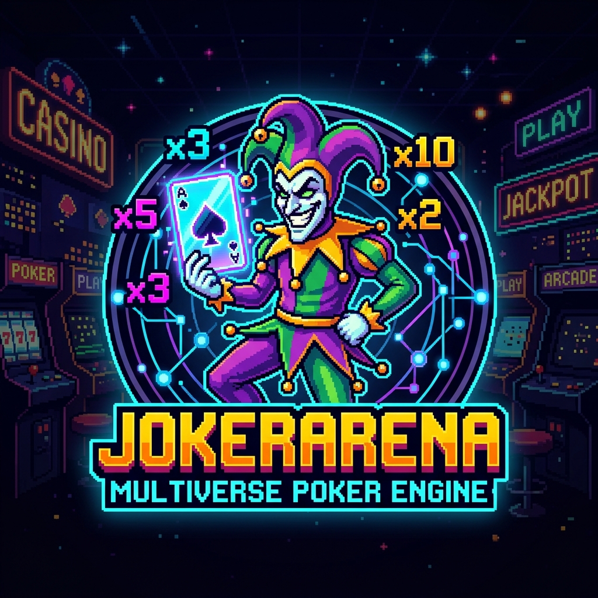
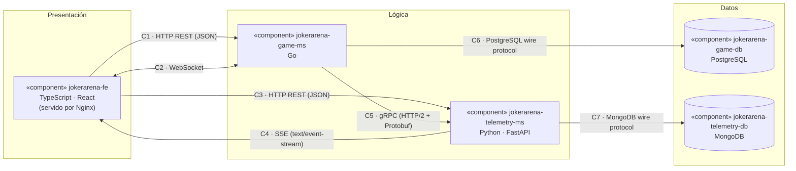
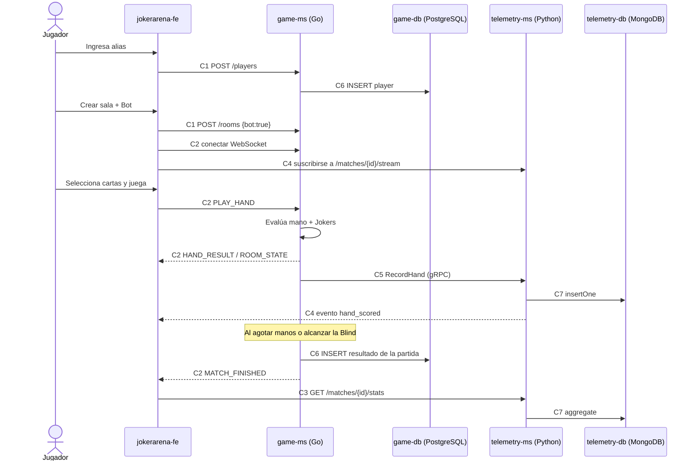

# p1_X — JokerArena: Multiverse Poker Engine
### Prototipo 1 — Simple Architectural Structure
Arquitectura de Software 2026-II · Universidad Nacional de Colombia — Sede Bogotá · Docente: Jeisson Andrés Vergara Vargas

> Entregable: este `.md` se exporta a `p1_X.pdf` (X = nombre del equipo) y se sube a MiCampus UNAL por un solo integrante.
> Fecha límite: lunes 12 de octubre de 2026 · Sustentación: martes 13 de octubre de 2026 (en clase).

---

## 1. Equipo

* **Nombre del equipo:** `X` *(PENDIENTE: 1a, 1b, …, 2a, 2b, …)*
* **Integrantes (nombres completos):**
  * `PENDIENTE — Integrante 1`
  * `PENDIENTE — Integrante 2`
  * `PENDIENTE — Integrante 3`
  * `PENDIENTE — Integrante 4`

---

## 2. Sistema de Software

### 2.1. Nombre
**JokerArena: Multiverse Poker Engine**

### 2.2. Logo


*(PENDIENTE: generar `logo.png` — comodín pixel-art sosteniendo una carta holográfica con un display "×Mult". El PDF exige un logo; el arte ASCII no lo reemplaza.)*

### 2.3. Descripción

**JokerArena** es un videojuego web multijugador inspirado en las mecánicas de puntuación de *Balatro*: los jugadores forman manos de póker con cartas de una baraja francesa, y la puntuación de cada mano se calcula como **Fichas (Chips) × Multiplicador (Mult)**, alterada por modificadores llamados *Jokers*. Los jugadores de una sala compiten por superar una meta de puntaje (*Blind*) con un número limitado de manos y descartes.

El sistema incluye además una **consola de telemetría en vivo** que muestra, jugada a jugada, el desglose exacto del cálculo (fichas base, aportes de cada Joker, multiplicadores) y estadísticas agregadas de la partida.

#### Alcance funcional del Prototipo 1 (vertical)

El prototipo implementa **un único flujo completo de extremo a extremo** que atraviesa todos los componentes (presentación → lógica → datos, y lógica → lógica):

| # | Funcionalidad | Componentes involucrados |
|---|---|---|
| F1 | **Registro de jugador por alias** (sin contraseña). | Frontend → Game Engine → PostgreSQL |
| F2 | **Crear / unirse a sala** con código alfanumérico (2–4 jugadores) u opción **"Jugar contra Bot"**. | Frontend → Game Engine |
| F3 | **Partida de una sola Blind**: meta de **22 000 puntos**, **20 manos** y **3 descartes** por jugador, **8 cartas** en mano. Gana quien alcance la meta primero; si nadie la alcanza, gana el mayor puntaje. | Frontend ⇄ Game Engine |
| F4 | **Jugar / descartar** de 1 a 5 cartas. El servidor valida y evalúa la mano (*server-authoritative*). | Frontend ⇄ Game Engine |
| F5 | **Cálculo de puntaje** con 9 tipos de mano y 3 Jokers fijos (ver tablas abajo). | Game Engine |
| F6 | **Envío de cada jugada a telemetría**, persistencia en MongoDB y difusión en vivo a la consola. | Game Engine → Telemetry → MongoDB → Frontend |
| F7 | **Cierre de partida**: se guarda el resultado (ganador, puntajes) en PostgreSQL y se muestran las estadísticas de la partida. | Game Engine → PostgreSQL · Frontend → Telemetry → MongoDB |

**Fuera de alcance en P1:** tienda, compra/venta de Jokers, múltiples Blinds/Antes, cartas mejoradas, cuentas con contraseña, ranking global.

#### Reglas de puntuación (valores base de *Balatro*)

| Mano | Chips base | Mult base |
|---|---|---|
| High Card | 5 | 1 |
| Pair | 10 | 2 |
| Two Pair | 20 | 2 |
| Three of a Kind | 30 | 3 |
| Straight | 30 | 4 |
| Flush | 35 | 4 |
| Full House | 40 | 4 |
| Four of a Kind | 60 | 7 |
| Straight Flush | 100 | 8 |

Cada carta que **puntúa** (forma parte de la mano reconocida) suma sus fichas: 2–10 = valor nominal, J/Q/K = 10, A = 11.

#### Jokers del prototipo (todos los jugadores los tienen activos, en este orden)

| Orden | Joker | Efecto | Tipo |
|---|---|---|---|
| 1 | **Banner** | +30 Chips por cada descarte restante | Aditivo de fichas |
| 2 | **Joker** | +4 Mult | Aditivo de Mult |
| 3 | **The Duo** | ×2 Mult si la mano jugada contiene un Pair | Multiplicativo |

Fórmula, aplicando los Jokers de izquierda a derecha:

$$\text{Puntaje} = \Big(\text{Chips}_{mano} + \sum \text{Chips}_{cartas} + \text{Chips}_{Banner}\Big) \times \Big((\text{Mult}_{mano} + 4) \times 2^{[\text{contiene Pair}]}\Big)$$

*Ejemplo:* Full House K-K-K-4-4 con 0 descartes restantes → Chips = 40 + 38 + 0 = 78; Mult = (4 + 4) × 2 = 16; **Puntaje = 1248**.

---

## 3. Estructuras Arquitectónicas

### 3.1. Estructura de Componentes y Conectores (C&C)

#### 3.1.1. Vista C&C



**Convenciones (leyenda):**

| Símbolo | Significado |
|---|---|
| Rectángulo | Componente de presentación o de lógica (contenedor independiente) |
| Cilindro | Componente de datos |
| Flecha `A → B` | Conector; la flecha apunta del iniciador (*caller / client / publisher*) al receptor |
| Flecha `A ↔ B` | Conector bidireccional (ambos extremos envían mensajes) |
| Etiqueta `Cn · tipo` | Identificador y tipo de conector |

> Al exportar a PDF, renderizar este diagrama como imagen (Mermaid CLI o mermaid.live) para que aparezca en el documento final.

**Conectores basados en HTTP (requisito: ≥ 2 tipos distintos):**

| Tipo | Conectores | Versión de HTTP | Formato |
|---|---|---|---|
| **REST** | C1, C3 | HTTP/1.1 | JSON |
| **gRPC** | C5 | HTTP/2 | Protocol Buffers |
| **SSE** | C4 | HTTP/1.1 (respuesta en streaming) | `text/event-stream` |
| **WebSocket** | C2 | Handshake HTTP/1.1 `Upgrade` → RFC 6455 | JSON |

REST y gRPC por sí solos ya cubren el requisito sin ambigüedad (distinto contrato, serialización y versión de HTTP). SSE y WebSocket son conectores complementarios.

#### 3.1.2. Estilos arquitectónicos utilizados

1. **Cliente–Servidor.** El navegador (cliente) solo presenta y captura acciones; toda regla de juego se valida en el servidor (*server-authoritative*), lo que impide que el cliente altere manos o puntajes.
2. **Microservicios.** La lógica se divide en dos servicios desplegables por separado (`game-ms`, `telemetry-ms`), cada uno con su propia base de datos (*database per service*). Ningún servicio accede a la base de datos del otro.
3. **Por capas (lógicas).** Presentación → Lógica → Datos; cada capa solo se comunica con la capa siguiente.
4. **Publicación–Suscripción (basado en eventos).** `telemetry-ms` publica cada jugada procesada en un canal por partida (`match_id`); las consolas suscritas la reciben por SSE sin hacer *polling*. Dentro de una sala, `game-ms` difunde el estado a todos los jugadores conectados por WebSocket.

#### 3.1.3. Elementos arquitectónicos (componentes)

| Componente | Tipo | Tecnología | Responsabilidades |
|---|---|---|---|
| **jokerarena-fe** | Presentación | TypeScript, React, Vite; servido por Nginx | Registro por alias, lobby (crear/unirse/bot), tapete de juego (seleccionar, jugar, descartar), consola de telemetría en vivo y pantalla de resultados. |
| **jokerarena-game-ms** | Lógica | Go (`net/http`, `gorilla/websocket`, `grpc-go`, `pgx`) | Gestión de jugadores y salas; baraja, reparto y validación de jugadas; evaluador de manos y pipeline de Jokers; bot oponente; envío de cada jugada a telemetría; persistencia del resultado de la partida. |
| **jokerarena-telemetry-ms** | Lógica | Python, FastAPI, `grpcio`, `motor` | Recibe jugadas por gRPC; las guarda en MongoDB; las publica por SSE a los suscriptores de la partida; expone estadísticas agregadas (puntaje por jugador, mano más frecuente, mayor Mult, descartes usados). |
| **jokerarena-game-db** | Datos (relacional) | PostgreSQL 16 | Jugadores, catálogo de Jokers, partidas y participantes con su puntaje final. Datos estructurados con integridad referencial. |
| **jokerarena-telemetry-db** | Datos (NoSQL documental) | MongoDB 7 | Un documento por jugada (append-only) con el desglose completo del cálculo. El esquema varía según los Jokers activados, por eso encaja un modelo documental. |

#### 3.1.4. Relaciones (conectores)

| ID | Origen → Destino | Tipo | Roles | Uso en el prototipo |
|---|---|---|---|---|
| **C1** | fe → game-ms | HTTP REST | client / server | `POST /players` (registro), `POST /rooms`, `POST /rooms/{code}/join`, `GET /rooms/{code}`, `GET /matches/{id}` |
| **C2** | fe ↔ game-ms | WebSocket | peer / peer | Cliente→servidor: `PLAY_HAND`, `DISCARD`. Servidor→clientes: `ROOM_STATE`, `HAND_RESULT`, `MATCH_FINISHED` |
| **C3** | fe → telemetry-ms | HTTP REST | client / server | `GET /matches/{id}/hands` (historial), `GET /matches/{id}/stats` (estadísticas) |
| **C4** | telemetry-ms → fe | SSE | publisher / subscriber | `GET /matches/{id}/stream`: un evento `hand_scored` por jugada |
| **C5** | game-ms → telemetry-ms | gRPC (unario) | client / server | `TelemetryService.RecordHand(HandEvent) → Ack`. Se invoca en una goroutine con *timeout*: si telemetría falla, la partida sigue (aislamiento de fallos) |
| **C6** | game-ms → game-db | PostgreSQL wire protocol (TCP 5432) | client / server | Lectura del catálogo de Jokers; escritura de jugadores, partidas y resultados |
| **C7** | telemetry-ms → telemetry-db | MongoDB wire protocol (TCP 27017) | client / server | Inserción de documentos de jugada; consultas de historial y agregaciones |

#### 3.1.5. Flujo vertical (cómo atraviesa todos los componentes)



#### 3.1.6. Modelo de datos

**PostgreSQL (`jokerarena-game-db`)**

```sql
CREATE TABLE players (
    id         UUID PRIMARY KEY,
    alias      VARCHAR(30) UNIQUE NOT NULL,
    created_at TIMESTAMPTZ NOT NULL DEFAULT now()
);

CREATE TABLE jokers (
    id            VARCHAR(30) PRIMARY KEY,          -- 'banner', 'joker', 'the_duo'
    name          VARCHAR(50) NOT NULL,
    description   TEXT NOT NULL,
    modifier_type VARCHAR(20) NOT NULL CHECK (modifier_type IN ('ADD_CHIPS','ADD_MULT','X_MULT')),
    value         NUMERIC(6,2) NOT NULL,
    apply_order   SMALLINT NOT NULL
);

CREATE TABLE matches (
    id           UUID PRIMARY KEY,
    room_code    VARCHAR(8) NOT NULL,
    target_score INT NOT NULL,
    winner_id    UUID REFERENCES players(id),
    status       VARCHAR(12) NOT NULL CHECK (status IN ('IN_PROGRESS','FINISHED')),
    started_at   TIMESTAMPTZ NOT NULL DEFAULT now(),
    finished_at  TIMESTAMPTZ
);

CREATE TABLE match_players (
    match_id    UUID REFERENCES matches(id),
    player_id   UUID REFERENCES players(id),
    is_bot      BOOLEAN NOT NULL DEFAULT false,
    final_score INT NOT NULL DEFAULT 0,
    PRIMARY KEY (match_id, player_id)
);
```

**MongoDB (`jokerarena-telemetry-db`, colección `hand_events`)**

```json
{
  "_id": "ObjectId(...)",
  "match_id": "8f1c...-uuid",
  "player_id": "3a9e...-uuid",
  "hand_number": 2,
  "poker_hand": "FULL_HOUSE",
  "cards_played": [
    {"rank": "K", "suit": "SPADES",   "chips": 10, "scored": true},
    {"rank": "K", "suit": "HEARTS",   "chips": 10, "scored": true},
    {"rank": "K", "suit": "CLUBS",    "chips": 10, "scored": true},
    {"rank": "4", "suit": "DIAMONDS", "chips": 4,  "scored": true},
    {"rank": "4", "suit": "SPADES",   "chips": 4,  "scored": true}
  ],
  "scoring": {
    "base_chips": 40,
    "base_mult": 4,
    "card_chips": 38,
    "jokers": [
      {"id": "banner",  "effect": "+30 Chips x 0 descartes", "chips_added": 0},
      {"id": "joker",   "effect": "+4 Mult",                 "mult_added": 4},
      {"id": "the_duo", "effect": "x2 Mult (contiene Pair)", "mult_factor": 2}
    ],
    "final_chips": 78,
    "final_mult": 16,
    "score": 1248
  },
  "discards_left": 0,
  "accumulated_score": 1530,
  "created_at": "2026-10-12T19:40:00Z"
}
```

---

## 4. Prototipo

### 4.1. Despliegue en contenedores

| Servicio (docker compose) | Imagen base | Puerto host | Depende de |
|---|---|---|---|
| `jokerarena-fe` | `node:20` (build) → `nginx:alpine` | 3000 | game-ms, telemetry-ms |
| `jokerarena-game-ms` | `golang:1.23` (build) → `alpine` | 8080 (REST + WS) | game-db, telemetry-ms |
| `jokerarena-telemetry-ms` | `python:3.12-slim` | 8000 (REST + SSE), 50051 (gRPC, solo red interna) | telemetry-db |
| `jokerarena-game-db` | `postgres:16` | 5432 | — |
| `jokerarena-telemetry-db` | `mongo:7` | 27017 | — |

Todos los servicios comparten una red `bridge` de Docker Compose; cada base de datos usa un volumen con nombre. Las credenciales van en un archivo `.env` (no versionado; el repositorio incluye `.env.example`).

### 4.2. Estructura del repositorio

```plaintext
jokerarena/
├── docker-compose.yml
├── .env.example
├── proto/telemetry.proto          # Contrato gRPC compartido (C5)
├── jokerarena-fe/                 # TypeScript / React
├── jokerarena-game-ms/            # Go
├── jokerarena-telemetry-ms/       # Python / FastAPI
└── db/postgres/init.sql           # Esquema + seed del catálogo de Jokers
```

### 4.3. Instrucciones para descargar y ejecutar

Requisitos: Git, Docker Engine 24+ y Docker Compose v2.

```bash
# 1. Descargar
git clone https://github.com/PENDIENTE-ORG/jokerarena.git
cd jokerarena

# 2. Configurar variables de entorno
cp .env.example .env

# 3. Construir y levantar todos los componentes
docker compose up --build -d

# 4. Verificar que los 5 contenedores estén en estado "running"/"healthy"
docker compose ps

# 5. Abrir la aplicación
#    http://localhost:3000

# 6. Detener (agregar -v para borrar también los datos)
docker compose down
```

### 4.4. Verificación rápida (demo de la sustentación)

1. Abrir `http://localhost:3000`, ingresar un alias y pulsar **Jugar contra Bot**.
2. Seleccionar hasta 5 cartas y pulsar **Jugar mano**: el tapete muestra el puntaje (C2) y la consola lateral recibe el desglose en vivo (C4).
3. Descartar cartas para comprobar el efecto de **Banner** al jugar la siguiente mano.
4. Al terminar la partida, la pantalla de resultados carga las estadísticas (C3).
5. Comprobar la persistencia:
   ```bash
   docker compose exec jokerarena-game-db psql -U postgres -d jokerarena -c "SELECT * FROM matches;"
   docker compose exec jokerarena-telemetry-db mongosh jokerarena --eval "db.hand_events.find().limit(3)"
   ```

---

## Anexo A. Verificación de requisitos no funcionales

| Requisito del PDF | Cómo se cumple |
|---|---|
| Arquitectura distribuida | 5 componentes en contenedores separados que se comunican por red |
| ≥ 1 componente de presentación (front-end web) | `jokerarena-fe` (React) |
| ≥ 2 componentes de lógica | `jokerarena-game-ms` (Go), `jokerarena-telemetry-ms` (Python) |
| ≥ 2 componentes de datos (relacional + NoSQL) | PostgreSQL + MongoDB |
| ≥ 2 tipos distintos de conectores basados en HTTP | REST (HTTP/1.1) y gRPC (HTTP/2); además SSE y WebSocket |
| ≥ 3 lenguajes de propósito general | TypeScript, Go, Python |
| Despliegue orientado a contenedores | Docker + Docker Compose |

## Anexo B. Limitaciones conocidas del prototipo

* Sin autenticación: el jugador se identifica solo con un alias, y los endpoints REST, WebSocket y SSE no tienen control de acceso. Es aceptable para una demo local, pero no para un despliegue público.
* El estado de las salas vive en memoria de `game-ms`: si el contenedor se reinicia, las partidas en curso se pierden (los resultados ya guardados se conservan).
* Las jugadas que se pierdan mientras `telemetry-ms` está caído no se reintentan en P1.
