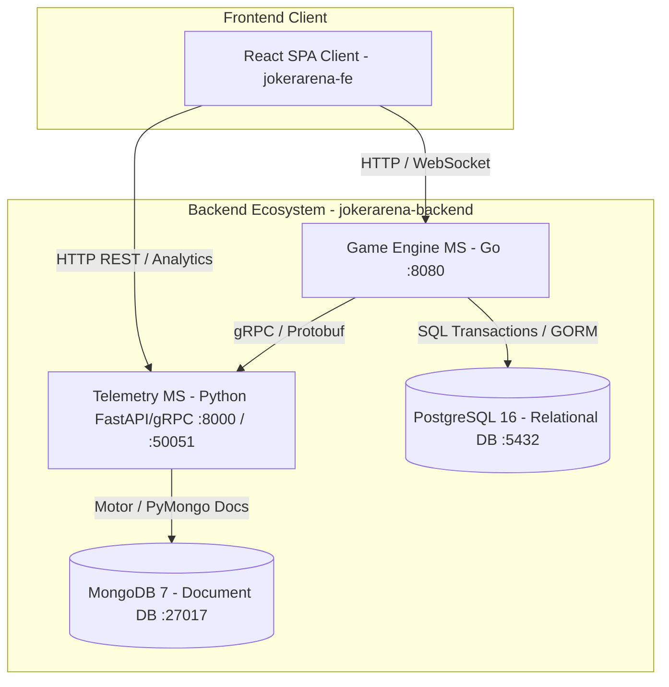

# Joker Arena - Backend & Distributed Architecture 🃏🏛️

Backend distribuido, microservicios, bases de datos y suites de prueba para **Joker Arena: Multiverse Poker Engine**, un sistema de juego de póker multiversal con simulación en tiempo real, persistencia híbrida (SQL + NoSQL), comunicación inter-servicio de alto desempeño (gRPC) e inferencia de telemetría y analítica.

---

## 🏗️ Arquitectura del Sistema

El backend se estructura bajo un enfoque de **Microservicios** con separación estricta de responsabilidades:



### Componentes Principales:

1. **Game Engine & Session Manager (`jokerarena-game-ms`)**:
   - Desarrollado en **Go (Golang)**.
   - Administra el estado de la partida, manos, barajas, validación de reglas de póker y sesiones concurrentes.
   - Conexión relacional transaccional con PostgreSQL para usuarios, salas y auditoría.
   - Cliente gRPC que transmite eventos de telemetría en tiempo real hacia el servicio de telemetría.

2. **Telemetry & Analytics Service (`jokerarena-telemetry-ms`)**:
   - Desarrollado en **Python 3.12** con **FastAPI** y servidor **gRPC**.
   - Consume eventos a través del contrato Protocol Buffers (`telemetry.proto`).
   - Persiste métricas no estructuradas, eventos de manos y telemetría de jugadores en **MongoDB**.
   - Expone endpoints REST para consumo analítico y tableros de control.

3. **Bases de Datos**:
   - **PostgreSQL 16**: Base de datos relacional para datos estructurados (tablas inicializadas en `db/postgres/init.sql`).
   - **MongoDB 7**: Almacén documental para eventos masivos y telemetría de juego.

4. **Protocol Buffers (`proto/`)**:
   - Contratos de interfaz gRPC unificados para la comunicación tipada y eficiente entre Go y Python.

5. **Suites de Pruebas de Integración y E2E (`tests/`)**:
   - Pruebas exhaustivas (Tiers 1 al 4, escenarios adversariales, telemetría e integridad Docker).

---

## 📋 Requisitos Previos

- [Docker](https://www.docker.com/) y **Docker Compose v2+** (método recomendado de ejecución unificada).
- [Go 1.22+](https://go.dev/) (para desarrollo local del Game Engine).
- [Python 3.12+](https://www.python.org/) (para desarrollo local del Telemetry Service y ejecución de tests).
- [PostgreSQL](https://www.postgresql.org/) y [MongoDB](https://www.mongodb.com/) (si se ejecutan fuera de Docker).

---

## 🚀 Despliegue Rápido con Docker Compose

1. **Configurar variables de entorno**:
   Copie el archivo de ejemplo para configurar los puertos y credenciales:
   ```bash
   cp .env.example .env
   ```

2. **Iniciar los servicios**:
   ```bash
   docker compose up -d --build
   ```

3. **Verificar el estado de los contenedores**:
   ```bash
   docker compose ps
   ```

   Los microservicios quedarán disponibles en:
   - **Game Engine**: `http://localhost:8080` (Healthcheck: `http://localhost:8080/health`)
   - **Telemetry API**: `http://localhost:8000` (Docs Swagger: `http://localhost:8000/docs`, Healthcheck: `http://localhost:8000/health`)
   - **Telemetry gRPC**: `localhost:50051`
   - **PostgreSQL**: `localhost:5432`
   - **MongoDB**: `localhost:27017`

4. **Detener los servicios**:
   ```bash
   docker compose down
   ```

---

## 🧪 Ejecución de Pruebas

El repositorio incluye suites completas de pruebas automatizadas en `tests/`:

1. **Instalar dependencias de pruebas**:
   ```bash
   cd tests
   pip install -r requirements.txt
   ```

2. **Ejecutar el runner End-to-End**:
   ```bash
   python e2e_runner.py
   ```

3. **Ejecutar suites individuales con pytest**:
   ```bash
   pytest test_tier1_features.py -v
   pytest test_tier2_boundaries.py -v
   pytest test_tier3_integration.py -v
   pytest test_tier4_scenarios.py -v
   pytest test_m2_telemetry.py -v
   pytest test_m1_adversarial_challenge.py -v
   pytest test_dockerfiles_integrity.py -v
   ```

---

## 📁 Estructura del Repositorio

```text
.
├── db/
│   └── postgres/
│       └── init.sql                 # Script DDL de inicialización relacional
├── jokerarena-game-ms/              # Microservicio en Go (Game Engine)
│   ├── Dockerfile
│   ├── go.mod
│   └── main.go
├── jokerarena-telemetry-ms/         # Microservicio en Python (Telemetry)
│   ├── app/                         # Rutas, modelos y servidor gRPC
│   ├── proto/                       # Stubs generados de gRPC
│   ├── Dockerfile
│   ├── main.py
│   └── requirements.txt
├── proto/                           # Definiciones Protobuf compartidas
│   └── telemetry.proto
├── tests/                           # Suites de pruebas E2E e integración
│   ├── e2e_runner.py
│   ├── test_*.py
│   └── requirements.txt
├── docker-compose.yml               # Orquestación de contenedores
├── .env.example                     # Plantilla de variables de entorno
└── README.md                        # Documentación técnica del backend
```

---

## 🌐 Repositorio Frontend Relacionado

Para la interfaz de usuario web, visita:
👉 [Joker Arena Frontend Client](https://github.com/AngelDavidRuizB/joker-arena-frontend)

---

## 📄 Licencia

Desarrollado con fines académicos para la asignatura de **Arquitectura de Software** (Universidad, 2026).
