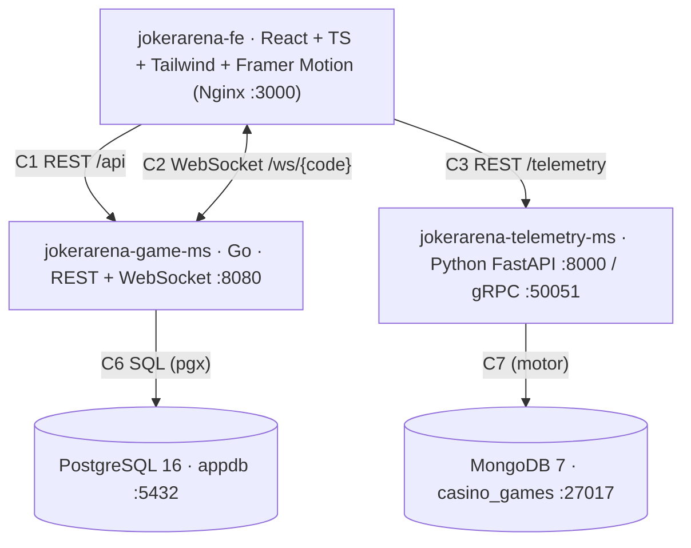

# JokerArena: Multiverse Poker Engine 🃏

Videojuego web distribuido de póker con *Jokers* en tiempo real, inspirado en la mecánica de puntuación de *Balatro*. Prototipo 1 de Arquitectura de Software 2026-II (Universidad Nacional de Colombia). Todo el sistema se despliega con **Docker Compose**.

**Alcance implementado (F1–F5):** registro por alias · salas con código `JKR-XXXX` y modo Bot · sincronización en tiempo real por WebSocket (baraja de 52, mano de 8 cartas) · jugar/descartar de 1 a 5 cartas con reconocimiento de las 9 manos de póker · cascada de puntuación con los 3 Jokers (Banner → Joker Clásico → The Duo) bajo la fórmula Chips × Mult · cierre de partida (meta de puntos o 20 manos agotadas) persistido en PostgreSQL.

---

## 🏗️ Arquitectura



| Servicio | Tecnología | Responsabilidad |
|---|---|---|
| `jokerarena-fe` | React 18, Vite, TypeScript, Tailwind, Framer Motion, Zustand | Interfaz neón: registro, lobby, tapete, cascada de puntuación y auditoría en vivo. Nginx hace de proxy mismo-origen (`/api`, `/ws`, `/telemetry`). |
| `jokerarena-game-ms` | Go 1.22, `gorilla/websocket`, `pgx/v5` | Motor **autoritativo**: una goroutine por sala (patrón actor), baraja con semilla, evaluador de manos, Jokers, persistencia. |
| `jokerarena-telemetry-ms` | Python 3.12, FastAPI, Motor, gRPC | Ingesta de eventos de mano (REST y gRPC) en MongoDB, `/health` y `/docs`. |
| `jokerarena-game-db` | PostgreSQL 16 | Esquema del equipo: `players`, `rooms`, `matches` (`db/postgres/create_db.sql`). |
| `jokerarena-telemetry-db` | MongoDB 7 | Base `casino_games` (colecciones `hands`, `players`, `rooms`; `db/mongo/mongo-init.js`). |

> Conectores C4 (SSE) y C5 (despacho gRPC desde el Game Engine) corresponden a F6 y no forman parte de este alcance; el servidor gRPC y el contrato `proto/telemetry.proto` sí están disponibles en telemetría.

---

## 🚀 Puesta en marcha

Requisitos: Docker Engine 24+ y Docker Compose v2+.

```bash
cp .env.example .env        # y complete las claves <password-...> con las credenciales del equipo
docker compose up --build -d
docker compose ps           # los 5 servicios deben quedar "healthy"
```

| Componente | URL |
|---|---|
| Aplicación web | http://localhost:3000 |
| Game Engine | http://localhost:8080/health · `ws://localhost:8080/ws/{code}` |
| Telemetría | http://localhost:8000/docs · http://localhost:8000/health · gRPC `localhost:50051` |
| PostgreSQL | `localhost:5432` · BD `appdb` · usuario `appuser` |
| MongoDB | `localhost:27017` · BD `casino_games` · usuario `admin` (`authSource=admin`) |

Si un puerto del host está ocupado, cambie `POSTGRES_PORT`, `GAME_ENGINE_PORT`, `MONGO_PORT`, etc. en `.env`. Para detener: `docker compose down` (añada `-v` para borrar los datos).

### Usar la base PostgreSQL remota compartida
Copie las variables de `.env.remote.example` a `.env` (`GAME_DB_HOST`, `GAME_DB_USER`, `GAME_DB_PASSWORD`…). El esquema ya existe en el servidor y no se modifica. **No ejecute pruebas destructivas contra esa base.**

### Variables de entorno relevantes
| Variable | Descripción |
|---|---|
| `POSTGRES_*`, `MONGO_*` | Credenciales y puertos de los contenedores de datos (solo en `.env`, que está en `.gitignore`). |
| `STORAGE_MODE` | `postgres` (defecto, persistente; devuelve 503 si la BD cae) o `memory` (solo pruebas, sin persistencia). |
| `GAME_DB_HOST/PORT/USER/PASSWORD/NAME` | Permite apuntar el Game Engine a otro PostgreSQL. La contraseña se codifica en código, admite `@`. |
| `ALLOWED_ORIGINS` | Orígenes adicionales permitidos para WebSocket/CORS (el mismo origen y `localhost` siempre se permiten). |

---

## 🎮 Cómo se juega
1. Regístrate con un alias (sin contraseña).
2. Crea una sala (meta 22 000 / 26 000 / 33 000, con o sin Bot) o únete con un código. Quien no es dueño de la sala entra como espectador.
3. Selecciona hasta 5 cartas (clic o teclas `1–8`) y **Jugar mano** (`P`) o **Descartar** (`D`). Tienes 20 manos y 3 descartes; la baraja se recicla (las cartas jugadas y descartadas se rebarajan cuando el mazo se agota).
4. Puntaje = `(fichas de la mano + fichas de las cartas que puntúan + 30 × descartes restantes) × ((mult de la mano + 4) × 2 si hay pareja)`. Ejemplo: Full House K♠K♥K♣4♦4♠ sin descartes = 78 × 16 = **1248**.
5. Ganas al alcanzar la meta; pierdes si agotas las 20 manos.

---

## 🧪 Pruebas

```bash
# Game Engine (Go) – dentro de un contenedor, contra el PostgreSQL del compose
docker run --rm --network prototipo1_jokerarena-net -v "%cd%/jokerarena-game-ms:/src" -v gomodcache:/go/pkg/mod -w /src \
  -e TEST_DATABASE_URL="postgres://appuser:<password-url-encoded>@jokerarena-game-db:5432/appdb?sslmode=disable" \
  golang:1.22-alpine sh -c "go vet ./... && go test ./... -count=1"

# Frontend
cd jokerarena-fe && npm ci && npm test && npm run build

# Integración / E2E Python (requiere el stack levantado)
python -m venv .venv && .venv/Scripts/pip install -r tests/requirements.txt
.venv/Scripts/python -m pytest tests -q
```

Cobertura destacada: evaluador y puntuación (`internal/poker`, incluye el caso de 1248), actor de sala y protocolo WebSocket, contrato del repositorio contra PostgreSQL real, partidas completas por WebSocket (`tests/test_ws_game_flow.py`) y componentes React (selección máx. 5, validaciones, cascada).

---

## 📁 Estructura

```text
.
├── db/
│   ├── postgres/create_db.sql      # DDL del esquema del equipo (players, rooms, matches)
│   └── mongo/mongo-init.js         # Inicialización de casino_games
├── jokerarena-game-ms/             # Go: config, db (pgx), models, poker, room (actor), handlers (REST + WS)
├── jokerarena-telemetry-ms/        # Python: FastAPI + gRPC + Motor
├── jokerarena-fe/                  # React/TS (repositorio independiente)
├── proto/telemetry.proto           # Contrato gRPC (C5)
├── tests/                          # Suites Python (integración, E2E, WebSocket)
├── docker-compose.yml · .env.example · .env.remote.example
├── p1_X.md                         # Documento de arquitectura (entregable)
└── GUIA_SUSTENTACION.md            # Guion de la sustentación
```

Frontend: <https://github.com/AngelDavidRuizB/joker-arena-frontend>

Desarrollado con fines académicos para la asignatura **Arquitectura de Software** (2026-II).
