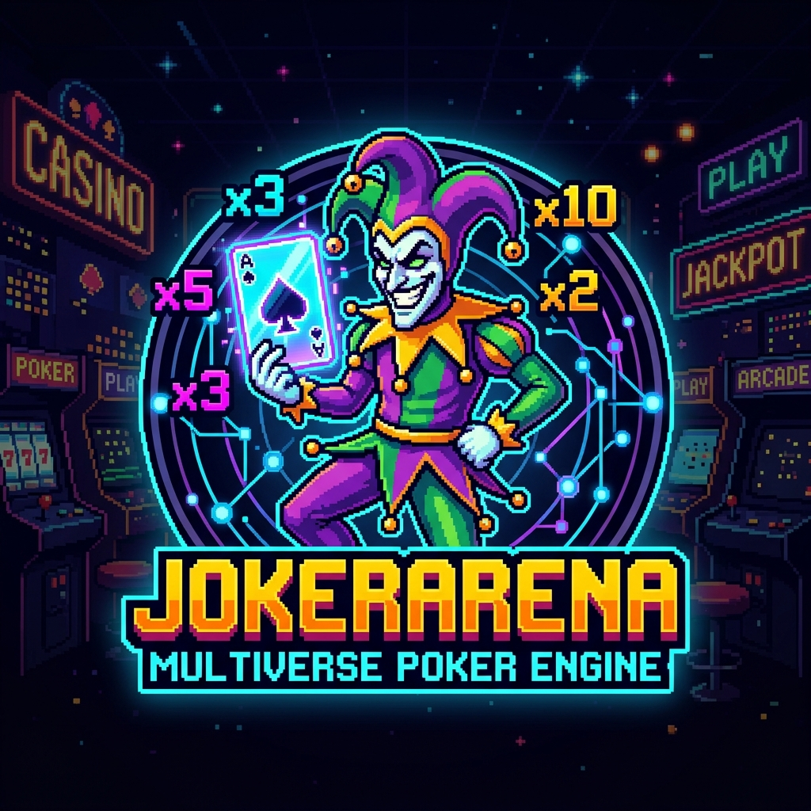
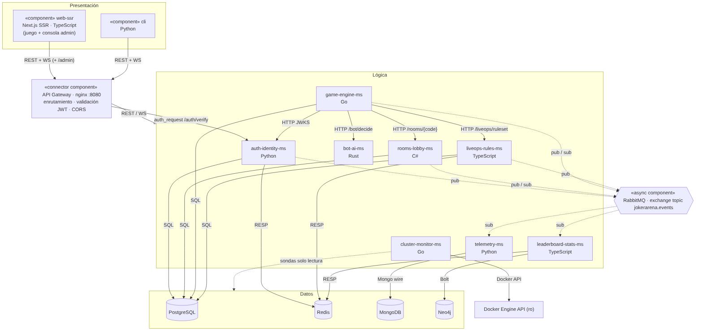
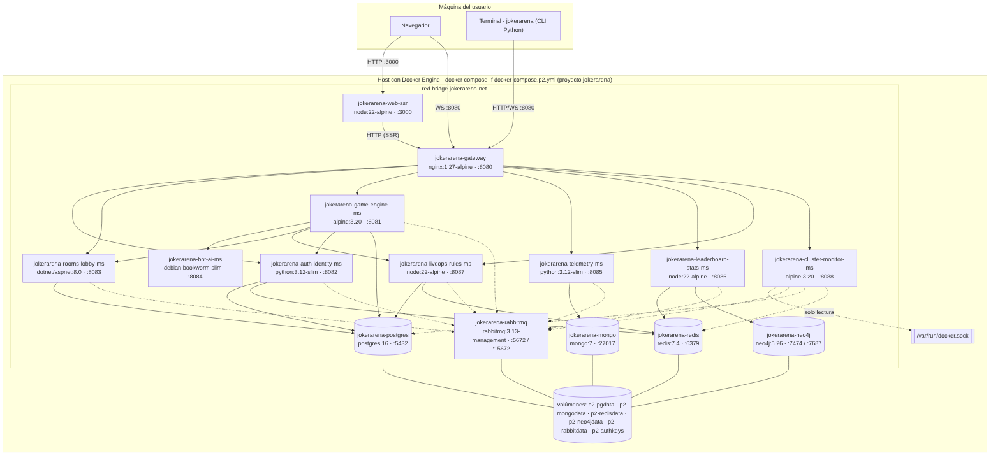
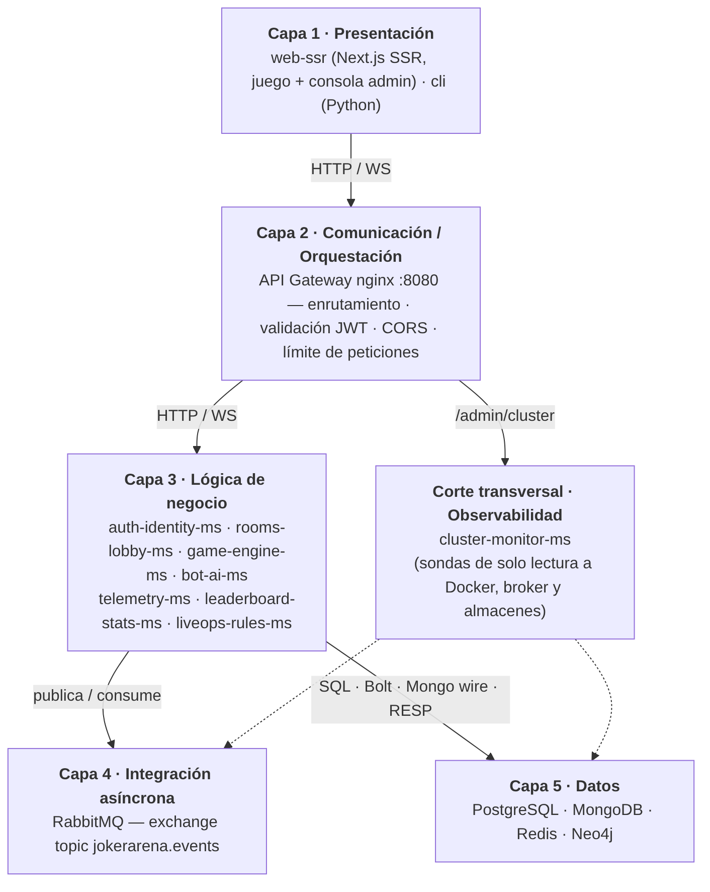
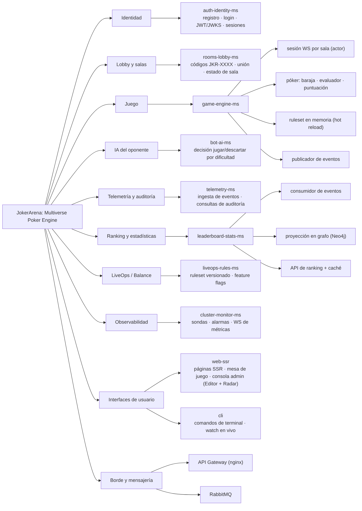

<!--
  NOTAS PARA EXPORTAR (los comentarios HTML no salen en el PDF)
  - Exportar a p2_2b.pdf desde VS Code (extensión "Markdown PDF") o con pandoc; las imágenes
    de los diagramas están en docs/p2/diagramas/*.png y se referencian con rutas relativas.
  - Pegar el link del video en la sección 4.5.
-->

# p2_2b — JokerArena: Multiverse Poker Engine

### Prototipo 2 — Advanced Architectural Structure

**Arquitectura de Software 2026-II · Universidad Nacional de Colombia — Sede Bogotá**<br>
**Docente:** Jeisson Andrés Vergara Vargas

---

## 1. Equipo

- **Nombre del equipo:** 2b
- **Integrantes:**
  - Santiago Zamora Garzon
  - Esteban Andrés Gómez Álvarez
  - Jose Arturo Herrera Rivera
  - Juan David Suárez Coronado
  - Nicole Ariadna Celemin Triana
  - José Alejandro Solano Garcés
  - Jaisson Andrés Machado Bautista
  - Ángel David Ruiz Barbosa

---

## 2. Sistema de software

### 2.1. Nombre

**JokerArena: Multiverse Poker Engine**

### 2.2. Logo



### 2.3. Descripción

**JokerArena** es un videojuego web distribuido de póker con *Jokers*, inspirado en las mecánicas de puntuación del roguelike *Balatro*. El jugador compite en una sala contra un oponente bot (o en solitario, con espectadores), jugando y descartando cartas de una baraja francesa de 52 cartas. Cada mano reconocida (par, escalera, color, etc.) se puntúa con la fórmula **Chips × Mult**, modificada por tres Jokers: *Banner*, *Joker Clásico* y *The Duo*.

En el Prototipo 2 el sistema se rediseñó como una arquitectura de **microservicios** detrás de un **API Gateway**, con **mensajería asíncrona** (RabbitMQ), **persistencia políglota** (PostgreSQL, MongoDB, Redis y Neo4j) y **ocho servicios de lógica en cinco lenguajes** (Go, Python, C#, Rust y TypeScript).

| # | Funcionalidad | Componentes principales |
|---|---|---|
| F1 | Entrada por alias con sesión JWT (y usuario `admin` con contraseña). | auth-identity-ms |
| F2 | Crear salas `JKR-XXXX` (contra el bot con dificultad fácil/normal/difícil, o en solitario) y listarlas. | rooms-lobby-ms |
| F3 | Partida en tiempo real por WebSocket: reparto, jugar/descartar, puntuación con Jokers y auditoría en vivo. | game-engine-ms |
| F4 | Oponente bot con tres niveles de dificultad. | bot-ai-ms |
| F5 | Auditoría mano a mano de cada partida terminada. | telemetry-ms |
| F6 | Ranking global y estadísticas por jugador (victorias, mejor puntaje, rivales frecuentes). | leaderboard-stats-ms |
| F7 | LiveOps: ajuste en caliente del balance de los Jokers y *Happy Hour*, sin reiniciar el motor. | liveops-rules-ms, game-engine-ms |
| F8 | Radar del clúster: estado, CPU y memoria de cada contenedor, broker y bases de datos, con alarmas. | cluster-monitor-ms |

Los usuarios acceden por una **web con renderizado en servidor (Next.js)**, que incluye una consola de administración, y por una **CLI** de terminal.

---

## 3. Estructuras arquitectónicas

### 3.1. Estructura de Componentes y Conectores (C&C)

#### 3.1.1. Vista C&C



*Línea continua: conector síncrono. Línea punteada: conector asíncrono (publicación/suscripción) o de solo lectura. Fuente: `docs/p2/diagramas/cc_view_p2.mmd`.*

#### 3.1.2. Elementos arquitectónicos

**Componentes de presentación**

| Componente | Tecnología | Responsabilidad |
|---|---|---|
| web-ssr | Next.js 14 (TypeScript) | Cliente web. Las páginas de lobby, ranking y auditoría se **renderizan en el servidor**: el servidor de Next consulta el gateway y envía el HTML ya armado. La mesa de juego y la consola de administración (editor de reglas y radar) son componentes interactivos conectados por WebSocket. |
| cli | Python (Typer, httpx, websockets) | Cliente de terminal: sesión, salas, ranking, auditoría de partidas, ruleset vigente y seguimiento de una partida en vivo. |

**Componente de comunicación / orquestación**

| Componente | Tecnología | Responsabilidad |
|---|---|---|
| API Gateway | nginx 1.27 | Punto único de entrada (`:8080`). Enruta `/api/*`, `/ws/*` y `/admin/*`; antes de enrutar una ruta protegida valida el JWT con una subpetición a auth-identity-ms (`/auth/verify`) y exige el rol `admin` en `/admin/*`; aplica CORS y límite de peticiones en `/api/auth/*`; reenvía WebSockets. |

**Componentes de lógica**

| Componente | Lenguaje | Responsabilidad | Datos propios |
|---|---|---|---|
| auth-identity-ms | Python (FastAPI) | Registro y entrada por alias, emisión de JWT RS256 y su JWKS, sesiones y revocación, verificación para el gateway. | PostgreSQL `auth`, Redis `auth:*` |
| rooms-lobby-ms | C# (.NET 8) | Salas: código `JKR-XXXX`, modo, dificultad, jugadores y estado (`open` → `in_progress` → `closed`). | PostgreSQL `lobby` |
| game-engine-ms | Go | Motor autoritativo: una sesión WebSocket por sala, baraja, evaluador de manos y puntuación con los Jokers según el ruleset vigente. | PostgreSQL `game` |
| bot-ai-ms | Rust (axum) | Decide la jugada del bot (jugar o descartar y qué cartas) según la dificultad y el ruleset. Sin estado. | — |
| telemetry-ms | Python (FastAPI) | Proyecta los eventos de juego en MongoDB y sirve la auditoría y estadísticas. | MongoDB `telemetry` |
| leaderboard-stats-ms | TypeScript (Fastify) | Proyecta jugadores y partidas en un grafo y sirve el ranking y los rivales frecuentes. | Neo4j, Redis `leaderboard:top` |
| liveops-rules-ms | TypeScript (Fastify) | Ruleset de balance versionado (valores y activación de los Jokers, *Happy Hour*); publica cada cambio. | PostgreSQL `liveops`, Redis `liveops:*` |
| cluster-monitor-ms | Go | Agrega el estado de los contenedores (Docker Engine API) y de broker y bases de datos; calcula alarmas y las emite por WebSocket. | — |

**Componente asíncrono**

| Componente | Tecnología | Responsabilidad |
|---|---|---|
| broker | RabbitMQ 3.13 | Exchange *topic* `jokerarena.events` con una cola durable por consumidor. Desacopla a quien produce un hecho de negocio de quienes reaccionan a él. |

**Componentes de datos**

| Componente | Tipo | Usado por |
|---|---|---|
| PostgreSQL 16 | Relacional | auth-identity-ms, rooms-lobby-ms, game-engine-ms, liveops-rules-ms (un esquema y un usuario por servicio) |
| MongoDB 7 | NoSQL documental | telemetry-ms |
| Redis 7.4 | NoSQL clave-valor | auth-identity-ms (sesiones), liveops-rules-ms (ruleset vigente), leaderboard-stats-ms (caché del ranking) |
| Neo4j 5.26 | NoSQL de grafos | leaderboard-stats-ms |

#### 3.1.3. Relaciones (conectores)

**Síncronos: HTTP y WebSocket**

| Origen → destino | Conector | Uso |
|---|---|---|
| web-ssr (navegador) → gateway | HTTP/REST, WebSocket | Todo el tráfico del navegador entra por el gateway; el WebSocket del juego y el del radar van con `?token=<jwt>`. |
| web-ssr (servidor) → gateway | HTTP/REST | Consultas para el renderizado en servidor, con el JWT de la cookie de sesión. |
| cli → gateway | HTTP/REST, WebSocket | Mismas rutas públicas. |
| gateway → servicios de lógica | HTTP/REST, WebSocket | Enrutamiento según `contracts/http-routes.md`. |
| gateway → auth-identity-ms | HTTP `GET /auth/verify` | Validación del JWT antes de enrutar rutas protegidas. |
| game-engine-ms → rooms-lobby-ms | HTTP `GET /rooms/{code}` | Validar la sala al abrir el WebSocket. |
| game-engine-ms → bot-ai-ms | HTTP `POST /bot/decide` | Turno del bot (con respaldo local si no responde en 800 ms). |
| game-engine-ms → liveops-rules-ms | HTTP `GET /liveops/ruleset` | Cargar el ruleset vigente al arrancar. |
| game-engine-ms → auth-identity-ms | HTTP JWKS | Llaves públicas para validar el JWT del WebSocket. |

**Asíncronos: AMQP 0-9-1 (exchange `jokerarena.events`)**

| Evento (routing key) | Productor | Consumidores |
|---|---|---|
| `auth.player.registered` | auth-identity-ms | leaderboard-stats-ms |
| `lobby.room.created` | rooms-lobby-ms | telemetry-ms |
| `game.match.started` | game-engine-ms | telemetry-ms, rooms-lobby-ms |
| `game.hand.scored` | game-engine-ms | telemetry-ms |
| `game.match.ended` | game-engine-ms | telemetry-ms, leaderboard-stats-ms, rooms-lobby-ms |
| `liveops.ruleset.updated` | liveops-rules-ms | game-engine-ms |

Todos los eventos comparten un sobre: `event_id`, `type`, `version`, `occurred_at`, `producer`, `payload` (`contracts/events.md`). La entrega es "al menos una vez" y todos los consumidores son idempotentes.

**De datos**

| Conector | Protocolo |
|---|---|
| Servicios → PostgreSQL | Protocolo de PostgreSQL (SQL) |
| telemetry-ms → MongoDB | Mongo wire protocol |
| Servicios → Redis | RESP |
| leaderboard-stats-ms → Neo4j | Bolt |
| cluster-monitor-ms → Docker Engine | Docker Engine API sobre socket Unix (solo lectura) |

#### 3.1.4. Estilos arquitectónicos

- **Microservicios:** ocho servicios de lógica desplegados de forma independiente, cada uno dueño de sus datos y escrito en el lenguaje que mejor se ajusta a su responsabilidad.
- **Cliente-servidor:** dos clientes (web y CLI) consumen servicios remotos a través del gateway.
- **Publish-subscribe / Event-driven:** los servicios publican hechos de negocio en RabbitMQ y otros reaccionan sin conocer al productor.
- **Arquitectura por capas** (ver 3.3).

#### 3.1.5. Patrones arquitectónicos

- **API Gateway / Single entry point:** el gateway oculta la topología interna y centraliza autenticación, CORS, límite de peticiones y enrutamiento.
- **Database per service:** cada servicio accede solo a su esquema, colección o base; no hay claves foráneas entre servicios.
- **Persistencia políglota:** relacional, documental, clave-valor y grafo según la naturaleza del dato.
- **Token-based authentication (JWT + JWKS):** el gateway y el motor validan el token con la llave pública sin depender de una sesión central.
- **Event-driven consumer, Idempotent receiver y Materialized view:** telemetry-ms y leaderboard-stats-ms construyen vistas de lectura a partir de eventos y toleran duplicados.
- **Cache-aside:** el ranking y el ruleset se sirven desde Redis con respaldo en su almacén principal.
- **Actor:** el motor ejecuta cada sala en su propia goroutine, que procesa los comandos de esa sala en orden.
- **Strategy + Hot reload:** el ruleset de puntuación se reemplaza en caliente al recibir `liveops.ruleset.updated`; las dificultades del bot son estrategias intercambiables.
- **Optimistic concurrency:** liveops-rules-ms rechaza con `409` una edición basada en una versión que ya no es la vigente.
- **Fallback / degradación controlada y Health Check:** cada componente expone `/health` con el estado de sus dependencias y sigue funcionando con capacidades reducidas si una falla (por ejemplo, el motor usa la estrategia local del bot si bot-ai-ms no responde, y el ranking responde desde Neo4j si Redis cae).

---

### 3.2. Estructura de Despliegue

#### 3.2.1. Vista de Despliegue



*Fuente: `docs/p2/diagramas/despliegue_view_p2.mmd`.*

#### 3.2.2. Elementos y relaciones

El sistema servidor se ejecuta en un **host con Docker Engine**, orquestado con **Docker Compose** (`docker-compose.p2.yml`, proyecto `jokerarena`): 15 contenedores en una red bridge única, `jokerarena-net`. El compose principal define la infraestructura e incluye (`include:`) el `compose.yml` propio de cada servicio. El navegador y la CLI se ejecutan en la máquina del usuario.

| Contenedor | Imagen base | Puerto interno | Publicado al host | Volúmenes / montajes |
|---|---|---|---|---|
| jokerarena-gateway | nginx:1.27-alpine | 8080 | **8080** | — |
| jokerarena-web-ssr | node:22-alpine | 3000 | **3000** | — |
| jokerarena-auth-identity-ms | python:3.12-slim | 8082 | — | `p2-authkeys` (llave RSA) |
| jokerarena-rooms-lobby-ms | mcr.microsoft.com/dotnet/aspnet:8.0 | 8083 | — | — |
| jokerarena-game-engine-ms | alpine:3.20 | 8081 | — | — |
| jokerarena-bot-ai-ms | debian:bookworm-slim | 8084 | — | — |
| jokerarena-telemetry-ms | python:3.12-slim | 8085 | — | — |
| jokerarena-leaderboard-stats-ms | node:22-alpine | 8086 | — | — |
| jokerarena-liveops-rules-ms | node:22-alpine | 8087 | — | — |
| jokerarena-cluster-monitor-ms | alpine:3.20 | 8088 | — | `/var/run/docker.sock` (**solo lectura**) |
| jokerarena-postgres | postgres:16-alpine | 5432 | 5432 (depuración) | `p2-pgdata`, `db/postgres/init` |
| jokerarena-mongo | mongo:7 | 27017 | 27017 (depuración) | `p2-mongodata`, `db/mongo/init.js` |
| jokerarena-redis | redis:7.4-alpine | 6379 | — | `p2-redisdata` |
| jokerarena-neo4j | neo4j:5.26-community | 7474 / 7687 | 7474 (navegador de Neo4j) | `p2-neo4jdata` |
| jokerarena-rabbitmq | rabbitmq:3.13-management-alpine | 5672 / 15672 | 15672 (consola de RabbitMQ) | `p2-rabbitdata` |

- Todos los contenedores tienen *healthcheck* y arrancan en orden con `depends_on: condition: service_healthy`.
- Las imágenes son multi-etapa (compilación separada del runtime) y los procesos corren como usuario no root.
- La configuración y las credenciales llegan por variables de entorno desde `.env` (plantilla `.env.example`; el `.env` no se versiona).
- PostgreSQL crea al iniciar un usuario y un esquema por servicio (`db/postgres/init/00_schemas.sh`), y un usuario de solo lectura con el rol `pg_monitor` para el monitor.

#### 3.2.3. Patrones de despliegue

- **Single service per container** e imágenes multi-etapa.
- **Health Check** en cada contenedor y arranque ordenado por estado *healthy*.
- **Externalized configuration:** configuración y secretos por variables de entorno.
- **Edge gateway:** solo el gateway y la web se publican al host; los servicios quedan en la red interna (los puertos de las bases de datos y consolas se publican solo para depuración y demostración).
- **Configuración por servicio (compose `include`):** cada servicio declara su propio despliegue y el compose principal los compone.
- **Concesión de seguridad documentada:** el socket de Docker se monta en solo lectura y únicamente en cluster-monitor-ms, como herramienta de observabilidad para administración; no es una configuración para producción.

---

### 3.3. Estructura por Capas

#### 3.3.1. Vista por Capas



*Fuente: `docs/p2/diagramas/capas_view_p2.mmd`.*

#### 3.3.2. Elementos y relaciones

| Capa | Elementos | Puede usar a |
|---|---|---|
| 1. Presentación | web-ssr, cli | Capa 2, únicamente |
| 2. Comunicación / Orquestación | API Gateway | Capa 3 y el corte de observabilidad |
| 3. Lógica de negocio | auth-identity-ms, rooms-lobby-ms, game-engine-ms, bot-ai-ms, telemetry-ms, leaderboard-stats-ms, liveops-rules-ms | Capa 4 (publicar/consumir), Capa 5 (solo sus propios datos) y llamadas HTTP entre servicios de la misma capa |
| 4. Integración asíncrona | RabbitMQ | Entrega eventos a los consumidores de la Capa 3 |
| 5. Datos | PostgreSQL, MongoDB, Redis, Neo4j | — |
| Corte transversal: Observabilidad | cluster-monitor-ms | Lectura de la Capa 4, la Capa 5 y el Docker Engine |

- Ningún cliente accede directamente a un servicio o a una base de datos: todo pasa por el gateway.
- La relación entre las Capas 3 y 4 es bidireccional porque el broker entrega eventos a consumidores que también están en la Capa 3.
- cluster-monitor-ms es un corte transversal porque observa todas las capas inferiores sin participar en la lógica del juego.

#### 3.3.3. Patrones

- **Capas relajadas:** dentro de la Capa 3 se permiten llamadas entre servicios (por ejemplo, game-engine-ms → bot-ai-ms) y la Capa 3 usa tanto la Capa 4 como la 5. Entre presentación y lógica la regla es estricta: siempre a través del gateway.
- **Separación de responsabilidades:** presentación, enrutamiento y seguridad, negocio, integración y persistencia están en elementos distintos.
- **Cross-cutting concern** (observabilidad) aislado en su propio componente.

---

### 3.4. Estructura de Descomposición

#### 3.4.1. Vista de Descomposición



*Fuente: `docs/p2/diagramas/descomposicion_view_p2.mmd`.*

#### 3.4.2. Elementos y relaciones

El sistema se descompone en **módulos por subdominio** (*bounded contexts*). Cada módulo es una unidad de código independiente del repositorio y tiene un responsable dentro del equipo.

| Módulo (subdominio) | Unidad de código | Submódulos principales | Responsable |
|---|---|---|---|
| Identidad | `services/auth-identity-ms` | registro y entrada, emisión de JWT y JWKS, sesiones, verificación para el gateway | Esteban Andrés Gómez Álvarez |
| Lobby y salas | `services/rooms-lobby-ms` | generación de códigos, reglas de unión, estado de sala, consumidor de eventos del juego | Jose Arturo Herrera Rivera |
| Juego | `services/game-engine-ms` | sesión WebSocket por sala (actor), póker (baraja, evaluador, puntuación), proveedor del ruleset, publicador de eventos | Santiago Zamora Garzon |
| IA del oponente | `services/bot-ai-ms` | evaluación de manos, estrategia por dificultad | Juan David Suárez Coronado |
| Telemetría y auditoría | `services/telemetry-ms` | consumidor de eventos, proyecciones, consultas de auditoría | José Alejandro Solano Garcés |
| Ranking y estadísticas | `services/leaderboard-stats-ms` | consumidor de eventos, proyección en grafo, API de ranking con caché | Nicole Ariadna Celemin Triana |
| LiveOps / Balance | `services/liveops-rules-ms` | ruleset versionado, validación, publicación de cambios | Jaisson Andrés Machado Bautista |
| Observabilidad | `services/cluster-monitor-ms` | sondas (Docker, broker, bases de datos), alarmas, WebSocket de métricas | Ángel David Ruiz Barbosa |
| Interfaces de usuario | `clients/web-ssr`, `clients/cli` | páginas SSR, mesa de juego, consola de administración; comandos de terminal | Jose Arturo Herrera Rivera, José Alejandro Solano Garcés |
| Borde y mensajería | `gateway/`, `docker-compose.p2.yml` | rutas y seguridad del gateway; exchange, colas e infraestructura | Esteban Andrés Gómez Álvarez, Ángel David Ruiz Barbosa |

La relación entre módulos es de **composición** (*is-part-of*): cada submódulo pertenece a un único módulo. Los módulos dependen entre sí solo a través de los contratos publicados en `contracts/` (rutas HTTP, eventos, ruleset y protocolo WebSocket), nunca compartiendo código ni base de datos.

#### 3.4.3. Patrones

- **Descomposición por subdominio (DDD, bounded contexts):** cada módulo encapsula un área del negocio y su propio modelo de datos.
- **Contratos explícitos entre módulos:** los acuerdos de integración viven en `contracts/` y se versionan junto al código.
- **Alta cohesión y bajo acoplamiento:** los módulos se comunican por HTTP o eventos y se desarrollan, prueban y despliegan por separado.

---

## 4. Prototipo

### 4.1. Requisitos

- Git.
- Docker Engine 24+ con Docker Compose 2.20+ (`docker compose version`). En Windows y Mac, Docker Desktop.
- Para la CLI: Python 3.10+.

### 4.2. Descarga y ejecución

```bash
git clone https://github.com/AngelDavidRuizB/joker-arena-backend.git
```

```bash
cd joker-arena-backend
```

```bash
cp .env.example .env
```

Editar `.env` y reemplazar cada valor `<...>` por una contraseña propia (la de Neo4j con al menos 8 caracteres). En Linux, poner además en `DOCKER_GID` el grupo del socket de Docker (`stat -c %g /var/run/docker.sock`); en Docker Desktop basta el valor `0`.

```bash
docker compose -f docker-compose.p2.yml up -d --build --wait
```

```bash
bash scripts/verify_p2.sh
```

La primera construcción tarda varios minutos. Al terminar, los 15 contenedores quedan en estado *healthy* y el script comprueba rutas, autenticación, la web SSR y las colas del broker.

### 4.3. Uso

| Qué | Dónde |
|---|---|
| Juego (web SSR) | http://localhost:3000 — entrar con cualquier alias |
| Consola de administración (editor de LiveOps + radar del clúster) | http://localhost:3000 con el alias `admin` y la contraseña `ADMIN_PASSWORD` del `.env` |
| Ranking | http://localhost:3000/leaderboard |
| API Gateway | http://localhost:8080 (rutas en `contracts/http-routes.md`) |
| Consola de RabbitMQ | http://localhost:15672 (usuario `RABBITMQ_USER`) |
| Navegador de Neo4j | http://localhost:7474 (usuario `neo4j`) |

**CLI:**

```bash
pip install ./clients/cli
```

```bash
jokerarena login MiAlias
```

```bash
jokerarena rooms create --difficulty hard
```

```bash
jokerarena leaderboard
```

Otros comandos: `rooms list`, `matches`, `match <match_id>`, `ruleset`, `watch <código>` (sigue una partida en vivo). La CLI usa `http://localhost:8080` o la variable `JOKERARENA_GATEWAY`.

### 4.4. Pruebas automatizadas

Cada servicio incluye sus pruebas (comandos en su `README.md`):

| Componente | Pruebas |
|---|---|
| game-engine-ms | `go test ./...` |
| auth-identity-ms, telemetry-ms | `pytest -q` |
| rooms-lobby-ms | `dotnet test tests/RoomsLobby.Tests` |
| bot-ai-ms | `cargo test` |
| leaderboard-stats-ms, liveops-rules-ms, web-ssr | `npm test` |
| cluster-monitor-ms | `go test ./...` |
| cli | `pytest -q` |

### 4.5. Video

**Link al video:** *pendiente*
