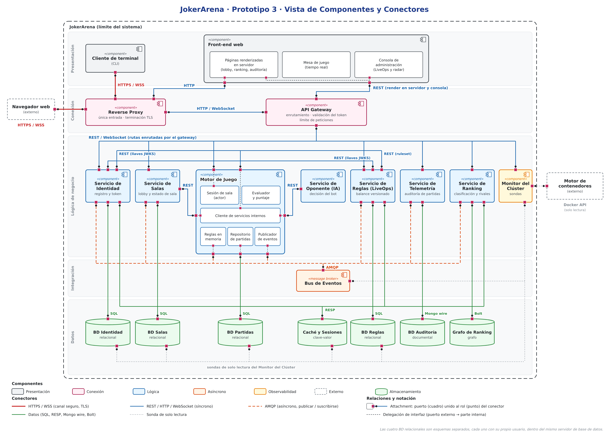
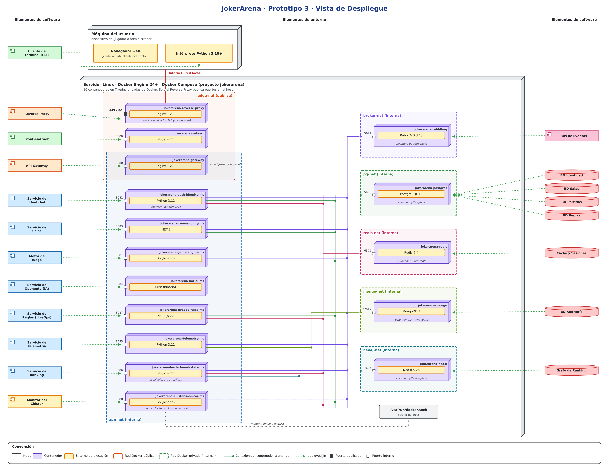
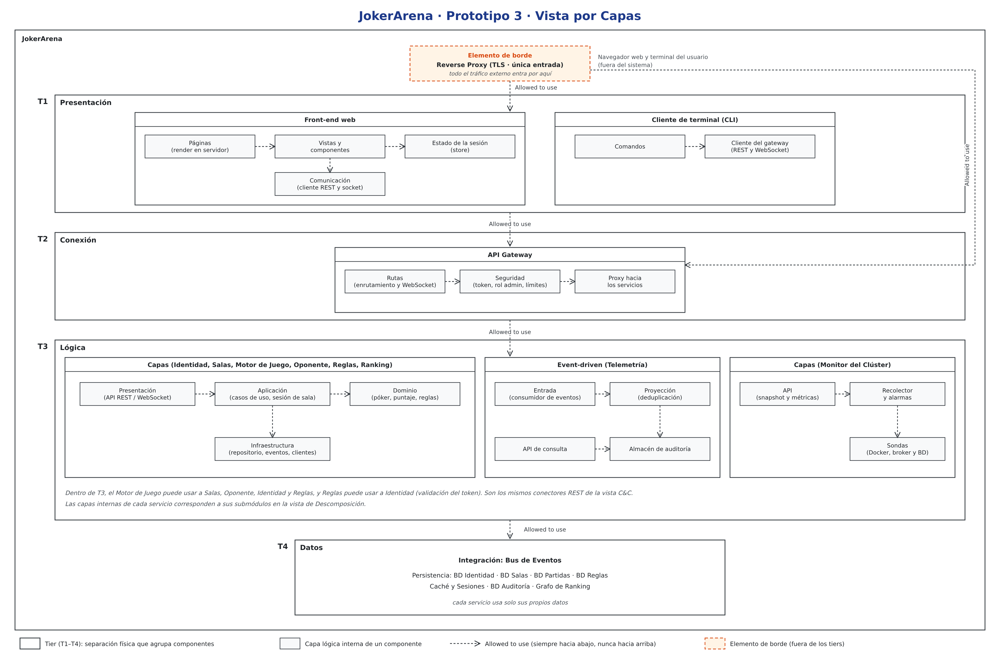
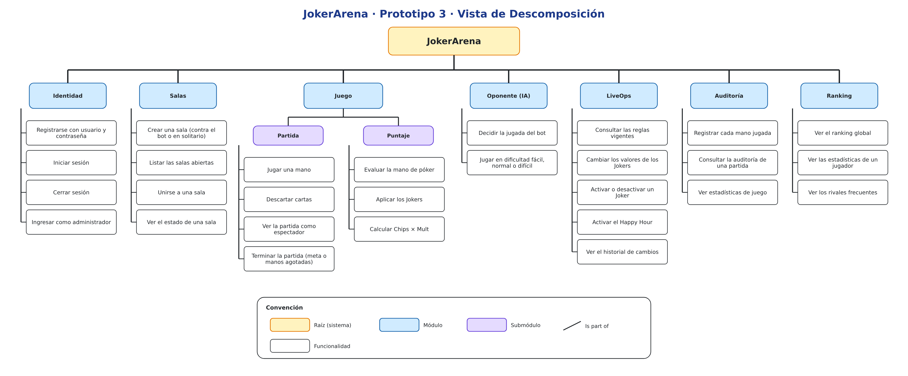
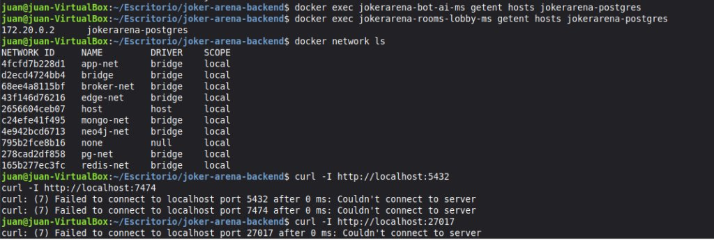
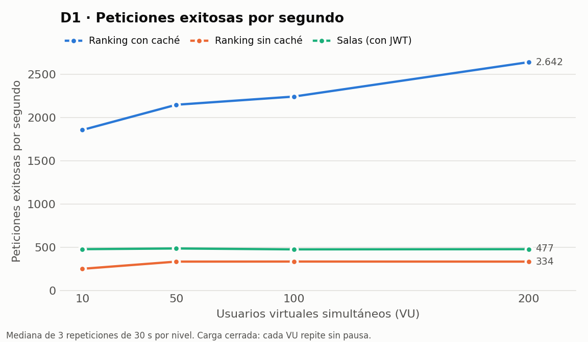
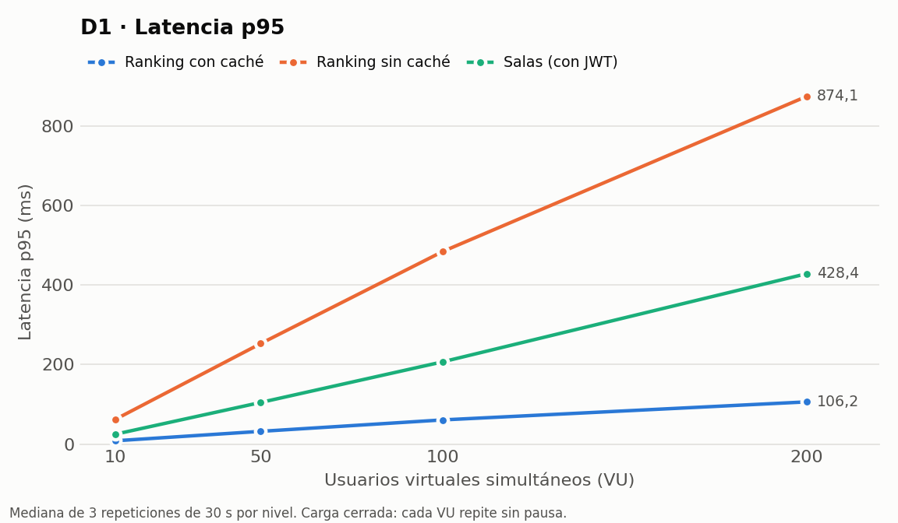
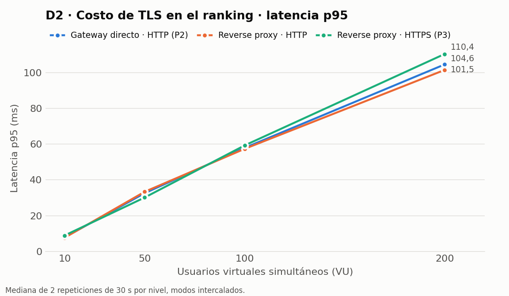

<!--
  NOTAS (los comentarios HTML no salen en el PDF)
  - Este archivo va en docs/p3/p3_2b.md.
  - Las imágenes de las vistas van en docs/p3/diagramas/ (los 4 PNG normales de Diagramas_v5, sin "_proyeccion").
  - Las gráficas de rendimiento se toman de perf/http/resultados/ (ya están en el repositorio).
  - Exportar a p3_2b.pdf desde VS Code (extensión "Markdown PDF").
-->

# p3_2b — JokerArena: Multiverse Poker Engine

### Prototipo 3 — Quality Attributes, Part 1

**Arquitectura de Software 2026-II · Universidad Nacional de Colombia — Sede Bogotá**<br>
**Docente:** Jeisson Andrés Vergara Vargas

---

## 1. Equipo

- **Nombre del equipo:** 2b
- **Integrantes:**
  - Santiago Zamora Garzon
  - Esteban Andrés Gómez Álvarez
  - Jose Arturo Herrera Rivera
  - Juan David Suárez Coronado
  - Nicole Ariadna Celemin Triana
  - José Alejandro Solano Garcés
  - Jaisson Andrés Machado Bautista
  - Ángel David Ruiz Barbosa

---

## 2. Sistema de software

### 2.1. Nombre

**JokerArena: Multiverse Poker Engine**

### 2.2. Logo


### 2.3. Descripción

**JokerArena** es un videojuego web distribuido de póker con *Jokers*, inspirado en las mecánicas de puntuación del roguelike *Balatro*. El jugador compite en una sala contra un bot (o en solitario, con espectadores), jugando y descartando cartas de una baraja francesa. Cada mano se puntúa con la fórmula **Chips × Mult**, modificada por tres Jokers cuyo balance se ajusta en caliente desde una consola de administración.

El sistema está formado por ocho servicios de lógica escritos en cinco lenguajes (Go, Python, C#, Rust y TypeScript), un API Gateway, mensajería asíncrona y persistencia políglota (relacional, documental, clave-valor y de grafos). Los usuarios acceden, con usuario y contraseña, por una web con renderizado en servidor y por una aplicación de terminal.

El código está en dos repositorios: [`joker-arena-backend`](https://github.com/AngelDavidRuizB/joker-arena-backend) (servicios, gateway, reverse proxy, infraestructura y CLI) y [`joker-arena-frontend`](https://github.com/AngelDavidRuizB/joker-arena-frontend) (Front-end web).

En el **Prototipo 3** la arquitectura se rediseñó para dos atributos de calidad:

- **Seguridad**, con cinco escenarios y sus contramedidas:
  - Canal seguro con TLS (*Secure Channel*).
  - Reverse proxy como única puerta de entrada (*Reverse Proxy*).
  - Red segmentada en siete zonas (*Network Segmentation*).
  - Bloqueo de cuenta por intentos fallidos (*Account Lockout + Rate Limiting*).
  - Autorización en el propio servicio (*Zero Trust*).
- **Rendimiento y escalabilidad**, analizados con pruebas de carga.

---

## 3. Estructuras arquitectónicas

Las cuatro vistas usan los mismos nombres para los mismos elementos:

- Cada **componente** de la vista C&C es un **elemento de software** asignado a un contenedor en la vista de Despliegue.
- Cada componente pertenece a un **tier** (T1 a T4) en la vista por Capas, salvo el Reverse Proxy, que es el elemento de borde. Sus capas lógicas internas aparecen en esa misma vista.
- Los servicios de lógica de negocio son los **módulos funcionales** de la vista de Descomposición, con lo que el usuario puede hacer en cada uno.

### 3.1. Estructura de Componentes y Conectores (C&C)

#### 3.1.1. Vista C&C



#### 3.1.2. Elementos arquitectónicos

**Componentes.** Cada componente tiene un nombre que indica su función e interactúa con los demás únicamente a través de sus **puertos**.

| Componente | Capa | Responsabilidad | Tecnología |
|---|---|---|---|
| Cliente de terminal (CLI) | Presentación | Sesión, salas, ranking, auditoría, ruleset y seguimiento de partidas desde la terminal | Python (Typer, httpx, websockets) |
| Front-end web *(compuesto)* | Presentación | Páginas renderizadas en servidor (lobby, ranking, auditoría), mesa de juego en tiempo real y consola de administración (LiveOps y radar) | Next.js 14 (TypeScript) |
| Reverse Proxy *(nuevo en P3)* | Conexión | Única entrada al sistema: termina TLS (HTTPS / WSS), redirige el puerto 80 al 443, oculta la topología interna y limita tamaño y tiempo de las peticiones | nginx 1.27 |
| API Gateway | Conexión | Enrutamiento hacia los servicios, validación del token, autorización del rol `admin`, límite de peticiones y CORS | nginx 1.27 |
| Monitor del Clúster | Lógica (observabilidad) | Estado de los contenedores (Docker API), del Bus de Eventos, de PostgreSQL y de Redis; alarmas por WebSocket | Go |
| Servicio de Identidad | Lógica | Registro y entrada con usuario y contraseña (PBKDF2), emisión del JWT (RS256), JWKS, sesiones y revocación; **bloqueo por intentos fallidos (P3)** | Python (FastAPI) |
| Servicio de Salas | Lógica | Salas `JKR-XXXX`, reglas de unión y estado de la sala | C# (.NET 8) |
| Motor de Juego *(compuesto)* | Lógica | Motor autoritativo: sesión de sala, póker, puntaje con el ruleset vigente, persistencia y eventos | Go |
| Servicio de Oponente (IA) | Lógica | Decide la jugada del bot según la dificultad | Rust (axum) |
| Servicio de Reglas (LiveOps) | Lógica | Ruleset de balance versionado; **valida por sí mismo el token de administrador (P3)** | TypeScript (Fastify) |
| Servicio de Telemetría | Lógica | Auditoría mano a mano a partir de los eventos | Python (FastAPI) |
| Servicio de Ranking | Lógica | Ranking global y rivales frecuentes, con caché | TypeScript (Fastify) |
| Bus de Eventos | Integración | Exchange *topic* `jokerarena.events` con una cola durable por consumidor | RabbitMQ 3.13 |
| BD Identidad, BD Salas, BD Partidas, BD Reglas | Datos | Almacenes relacionales, uno por servicio (esquemas separados del mismo servidor) | PostgreSQL 16 |
| Caché y Sesiones | Datos | Almacén clave-valor: sesiones, revocación, ruleset vigente y caché del ranking | Redis 7.4 |
| BD Auditoría | Datos | Almacén documental de la auditoría | MongoDB 7 |
| Grafo de Ranking | Datos | Almacén de grafos de jugadores y partidas | Neo4j 5.26 |

**Elementos externos:** *Navegador web* (ejecuta la parte de cliente del Front-end web) y *Motor de contenedores* (Docker Engine, leído por el Monitor).

**Conectores.** Cada conector es un camino de interacción en tiempo de ejecución con un **rol** en cada extremo.

| Conector | Tipo | Une a (roles) |
|---|---|---|
| HTTPS / WSS | Síncrono, canal seguro (TLS) | Navegador web y CLI → Reverse Proxy |
| HTTP | Síncrono | Reverse Proxy → Front-end web |
| HTTP / WebSocket | Síncrono | Reverse Proxy → API Gateway |
| REST | Síncrono | Front-end web (render en servidor y consola) → API Gateway |
| REST / WebSocket | Síncrono, un conector con varios roles | API Gateway → Identidad, Salas, Motor, Reglas, Telemetría, Ranking y Monitor |
| REST | Síncrono | Motor → Salas, Motor → Oponente, Motor → Identidad (llaves JWKS), Motor → Reglas (ruleset) |
| REST (llaves JWKS) *(nuevo en P3)* | Síncrono | Reglas → Identidad |
| AMQP | Asíncrono (publicar / suscribirse), un conector con varios roles | Identidad, Salas, Motor, Reglas, Telemetría y Ranking ↔ Bus de Eventos |
| SQL, RESP, Mongo wire, Bolt | Conectores de datos | Cada servicio → solo sus propios almacenes |
| Sonda de solo lectura | Síncrono | Monitor → Bus de Eventos, BD Identidad, BD Salas, BD Partidas, BD Reglas, Caché y Sesiones, y Motor de contenedores (Docker API). BD Auditoría y Grafo de Ranking no se sondean directamente: su estado se ve como contenedor por la Docker API |

#### 3.1.3. Relaciones

- **Attachment:** cada conector se une al componente asociando un **rol** del conector (punto) con un **puerto** del componente (cuadro). Así el sistema queda como un grafo de componentes (nodos) y conectores (arcos).
- **Interface delegation:** los componentes compuestos delegan sus puertos externos en sus partes internas.
  - **Front-end web:** el puerto que recibe HTTP del Reverse Proxy delega en *Páginas renderizadas en servidor*. El puerto que llama al API Gateway delega en *Páginas renderizadas en servidor* y en *Consola de administración*.
  - **Motor de Juego:**
    - El puerto WebSocket delega en *Sesión de sala*.
    - Los puertos REST hacia Salas, Oponente, Identidad y Reglas delegan en *Cliente de servicios internos*.
    - El puerto AMQP delega en *Publicador de eventos* y en *Reglas en memoria*.
    - El puerto SQL delega en *Repositorio de partidas*.

Los eventos que viajan por el Bus son `auth.player.registered`, `lobby.room.created`, `game.match.started`, `game.hand.scored`, `game.match.ended` y `liveops.ruleset.updated` (detalle en `contracts/events.md`).

#### 3.1.4. Estilos arquitectónicos

- **Microservicios:** ocho servicios de lógica desplegados por separado, cada uno dueño de sus datos.
- **Cliente-servidor:** la web y la CLI consumen servicios remotos a través de una única entrada.
- **Publish-subscribe (event-driven):** los servicios publican hechos de negocio en el Bus de Eventos y otros reaccionan sin conocer al productor.
- **Por capas:** ver 3.3.

#### 3.1.5. Patrones arquitectónicos

| Patrón | Dónde se aplica |
|---|---|
| **Secure Channel** *(P3)* | Conector HTTPS / WSS entre los clientes y el Reverse Proxy |
| **Reverse Proxy** *(P3)* | Componente Reverse Proxy, única entrada |
| **Account Lockout + Rate Limiting** *(P3)* | Servicio de Identidad (bloqueo) y API Gateway (límite de peticiones) |
| **Zero Trust / autorización en el servicio** *(P3)* | Servicio de Reglas valida el token con el JWKS de Identidad |
| API Gateway | Enrutamiento, validación del token y CORS en un solo punto |
| Database per service y persistencia políglota | Cada servicio con su propio almacén |
| Token-based authentication (JWT + JWKS) | Identidad firma; el Gateway valida cada token consultando a Identidad, y el Motor y Reglas lo verifican por su cuenta con las llaves JWKS |
| Event-driven consumer, Idempotent receiver, Materialized view | Telemetría y Ranking |
| Cache-aside | Ranking y ruleset en Caché y Sesiones |
| Actor | Una sesión de sala por partida en el Motor |
| Strategy + Hot reload | Ruleset reemplazado en caliente; estrategias del bot |
| Optimistic concurrency | Reglas responde 409 ante una versión vieja |
| Fallback y Health check | Bot local de respaldo; `/health` en todos los componentes |

---

### 3.2. Estructura de Despliegue

#### 3.2.1. Vista de Despliegue



#### 3.2.2. Elementos y relaciones

La vista asigna los elementos de software (los componentes de la vista C&C) a los **elementos de entorno** de la infraestructura mediante la relación **deployed_in** (*allocated-to*). No repite las interacciones entre componentes: muestra **dónde se ejecuta** cada uno y **cómo está conectada la infraestructura** (redes, puertos publicados, volúmenes y montajes).

**Elementos de entorno:**

- **Máquina del usuario** (dispositivo): contiene el *Navegador web* y el *Intérprete Python 3.10+*, donde se ejecuta el Cliente de terminal (CLI).
- **Servidor Linux con Docker Engine 24+** (dispositivo): ejecuta los 16 contenedores con Docker Compose (proyecto `jokerarena`).

**Asignación (deployed_in) de los componentes a sus contenedores:**

| Contenedor | Entorno de ejecución | Puerto | Componente (deployed_in) | Redes | Volumen / montaje |
|---|---|---|---|---|---|
| jokerarena-reverse-proxy | nginx 1.27 | 443, 80 (**publicados**) | Reverse Proxy | edge | certificados TLS (solo lectura) |
| jokerarena-web-ssr | Node.js 22 | 3000 | Front-end web (repositorio `joker-arena-frontend`) | edge | — |
| jokerarena-gateway | nginx 1.27 | 8080 | API Gateway | edge, app | — |
| jokerarena-auth-identity-ms | Python 3.12 | 8082 | Servicio de Identidad | app, broker, pg, redis | `p2-authkeys` (llave RSA) |
| jokerarena-rooms-lobby-ms | .NET 8 | 8083 | Servicio de Salas | app, broker, pg | — |
| jokerarena-game-engine-ms | Go (binario) | 8081 | Motor de Juego | app, broker, pg | — |
| jokerarena-bot-ai-ms | Rust (binario) | 8084 | Servicio de Oponente (IA) | app | — |
| jokerarena-liveops-rules-ms | Node.js 22 | 8087 | Servicio de Reglas (LiveOps) | app, broker, pg, redis | — |
| jokerarena-telemetry-ms | Python 3.12 | 8085 | Servicio de Telemetría | app, broker, mongo | — |
| jokerarena-leaderboard-stats-ms | Node.js 22 | 8086 | Servicio de Ranking (escalable a 1–3 réplicas) | app, broker, redis, neo4j | — |
| jokerarena-cluster-monitor-ms | Go (binario) | 8088 | Monitor del Clúster | app, broker, pg, redis | `/var/run/docker.sock` (solo lectura) |
| jokerarena-rabbitmq | RabbitMQ 3.13 | 5672 | Bus de Eventos | broker | `p2-rabbitdata` |
| jokerarena-postgres | PostgreSQL 16 | 5432 | BD Identidad, BD Salas, BD Partidas, BD Reglas | pg | `p2-pgdata` |
| jokerarena-redis | Redis 7.4 | 6379 | Caché y Sesiones | redis | `p2-redisdata` |
| jokerarena-mongo | MongoDB 7 | 27017 | BD Auditoría | mongo | `p2-mongodata` |
| jokerarena-neo4j | Neo4j 5.26 | 7687 | Grafo de Ranking | neo4j | `p2-neo4jdata` |

**Conexiones de infraestructura:**

- **Enlace externo:** Internet o red local hacia el único **puerto publicado** del host (443, y 80 que redirige a 443), que llega al contenedor del Reverse Proxy.
- **Redes Docker:** en la vista cada red es un **recuadro** que agrupa a los contenedores que pertenecen a ella (`edge-net` en línea continua por ser pública; las seis internas en línea punteada). `edge-net` y `app-net` se superponen en el API Gateway, que pertenece a las dos. Los servicios que además usan una red de datos se conectan a su recuadro con una línea que termina en un punto (interfaz de red). Un contenedor solo puede comunicarse con los contenedores de las redes a las que está conectado.

| Red | Interna | Contenedores conectados | Tráfico que permite |
|---|---|---|---|
| `edge-net` | no | Reverse Proxy, Front-end web, API Gateway | HTTP / WebSocket del borde |
| `app-net` | sí | API Gateway y los 8 servicios | REST / WebSocket :8081–8088 |
| `broker-net` | sí | Bus de Eventos e Identidad, Salas, Motor, Reglas, Telemetría, Ranking, Monitor | AMQP :5672 |
| `pg-net` | sí | PostgreSQL e Identidad, Salas, Motor, Reglas, Monitor | SQL :5432 |
| `redis-net` | sí | Redis e Identidad, Reglas, Ranking, Monitor | RESP :6379 |
| `mongo-net` | sí | MongoDB y Telemetría | Mongo wire :27017 |
| `neo4j-net` | sí | Neo4j y Ranking | Bolt :7687 |

- **Montajes:** volúmenes persistentes en los contenedores de datos y en Identidad; certificados TLS en el Reverse Proxy; socket de Docker, en solo lectura, en el Monitor.
- **Front-end web:** se construye y levanta desde su propio repositorio (`joker-arena-frontend`) y se une a la red `edge-net` del backend. No publica puertos: se llega a él solo a través del Reverse Proxy.

#### 3.2.3. Patrones de despliegue

- **Network Segmentation** *(P3)*: siete redes; las seis internas se crean con `internal: true`.
- **Single entry point / Edge gateway** *(P3)*: solo el Reverse Proxy publica puertos.
- **Single service per container.** Los servicios usan imágenes multi-etapa y se ejecutan como usuario no root. En los dos nginx (Reverse Proxy y API Gateway) los procesos que atienden las peticiones corren como el usuario `nginx`; en el Reverse Proxy solo el proceso maestro corre como root, para abrir los puertos 80 y 443.
- **Health check** en cada contenedor y arranque ordenado (`depends_on: service_healthy`).
- **Externalized configuration:** configuración y secretos en `.env`; los certificados quedan fuera del repositorio.
- **Escalamiento horizontal de servicios sin estado:** el Servicio de Ranking se puede levantar con varias réplicas detrás del API Gateway.

---

### 3.3. Estructura por Capas

#### 3.3.1. Vista por Capas



#### 3.3.2. Elementos y relaciones

**Elementos:**

- **Tiers (separación física):** agrupan los componentes del sistema. Se manejan cuatro:
  - **T1 Presentación:** los componentes con los que interactúa el usuario final (Front-end web y Cliente de terminal).
  - **T2 Conexión:** el API Gateway, capa intermedia que enruta las solicitudes y aplica la seguridad.
  - **T3 Lógica:** los servicios que implementan la lógica de negocio y el Monitor del Clúster.
  - **T4 Datos:** almacenamiento, persistencia e integración asíncrona (Bus de Eventos y almacenes).
- **Capas (separación lógica):** las divisiones lógicas internas de cada componente:

| Componente(s) | Estilo interno | Capas lógicas |
|---|---|---|
| Front-end web | Capas | Páginas (render en servidor) → Vistas y componentes → Estado de la sesión y Comunicación (cliente REST y socket) |
| Cliente de terminal (CLI) | Capas | Comandos → Cliente del gateway |
| API Gateway | Capas | Rutas → Seguridad (token, rol admin, límites) → Proxy hacia los servicios |
| Identidad, Salas, Motor de Juego, Oponente, Reglas, Ranking | Capas | Presentación (API REST / WebSocket) → Aplicación (casos de uso, sesión de sala) → Dominio (póker, puntaje, reglas) e Infraestructura (repositorio, eventos, clientes) |
| Telemetría | Event-driven | Entrada (consumidor de eventos) → Proyección (deduplicación) → Almacén de auditoría, con una API de consulta |
| Monitor del Clúster | Capas | API → Recolector y alarmas → Sondas |

- **Elemento de borde:** el **Reverse Proxy** no pertenece a ningún tier. Es el perímetro de seguridad por el que entra todo el tráfico externo (HTTPS / WSS) del navegador y de la terminal del usuario. Sus dos relaciones son **allowed to use**: hacia T1 (Front-end web) y hacia T2 (API Gateway, para la CLI y la mesa de juego).

**Relaciones:**

- **Allowed to use:** un tier usa al tier inmediatamente inferior: T1 → T2 → T3 → T4. Dentro de cada componente, cada capa lógica usa a la de abajo.
- Dentro de T3, el Motor de Juego puede usar a Salas, Oponente, Identidad y Reglas, y Reglas puede usar a Identidad para validar el token. Son los mismos conectores REST de la vista C&C.

**Restricciones que cumple la vista:**

- Cada componente pertenece a un solo tier.
- Hay cuatro tiers.
- Ninguna relación va de un tier inferior a uno superior.

#### 3.3.3. Patrones

- **Arquitectura multinivel (4 tiers):** presentación, conexión, lógica y datos separados físicamente.
- **Layered** dentro de cada servicio, y **Layered event-driven** en Telemetría: su entrada son eventos, no peticiones HTTP.
- **Perímetro de seguridad / Reverse Proxy** *(P3)*: un elemento de borde por el que pasa todo el tráfico externo.
- **Defensa en profundidad** *(P3)*: cada nivel suma un control de seguridad.
  - Borde: TLS y ocultamiento de la topología.
  - T2: validación del token y límite de peticiones.
  - T3: bloqueo de cuenta y autorización en el servicio.
  - Separación física de los tiers por la segmentación de red.

---

### 3.4. Estructura de Descomposición

#### 3.4.1. Vista de Descomposición



#### 3.4.2. Elementos y relaciones

La estructura descompone el sistema en **unidades funcionales**: qué puede hacer el usuario (jugador o administrador) y en qué módulo vive cada responsabilidad. Se representa como un cuadro conceptual: la raíz (JokerArena), sus módulos, los submódulos y las funcionalidades.

Solo se incluye lo **funcional**. Los elementos no funcionales no aparecen aquí; se ven en las vistas C&C, Despliegue y Capas. Son:

- El Reverse Proxy, el API Gateway, el Monitor del Clúster y la infraestructura.
- Las tácticas de seguridad del P3 (TLS, segmentación, bloqueo de cuenta y validación del token).
- Los clientes (Front-end web y CLI), que solo presentan estas funcionalidades.

**Elementos:**

- **Módulos:** las siete áreas funcionales del sistema.
- **Submódulos:** el módulo Juego se divide en *Partida* y *Puntaje*.
- **Funcionalidades:** lo que el usuario final (jugador o administrador) puede hacer o ver en cada módulo. Describen el **qué**, no el **cómo**.

| Módulo | Funcionalidades | Implementado en | Responsable |
|---|---|---|---|
| Identidad | Registrarse con usuario y contraseña, iniciar sesión, cerrar sesión, ingresar como administrador | `services/auth-identity-ms` | Esteban Andrés Gómez Álvarez |
| Salas | Crear una sala (contra el bot o en solitario), listar las salas abiertas, unirse a una sala, ver el estado de una sala | `services/rooms-lobby-ms` | Jose Arturo Herrera Rivera |
| Juego · Partida | Jugar una mano, descartar cartas, ver la partida como espectador, terminar la partida (meta o manos agotadas) | `services/game-engine-ms` | Santiago Zamora Garzon |
| Juego · Puntaje | Evaluar la mano de póker, aplicar los Jokers, calcular Chips × Mult | `services/game-engine-ms` | Santiago Zamora Garzon |
| Oponente (IA) | Decidir la jugada del bot, jugar en dificultad fácil, normal o difícil | `services/bot-ai-ms` | Juan David Suárez Coronado |
| LiveOps | Consultar las reglas vigentes, cambiar los valores de los Jokers, activar o desactivar un Joker, activar el Happy Hour, ver el historial de cambios | `services/liveops-rules-ms` | Jaisson Andrés Machado Bautista |
| Auditoría | Registrar cada mano jugada, consultar la auditoría de una partida, ver estadísticas de juego | `services/telemetry-ms` | José Alejandro Solano Garcés |
| Ranking | Ver el ranking global, ver las estadísticas de un jugador, ver los rivales frecuentes | `services/leaderboard-stats-ms` | Nicole Ariadna Celemin Triana |

**Relación «is part of»:** define la relación parte/todo entre un elemento y el que está sobre él en el árbol (funcionalidad → submódulo → módulo → sistema).

**Restricciones que cumple la vista:**

- No hay ciclos.
- Cada elemento tiene un solo padre.

**Criterio de validación:** alguien que no conoce la estructura interna del sistema, con solo la descripción de lo que hace JokerArena, podría reconstruir este árbol agrupando las funcionalidades por área. Cada módulo corresponde a un servicio de la capa de lógica (T3) y a un componente de la vista C&C.

---

## 4. Atributos de calidad

### 4.1. Seguridad

#### 4.1.1. Escenarios de seguridad

**Escenario 1 · Interceptación del tráfico — Secure Channel** *(responsable: Ángel David Ruiz Barbosa)*

| Parte | Descripción |
|---|---|
| Fuente | Un atacante conectado a la misma red que el jugador (por ejemplo, un wifi público). |
| Estímulo | Captura el tráfico entre el cliente y el servidor para leer la contraseña de `admin` o los tokens JWT y reutilizarlos. |
| Artefacto | Canal de comunicación entre los clientes (navegador y CLI) y el sistema. |
| Entorno | Operación normal. |
| Respuesta | Todo el tráfico externo viaja cifrado con TLS (HTTPS y WSS). Las peticiones por HTTP se redirigen a HTTPS y el navegador recibe HSTS. |
| Medida de la respuesta | En una captura de tráfico no se puede leer ninguna credencial ni token; el 100 % de las peticiones al puerto 80 recibe 301 hacia HTTPS. |

**Implementación.**

- `scripts/gen_certs.sh` genera una CA local y el certificado del servidor (SAN `localhost`, `jokerarena-reverse-proxy`, `127.0.0.1`) en `edge/certs/`, carpeta que queda fuera del repositorio.
- `edge/reverse-proxy/conf.d/10-tls.conf`: el puerto 80 responde `301` hacia HTTPS; el 443 termina TLS 1.2/1.3 con HTTP/2, sin *session tickets* y con la cabecera HSTS.
- La CLI usa `https://localhost` y `wss://` por defecto y verifica el certificado contra la CA local (`JOKERARENA_CA`).
- El Front-end web abre los WebSocket del juego y del radar de administración en el mismo origen de la página (`wss://<host>/...`), por el Reverse Proxy.

**Evidencia** (detalle en `docs/p3/secciones/escenario1_secure_channel.md`):

```text
$ openssl verify -CAfile edge/certs/jokerarena-ca.crt edge/certs/server.crt
edge/certs/server.crt: OK

# Captura de los bytes TCP durante login, consulta de salas y una jugada por WebSocket
HTTPS_OK tls=TLSv1.3 rooms=1 wire_bytes=4106 pass_in_wire=0 token_in_wire=0
WSS_OK url_scheme=wss msg_type=HAND_SCORED wire_bytes=3762 ws_token_in_wire=0 payload_in_wire=0
TLS_UNTRUSTED_REJECTED_OK   # sin la CA local, la CLI rechaza el certificado
```

Sobre el sistema completo (`bash scripts/verify.sh`, sección 4.1.2): el puerto 80 redirige con `301` a HTTPS, el certificado es válido para la CA local, la respuesta trae HSTS y el WebSocket del juego abre por WSS (`101`).

**Resultado:** se cumple la medida. La contraseña y el JWT aparecen 0 veces en los bytes capturados, y el 100 % de las peticiones al puerto 80 recibe `301`.

**Escenario 2 · Ataque directo a componentes internos — Reverse Proxy** *(responsable: Esteban Andrés Gómez Álvarez)*

| Parte | Descripción |
|---|---|
| Fuente | Un atacante externo. |
| Estímulo | Escanea los puertos del servidor e intenta conectarse directamente al API Gateway, al Front-end web o a una base de datos, o identificar la versión del software por las cabeceras. |
| Artefacto | Superficie expuesta del sistema (borde). |
| Entorno | Operación normal. |
| Respuesta | Solo el Reverse Proxy es alcanzable. No revela la versión ni la topología interna, y limita el tamaño y los tiempos de espera de las peticiones. |
| Medida de la respuesta | Desde fuera solo responden los puertos 80 y 443; ninguna cabecera revela la versión del software; las peticiones que exceden los límites se cortan (413 o 408). |

**Implementación.**

- `edge/reverse-proxy/` (nginx 1.27): es el único servicio con `ports:` (80 y 443) y solo está en `edge-net`.
- `locations.conf` envía `/api`, `/ws`, `/admin/*` y `/health` al API Gateway y el resto al Front-end web. Reutiliza las conexiones hacia el gateway (`keepalive`).
- `server_tokens off` oculta la versión. Agrega `X-Content-Type-Options`, `X-Frame-Options`, `Referrer-Policy` y `Permissions-Policy`. Limita el cuerpo a 64 KB y los tiempos de lectura y envío.
- Envía `X-Forwarded-For` y `X-Real-IP`, y el gateway recupera la IP real (`real_ip`), para que el límite de peticiones del escenario 4 siga contando por cliente.
- El gateway (`8080`) y el Front-end web (`3000`) ya no publican puertos. Para depurar existe `docker-compose.debug.yml`.

**Evidencia** (detalle en `docs/p3/secciones/escenario2_reverse_proxy.md`):

```text
$ docker ps --format '{{.Names}}\t{{.Ports}}' | grep -- '->'
jokerarena-reverse-proxy   0.0.0.0:80->80/tcp, 0.0.0.0:443->443/tcp

$ curl -m 3 http://localhost:8080/health      # gateway: connection refused
$ curl -m 3 http://localhost:3000/            # Front-end web: connection refused

$ curl -s --cacert edge/certs/jokerarena-ca.crt -D - -o /dev/null https://localhost/health
HTTP/2 200
server: nginx
strict-transport-security: max-age=31536000; includeSubDomains
x-content-type-options: nosniff
x-frame-options: SAMEORIGIN
referrer-policy: strict-origin-when-cross-origin
```

**Resultado:** se cumple la medida.

- Solo responden los puertos 80 y 443, y las conexiones directas a 8080 y 3000 fallan.
- La cabecera `Server` no revela la versión.
- Un cuerpo de 100 KB recibe `413`.
- Todo el juego funciona por `https://localhost`.

**Escenario 3 · Movimiento lateral desde un contenedor comprometido — Network Segmentation** *(responsable: Juan David Suárez Coronado)*

| Parte | Descripción |
|---|---|
| Fuente | Un atacante que logró ejecutar código dentro de un contenedor poco crítico (por ejemplo, el del Servicio de Oponente). |
| Estímulo | Intenta conectarse desde ese contenedor a las bases de datos para leer o borrar información. |
| Artefacto | Red interna de contenedores. |
| Entorno | Operación normal. |
| Respuesta | La conexión no es posible porque el contenedor no pertenece a las redes de datos; el resto del sistema sigue funcionando. |
| Medida de la respuesta | El 100 % de las conexiones no permitidas por la tabla de redes falla; el juego completo funciona igual que antes. |

**Implementación.**

- La red única del P2 se separó en siete redes. Las seis de servicios y datos se crean con `internal: true`; solo `edge-net` queda abierta.
- Cada contenedor se conecta únicamente a las redes que usa.
- Se quitaron los puertos publicados de las bases de datos, del broker, del gateway y de la web.

**Quién llega a quién:**

| Contenedor | edge | app | broker | pg | redis | mongo | neo4j |
|---|:---:|:---:|:---:|:---:|:---:|:---:|:---:|
| Reverse Proxy | X | | | | | | |
| API Gateway | X | X | | | | | |
| Front-end web | X | | | | | | |
| Servicio de Identidad | | X | X | X | X | | |
| Servicio de Salas | | X | X | X | | | |
| Motor de Juego | | X | X | X | | | |
| Servicio de Oponente (IA) | | X | | | | | |
| Servicio de Reglas (LiveOps) | | X | X | X | X | | |
| Servicio de Telemetría | | X | X | | | X | |
| Servicio de Ranking | | X | X | | X | | X |
| Monitor del Clúster | | X | X | X | X | | |
| RabbitMQ / PostgreSQL / Redis / MongoDB / Neo4j | | | broker | pg | redis | mongo | neo4j |

**Evidencia** (detalle y captura en `docs/p3/secciones/escenario3_segmentacion.md`):

```text
$ docker exec jokerarena-bot-ai-ms getent hosts jokerarena-postgres
(sin respuesta, código de salida 2)        # el Oponente no puede ni resolver la BD

$ docker exec jokerarena-rooms-lobby-ms getent hosts jokerarena-postgres
172.20.0.2     jokerarena-postgres         # acceso legítimo de Salas

$ curl -I http://localhost:5432   →  Failed to connect (también 7474 y 27017)
```



**Resultado:** se cumple la medida.

- El 100 % de las conexiones no permitidas falla.
- Los accesos legítimos funcionan, con los contenedores *healthy*.
- Ninguna base de datos ni servicio interno es alcanzable desde el host.

**Escenario 4 · Fuerza bruta contra la cuenta de administrador — Account Lockout + Rate Limiting** *(patrón definido por el equipo; responsable: Jose Arturo Herrera Rivera)*

| Parte | Descripción |
|---|---|
| Fuente | Un atacante que no conoce la contraseña de `admin`. |
| Estímulo | Un programa prueba muchas contraseñas seguidas en la entrada (o el registro) de la cuenta `admin`. |
| Artefacto | Servicio de Identidad. |
| Entorno | Operación normal, con jugadores conectados. |
| Respuesta | Tras 5 intentos fallidos la cuenta queda bloqueada durante el tiempo configurado (15 minutos por defecto), aunque después se envíe la contraseña correcta. Los tokens de administrador duran 30 minutos. El API Gateway limita además las peticiones por IP. |
| Medida de la respuesta | Como máximo 5 intentos fallidos por cuenta: el quinto fallo y todos los intentos siguientes reciben `423 account_locked` con `Retry-After`; 0 accesos durante el bloqueo; el gateway rechaza las ráfagas de más de 10 peticiones/s por IP; los demás jugadores no se ven afectados. |

**Implementación.**

- **Servicio de Identidad:**
  - Cada fallo de contraseña, en el login o en el registro de `admin`, se cuenta **por usuario** en Redis (`auth:fail:<usuario>`).
  - Al quinto fallo se crea `auth:lock:<usuario>` con la duración del bloqueo. Mientras exista, el login y el registro responden `423` con `Retry-After` sin consultar la base de datos.
  - Un login correcto reinicia el contador.
  - El token de `admin` dura 30 minutos; el de jugador, 12 horas.
  - Las contraseñas se guardan con PBKDF2.
  - Todo se configura con `AUTH_MAX_FAILED_ATTEMPTS`, `AUTH_LOCKOUT_MINUTES` y `AUTH_ADMIN_TOKEN_TTL_SECONDS`.
- **API Gateway:** `limit_req` de 10 peticiones/s por IP, con ráfaga de 20, en `/api/auth/*`.
- **Front-end web:** distingue el `423` del `401`, muestra los minutos restantes y desactiva el botón de envío.

**Evidencia** (detalle en `docs/p3/secciones/escenario4_lockout.md`):

```text
fallo 1: HTTP 401 → "Usuario o contraseña incorrectos. Te quedan 4 intentos."
fallo 2: HTTP 401 → "... Te quedan 3 intentos."
fallo 3: HTTP 401 → "... Te quedan 2 intentos."
fallo 4: HTTP 401 → "... Te queda 1 intento."
fallo 5: HTTP 423 → "Cuenta bloqueada por demasiados intentos fallidos. Inténtalo de nuevo en 15 minutos."  (Retry-After: 900)
contraseña correcta estando bloqueada: HTTP 423 en 2,7 ms

Ráfaga de 30 peticiones a /api/auth/me: 22 × 401 y 8 × 503 (límite del gateway)
Prueba de carga del login (40 intentos/s durante 20 s): 220 aceptados = 20 de ráfaga + 10/s × 20 s; 581 con 503
pytest: test_five_failed_logins_lock_the_account_for_15_minutes PASSED (y 5 pruebas más del escenario)
```

**Resultado:** se cumple la medida. El bloqueo es por usuario, así que las demás cuentas siguieron entrando durante las pruebas. El rechazo por bloqueo tarda menos de 100 ms.

**Escenario 5 · Cambio de reglas desde la red interna — Zero Trust / autorización en el servicio** *(patrón definido por el equipo; responsable: Jaisson Andrés Machado Bautista)*

| Parte | Descripción |
|---|---|
| Fuente | Un atacante que ya está dentro de la red interna (desde otro contenedor comprometido). |
| Estímulo | Llama directamente al Servicio de Reglas para cambiar el balance del juego sin pasar por el API Gateway. |
| Artefacto | Servicio de Reglas (LiveOps). |
| Entorno | Operación normal. |
| Respuesta | El servicio valida por sí mismo la firma, el vencimiento y el rol `admin` del token (con el JWKS del Servicio de Identidad) antes de aceptar un cambio, y registra los intentos rechazados sin escribir el token. |
| Medida de la respuesta | El 100 % de los cambios sin un token de administrador válido recibe 401 o 403; no se crea ninguna versión nueva del ruleset. |

**Implementación** (`services/liveops-rules-ms/src/auth.ts`):

- Toda petición que no sea `GET`, `HEAD` u `OPTIONS` pasa por un *guard* que verifica, con las llaves públicas del JWKS de Identidad:
  - la firma RS256 (rechaza `alg: none` y `HS*`);
  - el emisor y el vencimiento;
  - que la sesión no esté cerrada (`auth:revoked:<jti>` en Redis);
  - el rol `admin`.
- Responde `401` o `403` y registra el motivo del rechazo sin escribir el token.
- Si no hay llaves, rechaza con `503` (*fail closed*).
- El autor de cada cambio sale del token ya verificado.
- Las llaves se piden con reintentos, así que el servicio no depende del orden de arranque.
- El API Gateway sigue validando el rol `admin`: son dos controles independientes.

**Evidencia** (detalle en `docs/p3/secciones/escenario5_zero_trust.md`):

```text
# Desde otro contenedor de app-net, sin pasar por el gateway
PUT /liveops/ruleset sin token          → 401
GET /liveops/ruleset (lo usa el motor)  → 200
# Log del servicio:  "status":401,"reason":"sin_token","method":"PUT","url":"/liveops/ruleset"   (sin el token)

# Por el sistema completo, con token de administrador
PUT https://localhost/admin/liveops/ruleset → 200 (versión 2, updated_by: admin)

npm test: 38 passed (21 del escenario: firma de otra llave, vencido, alg none, HS256,
          rol alterado, jugador sin rol admin → 403, sesión revocada, auth caído → 503, …)
```

**Resultado:** se cumple la medida.

- Ningún cambio se acepta sin un token `admin` válido, aunque la llamada venga de dentro de la red.
- La consola de administración sigue guardando cambios.

#### 4.1.2. Verificación integrada

`bash scripts/verify.sh` comprueba los cinco escenarios sobre el sistema completo (los dos repositorios levantados). Resumen de su salida sobre la versión entregada:

```text
1. Configuración             ✔ compose válido · ✔ CA local · ✔ edge/certs/ fuera de git
3. Contenedores              ✔ 15 contenedores healthy (más el Front-end web)
4. Borde (escenarios 1 y 2)  ✔ certificado válido · ✔ 80 → 301 HTTPS · ✔ 8080 no expuesto
                             ✔ solo el reverse proxy publica puertos · ✔ Server sin versión
                             ✔ HSTS · ✔ cabeceras de seguridad · ✔ cuerpo de 100 KB → 413
5. Rutas por el proxy        ✔ registro, login, salas, auditoría, ranking, ruleset, 403 de admin
                             ✔ WSS /ws/<sala> → 101 (WebSocket sobre TLS)
6. Segmentación (3)          ✔ bot-ai-ms no resuelve PostgreSQL · ✔ rooms-lobby-ms sí
                             ✔ las seis redes internas son internal
7. Bloqueo (4)               ✔ quinto fallo → 423 · ✔ con la contraseña correcta sigue en 423
8. Zero Trust (5)            ✔ PUT sin token desde app-net → 401 · ✔ GET sigue abierto → 200
9. Cliente web               ✔ https://localhost/ → 200
Todo correcto.
```

Además, por el navegador en `https://localhost` se registró un usuario, se creó una sala contra el bot y se jugó una mano completa por WSS.

#### 4.1.3. Tácticas arquitectónicas aplicadas

| Categoría | Táctica | Escenario |
|---|---|---|
| Resistir ataques | Cifrar los datos en tránsito | 1 |
| Resistir ataques | Limitar la exposición (una sola entrada) | 2 |
| Resistir ataques | Limitar el acceso (segmentación de red) | 3 |
| Resistir ataques | Autenticar actores | 4, 5 |
| Resistir ataques | Autorizar actores (rol `admin` en el gateway y en el servicio) | 5 |
| Detectar ataques | Detectar denegación de servicio (límites de peticiones, tamaño y tiempo) | 2, 4 |
| Reaccionar a ataques | Bloquear la cuenta | 4 |
| Reaccionar a ataques | Revocar acceso (cierre de sesión y tokens de corta duración) | 4 |
| Recuperarse de ataques | Mantener una pista de auditoría (versiones del ruleset con su autor y registro de rechazos) | 5 |

#### 4.1.4. Patrones arquitectónicos aplicados

| Patrón | Escenario | Dónde se ve en las vistas |
|---|---|---|
| Secure Channel | 1 | C&C: conector HTTPS / WSS · Despliegue: certificados montados en el Reverse Proxy |
| Reverse Proxy | 2 | C&C: componente de entrada · Despliegue: único contenedor con puerto publicado · Capas: elemento de borde |
| Network Segmentation | 3 | Despliegue: siete redes en recuadros · Capas: separación física de los tiers |
| Account Lockout + Rate Limiting (equipo) | 4 | Capas: capa de Seguridad del API Gateway (T2) y lógica del Servicio de Identidad (T3) |
| Zero Trust / autorización en el servicio (equipo) | 5 | C&C y Capas: Reglas → Identidad (llaves JWKS) |

#### 4.1.5. Limitaciones conocidas

- **Valores del `.env.example`.** Trae contraseñas de ejemplo y `AUTH_LOCKOUT_MINUTES=1`, para que el equipo levante el sistema en local con `cp .env.example .env` y pueda ver el bloqueo sin esperar. En un despliegue real se reemplazan las contraseñas y se usa el bloqueo por defecto del servicio, de 15 minutos. El `.env` nunca se versiona.
- **Tráfico interno sin TLS.** El canal seguro cubre del cliente al Reverse Proxy. Dentro de la red de Docker el tráfico va por HTTP. La firma del JWT protege la integridad del token, no la confidencialidad del canal interno.
- **Certificado local.** La CA la genera `scripts/gen_certs.sh`, así que el navegador muestra una advertencia mientras no se importe esa CA.
- **Política *fail-open* con Redis caído.** Si Redis no responde, el login sigue funcionando sin bloqueo (se registra un aviso), y Reglas acepta un token ya verificado sin consultar la revocación. Se eligió así para no dejar el sistema sin autenticación por la caída de un servicio auxiliar.
- **Límite por IP.** El límite de peticiones del gateway es por IP, así que varios jugadores detrás de la misma red comparten la cuota.

### 4.2. Rendimiento y escalabilidad

#### 4.2.1. Metodología

Las pruebas se hicieron con **k6** contra el sistema completo desplegado con Docker Compose. Se midieron:

- Peticiones por segundo.
- Latencia p50, p95 y p99 (solo de las respuestas exitosas).
- Porcentaje de errores.

Cada nivel se repitió tres veces (dos en D2) y se reporta la mediana.

| Prueba | Qué se mide | Carga | Responsable |
|---|---|---|---|
| D1 · Ranking (`GET /api/leaderboard/top`), con y sin caché | Efecto de la caché y punto de degradación | 10, 50, 100 y 200 usuarios virtuales, 30 s por corrida | José Alejandro Solano Garcés |
| D1 · Salas (`GET /api/rooms`, con JWT) | Capacidad de una ruta que valida el token | 10, 50, 100 y 200 usuarios virtuales, 30 s | José Alejandro Solano Garcés |
| D1 · Login | Límite de peticiones (evidencia del escenario 4) | 40 intentos/s durante 20 s desde una IP | José Alejandro Solano Garcés |
| D2 · Costo de TLS | La misma carga directa al gateway, por proxy HTTP y por proxy HTTPS | 10 a 200 usuarios virtuales, 2 repeticiones intercaladas | José Alejandro Solano Garcés |
| D3 · Juego en tiempo real | Tiempo entre `PLAY_HAND` y `HAND_SCORED` por WebSocket | 10, 50 y 100 partidas simultáneas contra el bot | Santiago Zamora Garzon |
| D4 · Escalabilidad horizontal | Servicio de Ranking con 1, 2 y 3 réplicas | 50 usuarios virtuales durante 1 minuto | Santiago Zamora Garzon |

**Entorno:**

| Pruebas | Equipo | Sistema y herramientas |
|---|---|---|
| D1 y D2 | Intel Core i5-13420H (8 núcleos, 12 hilos), 23,7 GiB de RAM | Windows 11, Docker Desktop (WSL2, 12 CPU y 11,5 GiB asignados), k6 v2.4.0 |
| D3 y D4 | Intel Core i5-10210U (4 núcleos, 8 hilos), 15,9 GiB de RAM | Windows, Docker Desktop, k6 v2.4.0 en contenedor |

k6 corre en el mismo equipo que el sistema y compite con él por la CPU. Las cifras sirven para comparar configuraciones entre sí, no como capacidad absoluta de un servidor.

**Duración.** D1 y D2 suman cuatro sesiones: 222 corridas, unas 4 horas y media en total y unos 110 minutos bajo carga. La sesión de D1 sobre el P3 completo duró 35 minutos (37 corridas). Los comandos exactos y la hora de cada corrida están en `perf/http/resultados/<sesión>/manifiesto.csv`. Los resultados de D3 y D4 están en `results/k6/`.

#### 4.2.2. Resultados: rutas HTTP

**D1 sobre el P3 completo** (`https://localhost`: k6 → Reverse Proxy con TLS → API Gateway → servicios, con los cinco escenarios aplicados):

| Ruta | Usuarios | Peticiones/s | p50 (ms) | p95 (ms) | p99 (ms) | Errores |
|---|---:|---:|---:|---:|---:|---:|
| Ranking con caché | 10 | 1.856,9 | 4,77 | 8,38 | 13,52 | 0 % |
| Ranking con caché | 50 | 2.149,2 | 21,69 | 32,16 | 46,91 | 0 % |
| Ranking con caché | 100 | 2.243,8 | 42,38 | 60,91 | 78,21 | 0 % |
| Ranking con caché | 200 | 2.642,5 | 72,08 | 106,21 | 160,97 | 0 % |
| Ranking sin caché | 10 | 250,3 | 35,85 | 61,94 | 83,33 | 0 % |
| Ranking sin caché | 50 | 333,6 | 136,84 | 252,74 | 338,17 | 0 % |
| Ranking sin caché | 100 | 334,3 | 269,40 | 484,13 | 641,03 | 0 % |
| Ranking sin caché | 200 | 333,6 | 570,31 | 874,07 | 2.134,26 | 0 % |
| Salas (con JWT) | 10 | 477,5 | 16,75 | 24,83 | 30,47 | 0 % |
| Salas (con JWT) | 50 | 485,6 | 86,18 | 104,78 | 114,60 | 0 % |
| Salas (con JWT) | 100 | 475,3 | 173,40 | 206,89 | 230,21 | 0 % |
| Salas (con JWT) | 200 | 477,4 | 344,42 | 428,35 | 463,30 | 0 % |





**Punto de degradación.**

- **Ranking sin caché:** entre 10 y 50 usuarios. Las peticiones por segundo dejan de crecer (~334/s) y desde ahí solo sube la latencia: el p95 pasa de 62 ms a 874 ms con 200 usuarios. El límite lo ponen la consulta de agregación en Neo4j y el propio servicio.
- **Salas:** se satura en ~480 peticiones/s ya con 10 usuarios. Cada petición cuesta dos llamadas internas (el gateway valida el token con Identidad y luego llama a Salas).
- **Ranking con caché:** no se degrada en el rango probado. Sigue creciendo hasta ~2.640 peticiones/s con 200 usuarios, sin errores.

**Efecto de la caché.** Con caché, el ranking atiende entre 6 y 8 veces más peticiones por segundo que sin ella (2.149 frente a 334 con 50 usuarios) y su p95 es entre 7 y 8 veces menor.

**Cuello de botella encontrado y corregido.** En la primera medición, sobre el P2, el API Gateway abría una conexión TCP nueva por cada petición. Por encima de ~940 respuestas por segundo se quedaba sin puertos y respondía `503` al 30 % de las peticiones. El Reverse Proxy del P3 tenía el mismo problema y fallaba entre el 26 % y el 84 % de las peticiones por HTTPS desde 10 usuarios. Con `keepalive` hacia los servicios, en el gateway y en el proxy, los errores desaparecieron y el ranking con caché pasó de ~935 a más de 2.000 respuestas exitosas por segundo.

**Límite del login (escenario 4).** De 801 intentos en 20 s se aceptaron exactamente **220** (20 de ráfaga + 10/s × 20 s). Los 581 restantes recibieron `503` sin llegar a Identidad. El resultado es igual por HTTP y por HTTPS, lo que confirma que el gateway cuenta por la IP real del cliente detrás del proxy.

**D2 · Costo de TLS** (mismo nginx, sin y con TLS, conexiones reutilizadas):

| Ruta | Usuarios | p50 HTTP → HTTPS (ms) | Costo TLS p50 | Peticiones/s HTTP → HTTPS |
|---|---:|---|---:|---|
| Ranking con caché | 10 | 4,00 → 4,38 | +0,38 ms | 2.131 → 1.926 |
| Ranking con caché | 100 | 34,44 → 36,11 | +1,67 ms | 2.638 → 2.513 |
| Ranking con caché | 200 | 71,41 → 76,28 | +4,87 ms | 2.610 → 2.426 |
| Salas (con JWT) | 10 | 19,87 → 22,50 | +2,63 ms | 411 → 368 |
| Salas (con JWT) | 100 | 173,25 → 178,92 | +5,67 ms | 465 → 453 |



Mientras las conexiones se reutilizan, TLS suma entre 0,4 y 5,7 ms al p50, dentro de la variación entre repeticiones. TLS solo cuesta cuando cada petición abre una conexión nueva: el handshake promedia entre 8 y 45 ms y la capacidad cae entre un 30 y un 65 %. Sobre el P3 completo, con 10 a 100 usuarios, el ranking con caché rinde entre un 10 y un 18 % menos que por HTTP, con casi el mismo p95.

Las tablas completas, la sesión del P2 y la prueba A/B de la corrección están en `docs/p3/rendimiento/http.md`.

#### 4.2.3. Resultados: juego en tiempo real y escalabilidad

**D3 · Juego por WebSocket.** Cada usuario virtual crea su cuenta y una sala contra el bot, conecta el WebSocket y mide el tiempo desde que envía `PLAY_HAND` hasta que recibe su `HAND_SCORED`. Medianas de tres repeticiones:

| Partidas simultáneas | p50 (ms) | p95 (ms) | p99 (ms) | Conectadas y puntuadas | Errores y timeouts |
|---:|---:|---:|---:|---:|---:|
| 10 | 14,50 | 30,20 | 31,64 | 100 % | 0 |
| 50 | 25,00 | 62,65 | 74,67 | 100 % | 0 |
| 100 | 31,00 | 70,00 | 79,25 | 100 % | 0 |

Las 480 partidas de las nueve corridas se conectaron y puntuaron, sin errores ni timeouts. Con 10 veces más partidas, el p95 pasa de 30 a 70 ms.

**D4 · Escalabilidad horizontal del Servicio de Ranking** (50 usuarios virtuales, 1 minuto; medianas de tres repeticiones):

| Réplicas | Peticiones/s | p95 (ms) | p99 (ms) | Errores |
|---:|---:|---:|---:|---:|
| 1 | 264,35 | 371,40 | 698,66 | 0 |
| 2 | 533,01 | 220,26 | 368,65 | 0 |
| 3 | 575,98 | 194,56 | 279,38 | 0 |

Las réplicas comparten Redis, Neo4j y RabbitMQ, y el gateway las encuentra por el DNS interno de Docker (con 3 réplicas el nombre del servicio resolvió a 3 direcciones IP). La capacidad se duplica de 1 a 2 réplicas (×2,02), pero de 2 a 3 solo sube un 8 %. La escalabilidad no es lineal. Lo más probable es que la tercera réplica choque con lo que comparten todas (Neo4j, Redis y la CPU del mismo equipo), pero no se midió el consumo de recursos, así que el cuello de botella no quedó confirmado.

**Por qué el Motor de Juego no escala igual que el Ranking.** El Ranking no guarda estado propio, así que cualquier réplica puede atender cualquier petición. El Motor de Juego guarda en la memoria de su proceso la sesión de cada sala (un actor por partida) y mantiene abiertas las conexiones WebSocket de los jugadores. Con varias réplicas sin más cambios, dos réplicas podrían crear actores distintos para la misma sala. Para escalarlo habría que enrutar cada sala siempre a la misma réplica (afinidad de sala) o llevar el estado a un almacén compartido.

Los resultados individuales están en `docs/p3/k6-rendimiento.md` y `results/k6/`.

#### 4.2.4. Análisis y conclusiones

1. **La caché es la decisión de diseño que más rinde.** Sobre el P3 completo, el ranking con caché atiende entre 6 y 8 veces más peticiones por segundo que sin ella, con un p95 entre 7 y 8 veces menor. Sin caché, la consulta a Neo4j se satura desde los 50 usuarios.
2. **El primer cuello de botella no estaba en los servicios sino en los intermediarios.** El API Gateway y el Reverse Proxy abrían una conexión TCP por petición y se quedaban sin puertos. Reutilizar conexiones (`keepalive`) eliminó los errores y más que duplicó la capacidad del ranking. Cada salto nginx del sistema debe reutilizar conexiones.
3. **La seguridad del P3 cuesta poco en rendimiento.** Con conexiones reutilizadas, TLS y el salto extra del Reverse Proxy suman pocos milisegundos. Los controles que sí tienen costo se comportan como se diseñaron: el login acepta exactamente 10 peticiones/s por IP, y Salas se satura en ~480 peticiones/s porque cada petición valida el token con Identidad. Para subir esa capacidad se podría guardar en el gateway, por unos segundos, la validación de cada token, o escalar Identidad.
4. **El juego en tiempo real se mantiene estable bajo carga.** Con 100 partidas simultáneas el p95 entre jugada y puntaje es de 70 ms, sin errores ni desconexiones.
5. **Los servicios sin estado escalan horizontalmente; los que tienen estado no.** El Ranking duplica su capacidad con una segunda réplica, pero no crece de forma lineal: la tercera solo suma un 8 %. El Motor de Juego necesitaría afinidad de sala o estado compartido antes de poder escalar.

**Limitaciones de las mediciones.**

- k6 y el sistema compartieron el mismo equipo.
- D1/D2 y D3/D4 se midieron en equipos distintos, así que sus cifras no se comparan entre sí.
- D3 y D4 se ejecutaron contra el gateway del P2 (HTTP en el puerto 8080), antes de unir el Reverse Proxy.
- El consumo de CPU y memoria por contenedor no se midió de forma confiable: las muestras de `docker stats` de D1 salieron demasiado ruidosas y en D4 no se capturaron. En D4, además, 8 de los 9 resúmenes de k6 traen una latencia mínima negativa, por un problema de reloj del equipo, así que sus percentiles se toman como aproximados.

---

## 5. Prototipo

### 5.1. Requisitos

- Git.
- Docker Engine 24+ con Docker Compose 2.20+ (en Windows y Mac, Docker Desktop).
- `openssl`, para generar los certificados (viene con Git Bash).
- Para la CLI: Python 3.10+.

### 5.2. Descarga y ejecución

Los dos repositorios se clonan en la misma carpeta.

**1. Backend:**

```bash
git clone https://github.com/AngelDavidRuizB/joker-arena-backend.git
```

```bash
cd joker-arena-backend
```

```bash
cp .env.example .env
```

El `.env.example` trae valores de ejemplo para desarrollo local. En un despliegue real, cambie las contraseñas en el `.env`. Luego genere los certificados y levante el sistema:

```bash
bash scripts/gen_certs.sh
```

```bash
docker compose up -d --build --wait
```

**2. Front-end web** (se une a la red `edge-net` que creó el backend):

```bash
cd ..
```

```bash
git clone https://github.com/AngelDavidRuizB/joker-arena-frontend.git
```

```bash
cd joker-arena-frontend
```

```bash
docker compose up -d --build --wait
```

**3. Verificación** (desde `joker-arena-backend`):

```bash
cd ../joker-arena-backend
```

```bash
bash scripts/verify.sh
```

### 5.3. Uso

| Qué | Dónde |
|---|---|
| Juego | https://localhost (crear cuenta con usuario y contraseña) |
| Consola de administración | https://localhost/admin con el usuario `admin` y la contraseña `ADMIN_PASSWORD` del `.env` (la primera vez, use "Crear cuenta" con ese usuario y esa contraseña) |
| Ranking | https://localhost/leaderboard |
| API | https://localhost/api (rutas en `contracts/http-routes.md`) |

El navegador mostrará una advertencia porque el certificado es local. Para evitarla, importe `edge/certs/jokerarena-ca.crt` como autoridad de confianza.

**CLI** (desde `joker-arena-backend`; usa `https://localhost` y la CA de `edge/certs/`):

```bash
pip install ./clients/cli
```

```bash
jokerarena login MiUsuario
```

El comando pide la contraseña y crea la cuenta si no existe.

```bash
jokerarena rooms create
```

```bash
jokerarena leaderboard
```

### 5.4. Pruebas automatizadas

| Componente | Comando |
|---|---|
| Motor de Juego, Monitor del Clúster | `go test ./...` |
| Servicio de Identidad, Servicio de Telemetría, CLI | `pytest -q` |
| Servicio de Salas | `dotnet test tests/RoomsLobby.Tests` |
| Servicio de Oponente (IA) | `cargo test` |
| Servicio de Ranking, Servicio de Reglas | `npm test` |
| Front-end web (repositorio `joker-arena-frontend`) | `npm test` |
| Sistema completo (cinco escenarios de seguridad) | `bash scripts/verify.sh` |
| Rendimiento HTTP (D1 y D2) | `perf/http/run_http.ps1` (ver `perf/http/README.md`) |
| Rendimiento del juego y escalabilidad (D3 y D4) | `tests/k6/game-websocket.js` y `tests/k6/leaderboard.js` (ver `docs/p3/k6-rendimiento.md`) |
