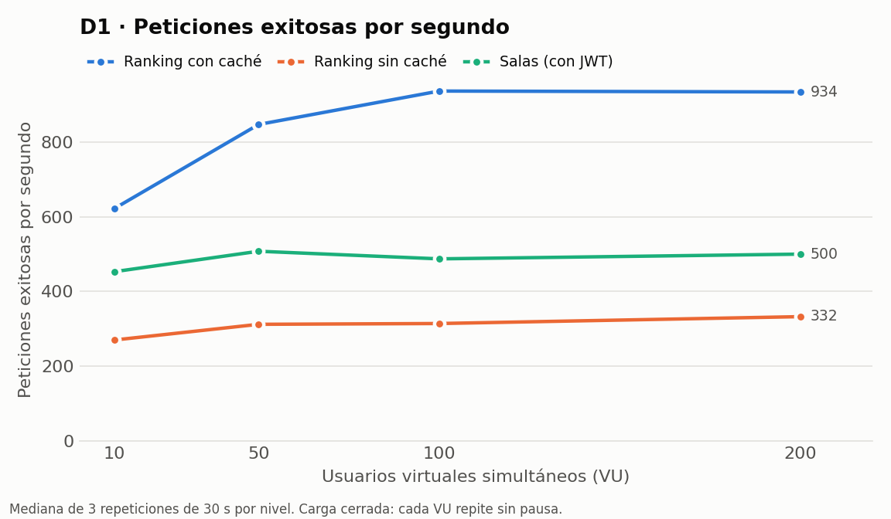
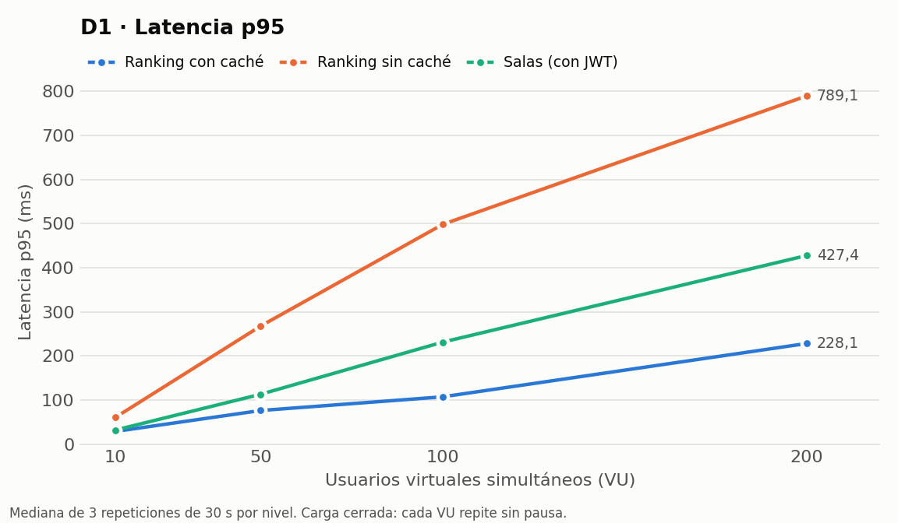
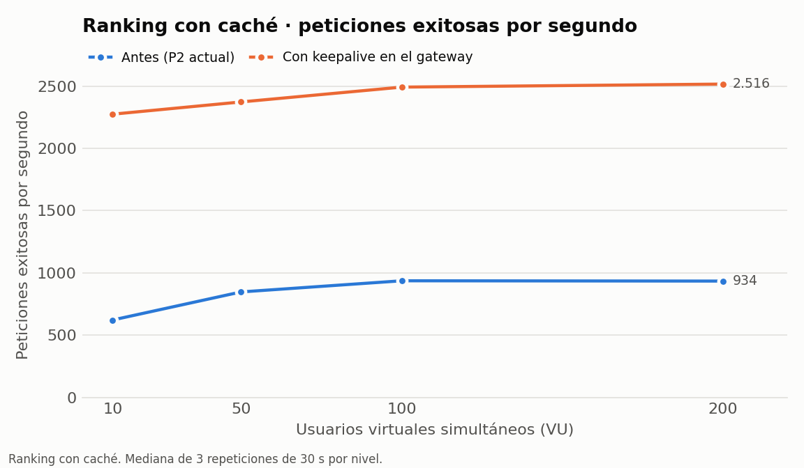
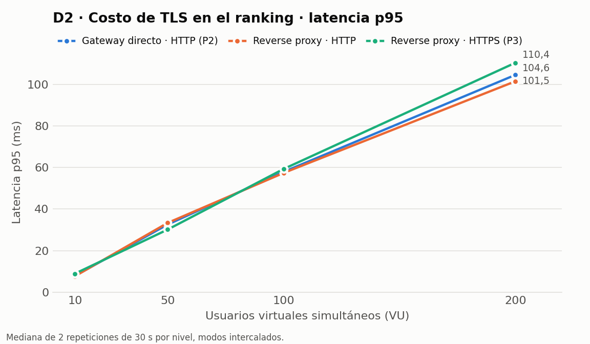
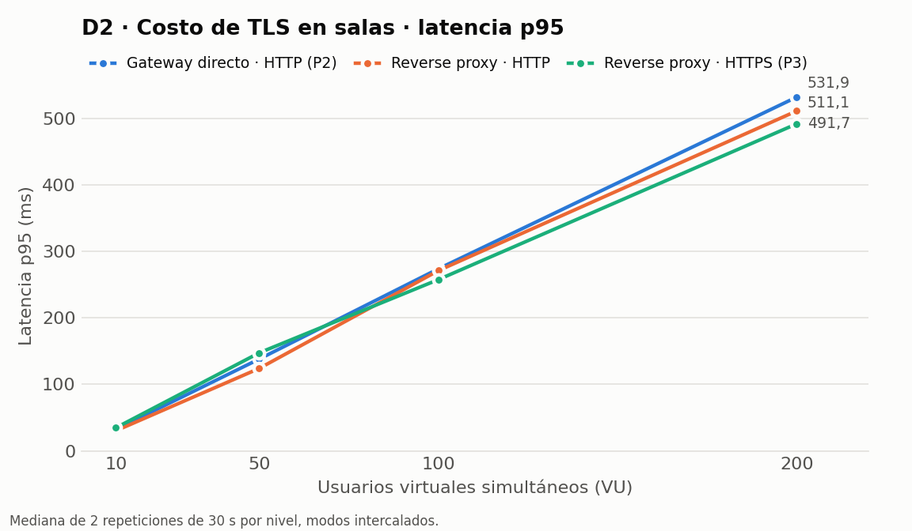
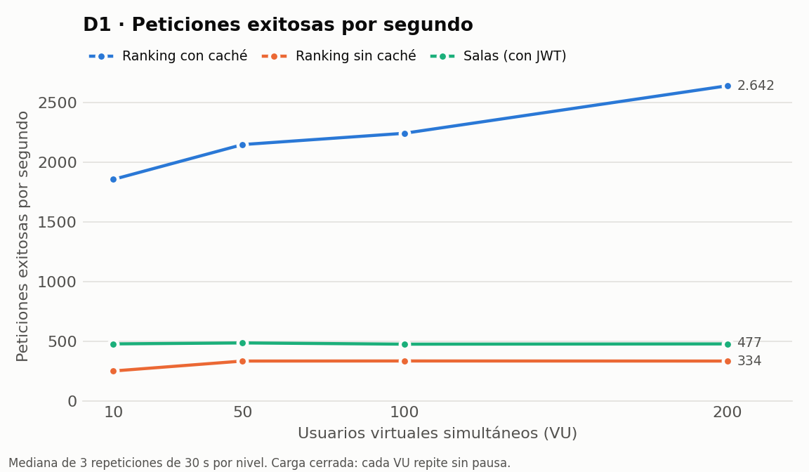
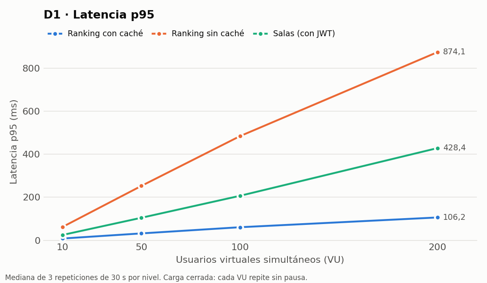

# Rendimiento de las rutas HTTP (D1, D2 y D5)

Responsable: José Alejandro Solano Garcés · Equipo 2b · JokerArena, Prototipo 3

Este documento reúne las pruebas de carga de las rutas HTTP del sistema con k6:

- **D1.** Capacidad del ranking con y sin caché, de las salas (ruta con JWT) y evidencia
  del límite de intentos del login.
- **D2.** Costo de TLS: la misma carga por HTTP (como en el P2) y por HTTPS (como en el P3).
- **D5.** Máquina, duración de cada prueba, comandos exactos y conclusiones.

Los scripts, los resultados crudos (un JSON de k6 por corrida) y el manifiesto con el
comando exacto de cada corrida están en [`perf/http/`](../../../perf/http/). Cómo
repetir las pruebas está en [`perf/http/README.md`](../../../perf/http/README.md).

## 1. Resumen

1. **La caché del ranking multiplica la capacidad por 2,3 a 2,7 y baja el p95 entre
   2 y 3,5 veces.** Sin caché el ranking se satura en ~310–330 peticiones/s desde los
   50 usuarios, y con 200 usuarios el p95 llega a 789 ms.
2. **El punto de degradación del ranking con caché no lo pone el ranking, lo pone el
   gateway.** Por encima de ~940 respuestas exitosas por segundo, el gateway responde
   503 al 30 % de las peticiones porque se queda sin puertos para conectarse a los
   servicios (`connect() failed (99: Address not available)`). La causa es que abre una
   conexión TCP nueva por cada petición. La corrección (`keepalive` hacia los
   servicios, rama `p3-fix-gateway-keepalive`) elimina los errores y sube el ranking
   con caché a ~2.500 respuestas exitosas por segundo, con la mitad del p95 (sección 6).
3. **Salas, con JWT, se satura en ~500 peticiones/s ya con 10–50 usuarios** y desde
   ahí solo crece la latencia (p95 de 32 ms con 10 usuarios a 427 ms con 200), sin
   errores.
4. **El límite del login funciona exactamente como está configurado:** de 801
   intentos en 20 s se aceptaron 220 (20 de ráfaga + 10 por segundo × 20 s) y los 581
   restantes recibieron 503.
5. **TLS no tiene un costo medible mientras las conexiones se reutilizan.** Con
   keepalive, HTTPS suma entre 0,4 y 5,7 ms al p50, dentro de la variación de la
   medición. TLS solo cuesta cuando cada petición abre una conexión nueva: el handshake
   promedia entre 8 y 45 ms y la capacidad cae un 30–65 %.
6. **D1 sobre el P3 completo (`https://localhost`, con reverse proxy y TLS) no tiene
   errores en ningún nivel.** El ranking con caché da 1.857–2.643 peticiones/s, sin
   caché ~334 y salas ~480. Para lograrlo hubo que corregir el reverse proxy, que tenía
   el mismo problema de puertos que el gateway: sin la corrección, por HTTPS fallaba
   entre el 26 % y el 84 % de las peticiones ya con 10 usuarios (sección 7.4).

## 2. Máquina y entorno (D5)

| | |
|---|---|
| Equipo | Portátil, Intel Core i5-13420H (8 núcleos, 12 hilos), 23,7 GiB de RAM |
| Sistema operativo | Windows 11 Home Single Language (build 26200) |
| Docker | Docker Desktop, Engine 29.6.1, backend WSL2 (kernel 6.18.33.2), 12 CPU y 11,5 GiB asignados |
| k6 | v2.4.0 (windows/amd64), instalado en Windows con `winget install k6` |
| Sistema probado | Stack del P2 (`docker-compose.p2.yml`, commit `a67be5b`, igual a `main` y a `p3`), gateway en `http://localhost:8080` |
| Fecha | 22 de noviembre de 2026 |

k6 corre en el mismo equipo que el sistema, así que compite con él por la CPU. Las
cifras sirven para comparar configuraciones entre sí (con o sin caché, HTTP o HTTPS,
antes o después de una corrección), no como capacidad absoluta de un servidor.

**Energía.** La primera sesión empezó con el portátil en batería; el cargador se
conectó a las 20:01, durante la tercera repetición del ranking con caché con 10
usuarios. Las tres repeticiones de ese nivel dan 598, 622 y 639 peticiones/s (±4 %),
así que no se nota en los datos. Desde entonces el runner no empieza una corrida si el
equipo está en batería, impide que Windows lo suspenda por inactividad y repite
cualquier corrida que dure mucho más de lo debido (por ejemplo, si se cierra la tapa).

## 3. Metodología

### Tipo de carga

- **Modelo cerrado** (`constant-vus`): cada usuario virtual (VU) repite la petición sin
  pausa apenas recibe la respuesta. Así, las peticiones por segundo que se miden son la
  capacidad del sistema con esa concurrencia, y la latencia sube cuando el sistema se
  satura (ley de Little: latencia ≈ usuarios ÷ peticiones por segundo).
- **Niveles:** 10, 50, 100 y 200 usuarios simultáneos.
- **Duración:** 30 s por corrida. **D1:** 3 repeticiones por nivel. **D2:** 2
  repeticiones por nivel, con los modos intercalados (directo, proxy HTTP, proxy HTTPS)
  para que cualquier deriva del equipo afecte a todos por igual.
- **Valor reportado:** la mediana de las repeticiones.
- **Latencia** (p50, p95, p99): solo de las respuestas exitosas
  (`http_req_duration{expected_response:true}`). Un 503 del gateway se responde en ~0 ms
  y bajaría los percentiles de forma engañosa. Por eso también se reportan por separado
  las peticiones exitosas por segundo y el porcentaje de errores.

### Rutas probadas

| Script | Ruta | Qué recorre |
|---|---|---|
| `ranking.js` | `GET /api/leaderboard/top?limit=10` (pública) | gateway → Servicio de Ranking → Redis (con caché) o Neo4j (sin caché) |
| `salas.js` | `GET /api/rooms?limit=20` y `GET /api/rooms/{code}` (con JWT) | gateway → subpetición `/_auth` a Identidad → Salas → PostgreSQL |
| `login_limite.js` | `POST /api/auth/login` | `limit_req` del gateway (10 por segundo por IP, ráfaga de 20) |

### Datos de prueba

- **Ranking.** Para que la consulta sin caché haga trabajo real, se sembraron en
  Neo4j 1.000 jugadores y 4.000 partidas (8.000 relaciones `PLAYED`), todos con prefijo
  `perf-` ([`seed/sembrar_ranking.cypher`](../../../perf/http/seed/sembrar_ranking.cypher)).
  Se borran con `seed/limpiar_ranking.cypher`.
- **Salas.** En el `setup()` cada corrida registra 20 jugadores (uno cada 0,15 s, para
  no chocar con el límite del login) y crea una sala contra bot; los VU se reparten esos
  tokens.

### Ranking sin caché

No se cambió código ni `.env`. El override
[`sin-cache/compose.sin-cache.yml`](../../../perf/http/sin-cache/compose.sin-cache.yml)
recrea solo el Servicio de Ranking con `REDIS_URL=redis://127.0.0.1:1/0`. Como el
servicio está hecho para funcionar sin Redis (`safeCache`), cada petición va a Neo4j.
La métrica `ranking_cache_hit` (campo `cached` de la respuesta) confirma el modo: 99,9 %
desde caché en una configuración y 0 % en la otra. Al terminar, el runner recrea el
servicio con su configuración normal.

### Banco de TLS (D2)

El reverse proxy con TLS del P3 (Escenario 1) todavía no está unido a `p3`. Para medir
solo el costo de TLS se armó un banco aparte
([`perf/http/tls/`](../../../perf/http/tls/)):

- Un nginx 1.27 con **la misma configuración TLS** del Escenario 1: TLS 1.2 y 1.3,
  HTTP/2, caché de sesiones y HSTS.
- El mismo proxy se publica dos veces: por HTTP en `:18081` y por HTTPS en `:18443`.
  Así la única diferencia entre los dos modos es TLS.
- Hacia el gateway usa conexiones reutilizables (`keepalive 64`), como un reverse
  proxy bien configurado.
- Se compara además con el gateway directo (`:8080`, como en el P2), para ver cuánto
  cuesta el salto extra del proxy.
- **Peor caso:** con `NO_REUSE=1` (opción `noConnectionReuse` de k6), cada petición
  abre una conexión nueva y por tanto hace un handshake TLS completo.

### Esperar a que el gateway libere los puertos

Durante las pruebas apareció el problema de puertos del gateway (sección 5). Una
corrida que lo agotaba dejaba ~28.000 conexiones en `TIME_WAIT` durante 60 s, y la
corrida siguiente empezaba con errores heredados: en una primera sesión la repetición
1 salió limpia y la 2 con 37 % de errores. Por eso, antes de cada corrida, el runner
espera a que el gateway tenga menos de 500 conexiones en `TIME_WAIT`, y registra ese
número al inicio y al final de la corrida (columnas `time_wait_inicio` y
`time_wait_fin` del manifiesto).

## 4. D1 · Resultados

Sesión `perf/http/resultados/20261122-1958` (19:58–22:12, 89 corridas).

### 4.1 Ranking con y sin caché

| Configuración | Usuarios | Peticiones/s | Exitosas/s | p50 (ms) | p95 (ms) | p99 (ms) | Errores | Desde caché |
|---|---:|---:|---:|---:|---:|---:|---:|---:|
| Con caché | 10 | 621,7 | 621,7 | 13,86 | 28,72 | 41,95 | 0 % | 99,9 % |
| Con caché | 50 | 847,2 | 847,2 | 57,10 | 76,25 | 108,73 | 0 % | 99,9 % |
| Con caché | 100 | 1.346,0 | **936,7** | 73,25 | 107,23 | 125,01 | **30,4 %** | 99,9 % |
| Con caché | 200 | 1.319,5 | **934,3** | 144,71 | 228,06 | 272,21 | **29,2 %** | 100 % |
| Sin caché | 10 | 269,8 | 269,8 | 33,90 | 60,35 | 78,27 | 0 % | 0 % |
| Sin caché | 50 | 311,9 | 311,9 | 136,69 | 267,76 | 375,89 | 0 % | 0 % |
| Sin caché | 100 | 314,0 | 314,0 | 277,17 | 498,03 | 611,59 | 0 % | 0 % |
| Sin caché | 200 | 332,4 | 332,4 | 568,17 | 789,11 | 930,74 | 0 % | 0 % |





La latencia p99 está en [`graficas/d1_p99.png`](../../../perf/http/resultados/20261122-1958/graficas/d1_p99.png).

**Efecto de la caché.**

| Usuarios | Peticiones/s: sin → con caché | p95: sin → con caché |
|---:|---|---|
| 10 | 270 → 622 (**×2,3**) | 60 → 29 ms (**2,1 veces menos**) |
| 50 | 312 → 847 (**×2,7**) | 268 → 76 ms (**3,5 veces menos**) |
| 100 y 200 | 314–332 → ~935 exitosas, con 30 % de errores del gateway | — |

Sin caché, el ranking deja de crecer desde los 50 usuarios: pasar de 50 a 200 solo sube
las peticiones de 312 a 332 por segundo, mientras el p50 se multiplica por 4 (de 137 a
568 ms). Es la saturación de la consulta de agregación en Neo4j y del propio servicio.
Con 100 usuarios el p95 ya roza los 500 ms (498 ms) y con 200 lo supera (789 ms).

**Punto de degradación.**

- **Sin caché:** entre 10 y 50 usuarios. Ahí las peticiones por segundo dejan de crecer
  (+16 %) y el p95 se multiplica por 4,4.
- **Con caché:** entre 50 y 100 usuarios, pero no por el ranking. Las peticiones totales
  siguen subiendo (1.346/s), pero las exitosas se quedan clavadas en ~935/s y el resto
  son 503 del gateway (sección 5).

### 4.2 Salas (ruta con JWT)

| Usuarios | Peticiones/s | p50 (ms) | p95 (ms) | p99 (ms) | Errores |
|---:|---:|---:|---:|---:|---:|
| 10 | 452,8 | 16,76 | 31,74 | 56,60 | 0 % |
| 50 | 507,6 | 81,99 | 113,07 | 127,29 | 0 % |
| 100 | 487,2 | 170,97 | 231,19 | 255,52 | 0 % |
| 200 | 499,9 | 340,09 | 427,45 | 474,69 | 0 % |

Las salas llegan a su máximo (~500 peticiones/s) ya con 10–50 usuarios. Desde ahí, más
usuarios solo alargan la cola: el p50 se duplica cada vez que se duplican los usuarios
(82 → 171 → 340 ms), que es lo que predice la ley de Little con un sistema saturado.

Cada petición a una ruta con JWT cuesta dos llamadas internas: el gateway primero
valida el token con Identidad (`/_auth` → `/auth/verify`) y después llama a Salas, que
consulta PostgreSQL. Por eso la capacidad es más o menos la mitad que la del ranking
con caché. No hubo errores en ningún nivel. Las llamadas van a dos servicios distintos,
así que los puertos del gateway se reparten entre dos destinos y no se agotan a este
ritmo.

### 4.3 Límite del login

`login_limite.js` envía 40 intentos de login por segundo durante 20 s
(`constant-arrival-rate`, independiente de lo que tarde la respuesta) desde una sola IP.

| Enviadas | Aceptadas (200) | Rechazadas por el límite (503) | Otros códigos | Esperadas aceptadas | p95 |
|---:|---:|---:|---:|---:|---:|
| 801 | **220** (27,5 %) | **581** (72,5 %) | 0 | 20 + 10/s × 20 s = **220** | 122 ms |

El número de aceptadas coincide exactamente con la configuración
(`limit_req zone=auth_rl burst=20 nodelay`, `rate=10r/s`). Todo lo que pasa del límite
recibe 503 con el cuerpo JSON común (`service_unavailable`) y no llega a Identidad. No
apareció ningún otro código.

## 5. Causa de la degradación: el gateway se queda sin puertos

**Síntoma.** Con el ranking con caché y desde 100 usuarios, cerca del 30 % de las
respuestas son 503 que el gateway devuelve en ~0 ms, y las exitosas se quedan en
~935–940 por segundo sin importar cuántos usuarios haya. La misma cifra aparece en D2,
pasando o no por el proxy y con HTTP o HTTPS.

**Evidencia en el log del gateway.** En la sesión hubo 315.290 líneas como esta:

```
[crit] 29#29: *37735 connect() to 172.18.0.10:8086 failed (99: Address not available)
while connecting to upstream, ... request: "GET /api/leaderboard/top?limit=10 HTTP/1.1"
```

**Causa.**

- `gateway/nginx.conf` usa `proxy_pass` con variables (`set $ranking_svc http://jokerarena-leaderboard-stats-ms:8086`),
  sin bloque `upstream` ni `keepalive`. Así, el gateway **abre una conexión TCP nueva
  hacia el servicio en cada petición** y la cierra al terminar.
- Cada conexión cerrada deja su puerto local 60 s en `TIME_WAIT`.
- El contenedor tiene ~28.200 puertos efímeros (32768–60999) por cada destino.

En una corrida de 30 s caben ~28.200 conexiones nuevas: unas **940 por segundo**, que
es justo el techo que se ve. El manifiesto lo confirma: todas las corridas con errores
terminan con 28.237–28.265 conexiones en `TIME_WAIT`. En carga sostenida (más de 60 s)
el techo sería aún más bajo, unas 28.200 ÷ 60 ≈ **470 conexiones nuevas por segundo**.

Abrir una conexión por petición además cuesta latencia aunque haya puertos de sobra:
el handshake TCP y el arranque de la conexión en el servicio se pagan en cada
petición (sección 6).

**Corrección propuesta** (rama `p3-fix-gateway-keepalive`, commit `642877d`):

- Cada servicio se define como un grupo `upstream` con `keepalive 32`.
- `server ... resolve` (nginx ≥ 1.27.3; la imagen trae 1.27.5) mantiene lo que hoy dan
  las variables: el gateway arranca aunque un servicio todavía no exista, vuelve a
  resolver el nombre con el DNS de Docker y reparte entre réplicas
  (`docker compose --scale`, que usa D4).
- `keepalive_timeout 4s` es menor que el de los servicios (uvicorn cierra a los 5 s),
  para que nginx nunca reutilice una conexión que el servicio ya cerró.

Se validó con `nginx -t` (con y sin la red de Docker) y con pruebas a mano:
- el ranking responde;
- `/api/rooms` responde 401 sin token y 200 con token;
- la creación de sala funciona;
- el WebSocket `/ws/{code}?token=` hace el upgrade (101).

Como `gateway/nginx.conf` es de Esteban (y en el P3 también lo tocan Esteban con
`real_ip` y Santiago con `/_auth_ws`), va en un PR aparte para que él lo revise.

### 5.1 El mismo problema en el reverse proxy del P3

Al correr D1 sobre `https://localhost` con el reverse proxy del Escenario 2 recién
unido, el ranking con caché falló entre el **26 % y el 84 %** de las peticiones ya con
10 usuarios. El log del proxy tenía decenas de miles de líneas iguales a las del
gateway:

```
[crit] 26#26: connect() to 172.26.0.2:8080 failed (99: Address not available)
while connecting to upstream, client: 172.26.0.1, ...
```

y el contenedor tenía **28.240** conexiones en `TIME_WAIT`. La causa es la misma: el
proxy usaba `proxy_pass` con variables (`set $gateway http://jokerarena-gateway:8080`) y
abría una conexión TCP nueva hacia el gateway en cada petición. La corrección (PR #20)
es la misma de la sección anterior: grupos `upstream` con `keepalive` y `resolve` en
`edge/reverse-proxy/nginx.conf`. Con ella, el ranking por HTTPS con 100 usuarios pasó a
2.843 peticiones/s, 0 % de errores y solo 3 conexiones en `TIME_WAIT`. Los resultados
de D1 sobre el P3 (sección 7.4) son con el proxy corregido.

## 6. Antes y después de la corrección

Para medir la corrección sin reconstruir el stack, se copió el `nginx.conf` corregido
dentro del gateway en ejecución y se recargó (`nginx -s reload`). Después se repitieron
D1 y D2 completos: sesión `perf/http/resultados/20261122-2237`, 22:41–00:12, 88
corridas, con el equipo conectado al cargador de principio a fin. Al terminar se
restauró la configuración original del P2.

### 6.1 Ranking con caché: la ruta que sufría el problema

| Usuarios | Exitosas/s antes | Exitosas/s después | p95 antes | p95 después | Errores antes | Errores después |
|---:|---:|---:|---:|---:|---:|---:|
| 10 | 621,7 | **2.274,4** | 28,72 ms | **7,49 ms** | 0 % | 0 % |
| 50 | 847,2 | **2.372,8** | 76,25 ms | **31,50 ms** | 0 % | 0 % |
| 100 | 936,7 | **2.491,9** | 107,23 ms | **56,98 ms** | 30,4 % | **0 %** |
| 200 | 934,3 | **2.516,3** | 228,06 ms | **109,40 ms** | 29,2 % | **0 %** |



La gráfica de errores está en [`comparacion_errores.png`](../../../perf/http/resultados/20261122-2237/graficas/comparacion_errores.png).

Con conexiones reutilizables:

- Desaparecen los 503.
- El techo pasa de ~935 a ~2.500 respuestas exitosas por segundo (×2,7).
- El p95 baja a la mitad o menos en todos los niveles, incluso con 10 usuarios, donde
  no faltaban puertos. Abrir una conexión TCP por petición costaba latencia aunque no
  hubiera errores.

Con la corrección, la caché pasa a valer mucho más. Con 50 usuarios el ranking con
caché da 2.373 peticiones/s y sin caché 225, unas 10 veces más.

### 6.2 Las otras rutas: prueba A/B intercalada

Entre las dos sesiones, el ranking sin caché y las salas dieron cifras más bajas
(por ejemplo, sin caché con 50 usuarios: 312 → 225 peticiones/s). Para saber si eso
era culpa de la corrección o del equipo, se hizo una prueba A/B directa:

- 50 usuarios y 30 s por corrida.
- Se alternó el gateway original y el corregido, 2 veces cada uno, uno inmediatamente
  después del otro.
- Resultados en `perf/http/resultados/20261123-ab-gateway`.

| Ruta (50 usuarios) | Gateway original (r1 / r2) | Gateway con keepalive (r1 / r2) |
|---|---|---|
| Ranking sin caché · peticiones/s | 229,5 / 253,8 | **278,8 / 280,9** |
| Ranking sin caché · p95 | 371,8 / 320,7 ms | **299,6 / 300,7 ms** |
| Salas · peticiones/s | 290,1 / 295,1 | 297,0 / 281,9 |
| Salas · p95 | 227,8 / 217,3 ms | 217,2 / 217,3 ms |

La corrección no empeora nada:

- El ranking sin caché mejora ~15 %.
- Las salas quedan igual.

La diferencia entre sesiones era del equipo. En la prueba A/B incluso el gateway
original da cifras más bajas que en la primera sesión: el portátil ya había pasado
por una suspensión y estaba en batería. Por eso las comparaciones entre sesiones
distintas solo se usan para el ranking con caché, donde la diferencia (×2,7 y 0 % de
errores) es mucho mayor que esa variación.

## 7. D2 · Costo de TLS

Se usa la sesión con la corrección (`20261122-2237`). En la primera sesión, el
ranking por cualquiera de las tres vías chocaba con el techo de puertos del gateway
(30 % de errores desde 50 usuarios), así que medía el gateway y no TLS. Las tablas de
esa sesión están en [`20261122-1958/tablas.md`](../../../perf/http/resultados/20261122-1958/tablas.md).
Todas las corridas de esta tabla tuvieron 0 % de errores.

**Columnas:**
- **Directo:** gateway en `:8080` por HTTP, como en el P2.
- **Proxy HTTP y proxy HTTPS:** el mismo nginx del banco, sin y con TLS.
- **Costo TLS:** proxy HTTPS menos proxy HTTP.

### 7.1 Ranking (con caché)

| Usuarios | p50 directo | p50 proxy HTTP | p50 proxy HTTPS | p95 directo | p95 proxy HTTP | p95 proxy HTTPS | Costo TLS p50 | Costo TLS p95 | Peticiones/s HTTP → HTTPS |
|---:|---:|---:|---:|---:|---:|---:|---:|---:|---|
| 10 | 3,90 | 4,00 | 4,38 | 7,83 | 7,66 | 8,90 | +0,38 ms | +1,24 ms | 2.131 → 1.926 (−9,7 %) |
| 50 | 17,55 | 18,56 | 17,89 | 32,54 | 33,33 | 30,12 | −0,67 ms | −3,21 ms | 2.415 → 2.534 (+4,9 %) |
| 100 | 33,86 | 34,44 | 36,11 | 57,89 | 57,36 | 59,27 | +1,67 ms | +1,91 ms | 2.638 → 2.513 (−4,7 %) |
| 200 | 67,39 | 71,41 | 76,28 | 104,56 | 101,48 | 110,40 | +4,87 ms | +8,92 ms | 2.610 → 2.426 (−7,1 %) |



Las peticiones por segundo están en [`d2_ranking_rps.png`](../../../perf/http/resultados/20261122-2237/graficas/d2_ranking_rps.png).

### 7.2 Salas (con JWT)

| Usuarios | p50 directo | p50 proxy HTTP | p50 proxy HTTPS | p95 directo | p95 proxy HTTP | p95 proxy HTTPS | Costo TLS p50 | Costo TLS p95 | Peticiones/s HTTP → HTTPS |
|---:|---:|---:|---:|---:|---:|---:|---:|---:|---|
| 10 | 19,44 | 19,87 | 22,50 | 32,32 | 30,37 | 34,84 | +2,63 ms | +4,47 ms | 411 → 368 (−10,6 %) |
| 50 | 86,94 | 89,05 | 92,91 | 138,13 | 124,07 | 147,48 | +3,86 ms | +23,41 ms | 470 → 438 (−6,6 %) |
| 100 | 177,51 | 173,25 | 178,92 | 273,76 | 271,06 | 257,56 | +5,67 ms | −13,50 ms | 465 → 453 (−2,5 %) |
| 200 | 357,35 | 371,79 | 373,68 | 531,89 | 511,06 | 491,68 | +1,89 ms | −19,38 ms | 445 → 450 (+1,2 %) |



**Lectura.**

- **Con conexiones reutilizadas, el costo de TLS es pequeño.** En el ranking sube el
  p50 entre 0,4 y 4,9 ms y baja la capacidad entre un 0 y un 10 %. En salas el p50 sube
  entre 2 y 6 ms. Comparado con el tiempo propio de la ruta (35–375 ms con carga), queda
  dentro de la variación entre repeticiones: en algunos niveles HTTPS sale incluso más
  rápido. La razón es que el handshake se hace una sola vez por conexión, y k6 reutiliza
  la conexión durante toda la corrida. El handshake promedio por petición fue de 0,005 a
  1,6 ms.
- **El salto extra del reverse proxy tampoco se nota.** Directo y proxy HTTP difieren
  en pocos milisegundos y en ambos sentidos.

### 7.3 Peor caso: un handshake TLS por petición

Con `NO_REUSE=1`, k6 abre una conexión nueva en cada petición. Es lo que pasaría con
clientes que no reutilizan conexiones.

| Usuarios | Sesión | Peticiones/s HTTP | Peticiones/s HTTPS | Caída | Handshake TLS promedio | Errores HTTPS |
|---:|---|---:|---:|---:|---:|---:|
| 10 | 20261122-1958 | 816,6 | 491,2 | −40 % | 7,6 ms | 4,7 % |
| 10 | 20261122-2237 | 1.136,3 | 402,1 | −65 % | 11,3 ms | 0 % |
| 50 | 20261122-1958 | 774,3 | 540,8 | −30 % | 45,0 ms | 5,1 % |

Sin reutilización, TLS sí cuesta:

- Cada petición paga un handshake de 8 a 45 ms, que crece con la concurrencia porque
  es trabajo de CPU.
- La capacidad cae entre 30 y 65 %.

k6 mide el handshake aparte (`http_req_tls_handshaking`) y no lo incluye en
`http_req_duration`. Por eso el costo se ve en las peticiones por segundo y no en el
p50.

Los errores de HTTPS en este modo son del cliente, no del sistema: Windows se queda
sin puertos locales para abrir tantas conexiones (`connectex: Only one usage of each
socket address`). Por eso el nivel de 50 usuarios de la segunda sesión (87 % de
errores del cliente) no se reporta.

**Consecuencia para el P3.** El reverse proxy del Escenario 1 debe mantener la
reutilización:
- `keepalive` hacia el gateway;
- `ssl_session_cache` para que los clientes que vuelven reanuden la sesión sin
  handshake completo (ya está en la configuración de Ángel).

### 7.4 D1 completo sobre HTTPS (P3 con reverse proxy)

Sesión `perf/http/resultados/20261123-2215` (22:15–22:50, 37 corridas), sobre `main`
con todos los escenarios unidos: reverse proxy con TLS (escenarios 1 y 2), 7 redes
(escenario 3), bloqueo de cuenta (escenario 4) y autorización en LiveOps (escenario 5).
La entrada es `https://localhost`: k6 → reverse proxy (TLS) → gateway → servicios.
Mismos scripts, niveles, duración y repeticiones que la sección 4.

| Configuración | Usuarios | Peticiones/s | p50 (ms) | p95 (ms) | p99 (ms) | Errores | Desde caché |
|---|---:|---:|---:|---:|---:|---:|---:|
| Ranking con caché | 10 | 1.856,9 | 4,77 | 8,38 | 13,52 | 0 % | 100 % |
| Ranking con caché | 50 | 2.149,2 | 21,69 | 32,16 | 46,91 | 0 % | 99,9 % |
| Ranking con caché | 100 | 2.243,8 | 42,38 | 60,91 | 78,21 | 0 % | 100 % |
| Ranking con caché | 200 | 2.642,5 | 72,08 | 106,21 | 160,97 | 0 % | 100 % |
| Ranking sin caché | 10 | 250,3 | 35,85 | 61,94 | 83,33 | 0 % | 0 % |
| Ranking sin caché | 50 | 333,6 | 136,84 | 252,74 | 338,17 | 0 % | 0 % |
| Ranking sin caché | 100 | 334,3 | 269,40 | 484,13 | 641,03 | 0 % | 0 % |
| Ranking sin caché | 200 | 333,6 | 570,31 | 874,07 | 2.134,26 | 0 % | 0 % |
| Salas (con JWT) | 10 | 477,5 | 16,75 | 24,83 | 30,47 | 0 % | — |
| Salas (con JWT) | 50 | 485,6 | 86,18 | 104,78 | 114,60 | 0 % | — |
| Salas (con JWT) | 100 | 475,3 | 173,40 | 206,89 | 230,21 | 0 % | — |
| Salas (con JWT) | 200 | 477,4 | 344,42 | 428,35 | 463,30 | 0 % | — |





**Límite del login por HTTPS:** de 801 intentos en 20 s se aceptaron **220** (20 + 10
por segundo × 20 s) y 581 recibieron 503, igual que por HTTP. Esto confirma que el
gateway sigue contando por la IP real del cliente detrás del proxy (`real_ip`). El p95
del login sube a 3 s porque en el P3 el login verifica la contraseña con PBKDF2, un
cálculo lento a propósito (escenario 4), y las peticiones aceptadas hacen cola.

**Comparación con HTTP (P2 con el gateway corregido, sesión `20261122-2237`):**

- **Ranking con caché:** con HTTPS y el salto extra del proxy da entre un 10 y un 18 %
  menos de peticiones por segundo con 10–100 usuarios (1.857 frente a 2.274 con 10) y un
  p95 prácticamente igual (8,4 frente a 7,5 ms; 60,9 frente a 57,0 ms con 100). Con 200
  usuarios incluso da un poco más (2.643 frente a 2.516). Es el orden de magnitud que
  anticipaba D2 para TLS con conexiones reutilizadas.
- **Ranking sin caché y salas:** quedan iguales a la primera sesión del P2 (sección 4):
  sin caché ~334 frente a 312–332 peticiones/s, y salas ~480 frente a 487–508. Ahí el
  límite lo ponen Neo4j y la validación del token, no TLS.

Conclusión: con el proxy corregido, el P3 completo rinde como el P2 corregido: TLS y el
salto extra del reverse proxy cuestan pocos milisegundos y no introducen errores.

## 8. Duración de las pruebas (D5)

| Sesión | Contenido | Corridas | Tiempo bajo carga | Duración total |
|---|---|---:|---:|---|
| `20261122-1958` (gateway del P2) | D1 (36 corridas), login (1) y D2 (52) | 89 | 88 × 30 s + 20 s ≈ 44 min | 19:58–22:12 (2 h 14 min) |
| `20261122-2237` (gateway con keepalive) | D1 (36) y D2 (52) | 88 | 88 × 30 s = 44 min | 22:41–00:12 (1 h 31 min) |
| `20261123-ab-gateway` | A/B de la sección 6.2 | 8 | 8 × 30 s = 4 min | 00:14–00:24 (10 min) |
| `20261123-2215` (P3 completo, HTTPS) | D1 (36) y login (1) | 37 | 36 × 30 s + 20 s ≈ 18 min | 22:15–22:50 (35 min) |

Cada corrida dura 30 s más 10 s de `gracefulStop` como máximo. La prueba del login dura
20 s, más 3 s de arranque. El resto del tiempo es:
- la espera a que el gateway libere los puertos (en la primera sesión, hasta 3 minutos
  entre corridas);
- el registro de jugadores del `setup()` de salas;
- la pausa de 5 s entre corridas;
- recrear el Servicio de Ranking para el modo sin caché y levantar el banco de TLS.

La hora exacta de inicio y fin de cada corrida está en el `manifiesto.csv` de su
sesión.

## 9. Comandos exactos (D5)

Cada corrida quedó registrada con su comando exacto en `manifiesto.csv` de su carpeta
de resultados. Un ejemplo de cada tipo (sesión `20261122-1958`):

```powershell
# D1 · ranking con caché (MODO solo etiqueta la corrida; la caché se activa o no con el override)
k6 run --quiet --summary-export perf/http/resultados/20261122-1958/d1-ranking-cache-v10-r1.json -e BASE_URL=http://localhost:8080 -e VUS=10 -e DURATION=30s -e MODO=cache perf/http/ranking.js

# D1 · ranking sin caché (con el servicio recreado con sin-cache/compose.sin-cache.yml)
k6 run --quiet --summary-export perf/http/resultados/20261122-1958/d1-ranking-sin-cache-v10-r1.json -e BASE_URL=http://localhost:8080 -e VUS=10 -e DURATION=30s -e MODO=sin-cache perf/http/ranking.js

# D1 · salas con JWT
k6 run --quiet --summary-export perf/http/resultados/20261122-1958/d1-salas-jwt-v10-r1.json -e BASE_URL=http://localhost:8080 -e VUS=10 -e DURATION=30s -e MODO=jwt perf/http/salas.js

# D1 · límite del login
k6 run --summary-export d1-login-limite-rate40.json -e BASE_URL=http://localhost:8080 -e RATE=40 -e DURATION=20s perf/http/login_limite.js

# D2 · gateway directo, proxy HTTP y proxy HTTPS (igual para salas.js)
k6 run --quiet --summary-export perf/http/resultados/20261122-1958/d2-ranking-directo-http-v10-r1.json -e BASE_URL=http://localhost:8080 -e VUS=10 -e DURATION=30s -e MODO=directo-http perf/http/ranking.js
k6 run --quiet --summary-export perf/http/resultados/20261122-1958/d2-ranking-proxy-http-v10-r1.json -e BASE_URL=http://localhost:18081 -e VUS=10 -e DURATION=30s -e MODO=proxy-http perf/http/ranking.js
k6 run --quiet --summary-export perf/http/resultados/20261122-1958/d2-ranking-proxy-https-v10-r1.json -e BASE_URL=https://localhost:18443 -e VUS=10 -e DURATION=30s -e MODO=proxy-https perf/http/ranking.js

# D1 sobre el P3 completo (HTTPS), sesión 20261123-2215 (igual para sin-cache y salas)
k6 run --quiet --summary-export perf/http/resultados/20261123-2215/d1-ranking-cache-v10-r1.json -e BASE_URL=https://localhost -e VUS=10 -e DURATION=30s -e MODO=cache perf/http/ranking.js
k6 run --summary-export d1-login-limite-rate40.json -e BASE_URL=https://localhost -e RATE=40 -e DURATION=20s perf/http/login_limite.js

# D2 · peor caso, una conexión (y un handshake TLS) por petición
k6 run --quiet --summary-export perf/http/resultados/20261122-1958/d2-ranking-noreuse-proxy-https-v10-r1.json -e BASE_URL=https://localhost:18443 -e VUS=10 -e DURATION=30s -e MODO=proxy-https -e NO_REUSE=1 perf/http/ranking.js
```

Los scripts aceptan certificados locales sin verificarlos (`insecureSkipTLSVerify: true`
en `lib/config.js`), que equivale a pasar `--insecure-skip-tls-verify` en la línea de
comandos.

La sesión completa se corre con:

```powershell
bash perf/http/tls/gen_cert.sh
powershell -ExecutionPolicy Bypass -File perf/http/run_http.ps1 -ComposeDir C:\ruta\del\stack
python perf/http/resumir.py perf/http/resultados/<fecha>
```

## 10. Limitaciones y cambios frente al plan

- **D1 se midió dos veces:** sobre el P2 (`http://localhost:8080`, sección 4) y sobre
  el P3 completo (`https://localhost`, sección 7.4). La sesión del P3 se corrió con:
  `powershell -ExecutionPolicy Bypass -File perf/http/run_http.ps1 -BaseUrl https://localhost -Pruebas d1,login`.
- **Cambio en la API del login.** El escenario 4 hizo que `/api/auth/register` y
  `/api/auth/login` pidan `{"user", "password"}`. Los scripts envían usuario, alias y una
  contraseña de prueba, así funcionan contra el P2 y contra el P3.
- **D2 usa un banco de TLS propio** con la configuración TLS del Escenario 1, y no el
  reverse proxy definitivo. Así la única diferencia entre los dos modos es TLS. Si el
  proxy definitivo cambia algo importante (por ejemplo, no reutiliza conexiones hacia
  el gateway), el resultado puede cambiar y conviene repetir D2 contra él.
- **k6 corre en Windows, no en Docker** (a diferencia de los scripts de Santiago para
  D3 y D4). Desde un contenedor, `localhost` sería el propio contenedor. k6 y el sistema
  comparten la CPU del portátil, así que las cifras son relativas al equipo.
- **El techo de puertos depende de la duración.** Con corridas de 30 s, el gateway
  original aguanta ~940 conexiones nuevas por segundo. En carga sostenida serían ~470.
  Una prueba más larga habría mostrado la degradación del ranking con caché ya desde
  los 50 usuarios.
- **Variación entre sesiones.** Las cifras absolutas cambian entre sesiones en el mismo
  equipo (energía, temperatura, suspensiones). Por eso cada comparación se hizo dentro
  de una misma sesión, con modos intercalados, o con una prueba A/B. Las muestras de
  `docker stats` (una por corrida, a los 15 s) salieron demasiado ruidosas para sacar
  conclusiones y quedan solo como referencia.
- **Datos de prueba en la base local.** Quedan los 1.000 jugadores y 4.000 partidas
  `perf-` en Neo4j, y los jugadores y salas de prueba en PostgreSQL. Los comandos de
  limpieza están en el README.
- **Correcciones unidas.** La del gateway (PR #10) y la del reverse proxy (PR #20)
  están en `main`. Las cifras de la sección 4 son las del P2 tal como se entregó; las de
  la sección 7.4 son las del P3 con ambas correcciones.

## 11. Conclusiones

1. **La caché es la decisión de diseño que más rinde en el ranking.** Con el gateway
   actual multiplica la capacidad por 2,3–2,7 y baja el p95 entre 2 y 3,5 veces. Con el
   gateway corregido, la diferencia llega a ~10 veces (2.373 contra 225 peticiones/s con
   50 usuarios). Sin caché, el ranking se satura desde 50 usuarios y con 200 pasa de
   500 ms de p95 (789 ms).
2. **El primer cuello de botella del sistema era el gateway, no los servicios.** Abría
   una conexión TCP nueva por petición, así que agotaba sus ~28.000 puertos y respondía
   503 al 30 % de las peticiones desde 100 usuarios. Con `keepalive` hacia los servicios
   se eliminan los errores, el ranking con caché sube de ~935 a ~2.500 respuestas
   exitosas por segundo y el p95 baja a la mitad, sin empeorar las demás rutas (prueba
   A/B).
3. **Las rutas con JWT cuestan el doble porque validan el token en cada petición.**
   Salas se satura en ~500 peticiones/s ya con 10–50 usuarios; desde ahí solo crece la
   latencia (p95 de 427 ms con 200 usuarios), sin errores. Para subir esa capacidad
   habría que reducir el costo de `/auth/verify`, por ejemplo cacheando en el gateway la
   validación de cada token por unos segundos, o escalar Identidad.
4. **El límite del login protege a Identidad exactamente como se configuró:** 220
   aceptadas de 801 (20 de ráfaga + 10 por segundo) y el resto 503 sin llegar al
   servicio.
5. **HTTPS es prácticamente gratis si se reutilizan conexiones.** Con keepalive el
   costo de TLS se queda en pocos milisegundos, dentro de la variación de la medición.
   Sin reutilización, cada petición paga un handshake de 8–45 ms y la capacidad cae un
   30–65 %. El P3 completo lo confirma: con el reverse proxy corregido (`keepalive`
   hacia el gateway), D1 por HTTPS no tiene errores y el ranking con caché rinde entre
   un 10 y un 18 % menos que por HTTP, con casi el mismo p95. Sin esa corrección el
   proxy repetía el error de puertos del gateway y fallaba desde 10 usuarios: cada
   salto nginx del sistema debe reutilizar conexiones.
