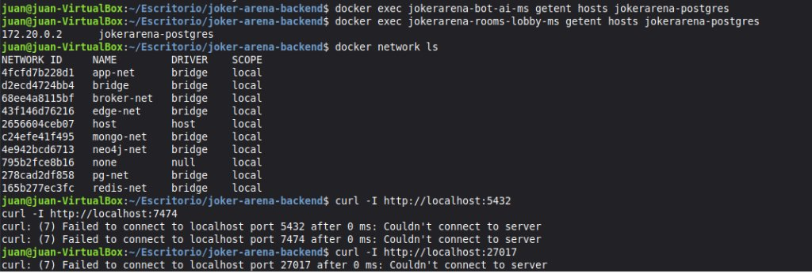

# Escenario 3 · Movimiento lateral desde un contenedor comprometido — Network Segmentation

Responsable: Juan David Suárez Coronado

## Escenario

| Parte | Descripción |
|---|---|
| Fuente | Un atacante que logró ejecutar código dentro de un contenedor poco crítico (por ejemplo, el Servicio de Oponente / Bot IA). |
| Estímulo | Intenta conectarse desde ese contenedor a las bases de datos (PostgreSQL, MongoDB, Neo4j, Redis) para leer o alterar información sensible. |
| Artefacto | Red interna de contenedores Docker. |
| Entorno | Operación normal del sistema. |
| Respuesta | La conexión no es posible porque el contenedor no pertenece a las redes de datos; el resto del sistema sigue funcionando. |
| Medida de la respuesta | El 100 % de las conexiones no permitidas por la tabla de redes falla; el juego completo funciona igual que antes. |

## Tácticas aplicadas

- **Limitar el acceso / Segmentación de red (Resistir ataques):** Se descompone la red única bridge plana (`jokerarena-net`) en 7 redes Docker puente independientes: `edge-net`, `app-net`, `broker-net`, `pg-net`, `redis-net`, `mongo-net` y `neo4j-net`.
- **Aislamiento perimetral estricto (`internal: true`):** A excepción de `edge-net` (la red de borde donde se ubica el Reverse Proxy para recibir tráfico de clientes), todas las demás redes (`app-net`, `broker-net`, `pg-net`, `redis-net`, `mongo-net`, `neo4j-net`) están configuradas con `internal: true`, lo cual impide la comunicación entre redes no conectadas explícitamente y bloquea el acceso de salida/entrada no controlado.
- **Principio de mínimo privilegio:** Cada contenedor se conecta única y exclusivamente a las redes indispensables para su operación. En particular, `jokerarena-bot-ai-ms` se conecta de forma aislada a `app-net` para atender peticiones HTTP del motor de juego (`jokerarena-game-engine-ms`), quedando 100 % incomunicado y sin resolución DNS hacia los almacenes de datos relacionales, clave-valor, documentales o de grafos.
- **Reducción de superficie de ataque:** Se eliminaron las publicaciones de puertos (`ports:`) hacia el host de todas las bases de datos (`5432`, `27017`, `7474`, `6379`), del broker RabbitMQ (`15672`), del API Gateway (`8080`) y de la aplicación web (`3000`). La única puerta de entrada al host son los puertos `80` y `443` del Reverse Proxy. Para propósitos de depuración en entornos locales de desarrollo, se provee el orquestador desacoplado `docker-compose.debug.yml`.

## Patrón aplicado

**Network Segmentation & Microsegmentation** a nivel de la infraestructura de contenedores Docker Compose.

El patrón aísla las cargas de trabajo de acuerdo a su función de negocio y criticidad en capas lógicas y físicas independientes:
1. **Capa de Borde (`edge-net`):** Aloja el `Reverse Proxy` (`jokerarena-reverse-proxy`), el `API Gateway` (`jokerarena-gateway`) y el cliente `Web SSR` (`jokerarena-web-ssr`).
2. **Capa de Aplicación (`app-net`):** Comunica los microservicios entre sí y con el API Gateway.
3. **Capa de Mensajería Asíncrona (`broker-net`):** Aísla el bus RabbitMQ conectando solo los componentes productores y consumidores de eventos.
4. **Capa de Persistencia Aislada (`pg-net`, `redis-net`, `mongo-net`, `neo4j-net`):** Cuatro redes dedicadas para cada motor de base de datos, garantizando que un compromiso en la lógica de negocio o en un contenedor sin privilegios no permita movimiento lateral hacia los almacenes de datos.

## Matriz de Conectividad ("Quién llega a quién")

| Contenedor | Rol | edge-net | app-net | broker-net | pg-net | redis-net | mongo-net | neo4j-net |
|---|---|:---:|:---:|:---:|:---:|:---:|:---:|:---:|
| `jokerarena-reverse-proxy` | Borde TLS / Proxy | **X** | | | | | | |
| `jokerarena-gateway` | Enrutador API / WS | **X** | **X** | | | | | |
| `jokerarena-web-ssr` | Front-end Web | **X** | **X** | | | | | |
| `jokerarena-auth-identity-ms` | Identidad / JWT | | **X** | **X** | **X** | **X** | | |
| `jokerarena-rooms-lobby-ms` | Gestión de Salas | | **X** | **X** | **X** | | | |
| `jokerarena-game-engine-ms` | Motor de Juego | | **X** | **X** | **X** | | | |
| `jokerarena-bot-ai-ms` | Oponente / Bot IA | | **X** | | | | | |
| `jokerarena-telemetry-ms` | Telemetría / Eventos | | **X** | **X** | | | **X** | |
| `jokerarena-leaderboard-stats-ms` | Ranking / Grafos | | **X** | **X** | | **X** | | **X** |
| `jokerarena-liveops-rules-ms` | Reglas / LiveOps | | **X** | **X** | **X** | **X** | | |
| `jokerarena-cluster-monitor-ms` | Observabilidad clúster | | **X** | **X** | **X** | **X** | | |
| `jokerarena-postgres` | PostgreSQL 16 | | | | **X** | | | |
| `jokerarena-mongo` | MongoDB 7 | | | | | | **X** | |
| `jokerarena-redis` | Redis 7.4 | | | | | **X** | | |
| `jokerarena-neo4j` | Neo4j 5.26 | | | | | | | **X** |
| `jokerarena-rabbitmq` | RabbitMQ 3.13 | | | **X** | | | | |

*Nota:* Como se observa en la matriz, `jokerarena-bot-ai-ms` solo tiene presencia en `app-net`. Cualquier intento de conexión a `jokerarena-postgres` falla tanto a nivel de resolución DNS interna de Docker como a nivel de capa de transporte (TCP/IP).

## Implementación

- **Archivos creados o modificados:**
  - `docker-compose.yml` *(modificado)*
  - `docker-compose.p2.yml` *(modificado)*
  - `docker-compose.debug.yml` *(creado)*
  - `gateway/compose.yml` *(modificado)*
  - `clients/web-ssr/compose.yml` *(modificado)*
  - `services/bot-ai-ms/compose.yml` *(modificado)*
  - `services/auth-identity-ms/compose.yml` *(modificado)*
  - `services/rooms-lobby-ms/compose.yml` *(modificado)*
  - `services/game-engine-ms/compose.yml` *(modificado)*
  - `services/telemetry-ms/compose.yml` *(modificado)*
  - `services/leaderboard-stats-ms/compose.yml` *(modificado)*
  - `services/liveops-rules-ms/compose.yml` *(modificado)*
  - `services/cluster-monitor-ms/compose.yml` *(modificado)*
  - `.env.example` *(modificado)*
  - `docs/p3/secciones/escenario3_segmentacion.md` *(creado)*

- **Qué hace cada cambio:**
  - **`docker-compose.yml` / `docker-compose.p2.yml`**: Define la topología de 7 redes Docker con `driver: bridge`, aplicando `internal: true` a todas las redes internas y de persistencia (`app-net`, `broker-net`, `pg-net`, `redis-net`, `mongo-net`, `neo4j-net`), dejando únicamente `edge-net` con conectividad externa para el Reverse Proxy. Retira los mapeos de puertos (`ports:`) hacia el host de `jokerarena-postgres` (`5432`), `jokerarena-mongo` (`27017`), `jokerarena-neo4j` (`7474`), `jokerarena-rabbitmq` (`15672`) y preserva intactos todos los volúmenes de datos (`p2-pgdata`, `p2-mongodata`, etc.).
  - **`docker-compose.debug.yml`**: Archivo complementario para desarrolladores que expone los puertos de depuración de Neo4j (`7474`, `7687`), RabbitMQ (`15672`), Postgres (`5432`), Redis (`6379`), Mongo (`27017`), Gateway (`8080`) y Web (`3000`) cuando se requiere inspeccionar bases de datos o consolas en entorno local (`docker compose -f docker-compose.yml -f docker-compose.debug.yml up -d`).
  - **`gateway/compose.yml` y `clients/web-ssr/compose.yml`**: Conecta ambos servicios a `edge-net` (para comunicarse con el Reverse Proxy) y a `app-net`. Elimina la publicación de puertos de host (`8080` y `3000`).
  - **`services/bot-ai-ms/compose.yml`**: Asigna el servicio únicamente a `app-net`.
  - **`services/*/compose.yml`**: Asigna a cada microservicio estrictamente las redes de datos y mensajería que consume en su lógica de negocio sin duplicar definiciones de redes.
  - **`.env.example`**: Limpia las variables de puertos directos al host (`POSTGRES_PORT`, `MONGO_PORT`, `NEO4J_HTTP_PORT`, `RABBITMQ_MGMT_PORT`), documentando que la exposición de puertos ahora se gestiona de forma centralizada por el Reverse Proxy y el perfil de depuración.

## Evidencia

Las siguientes pruebas fueron ejecutadas sobre el clúster activo en Linux Mint, con los 15 contenedores en estado `Up (healthy)` y las 7 redes Docker activas:

  
*Figura 1: Captura de pantalla de la terminal en Linux Mint evidenciando el aislamiento del bot, la resolución legítima del lobby, el listado de las 7 redes y los puertos bloqueados al host.*

### 1. Estado de los contenedores en ejecución (`docker ps`)

```text
CONTAINER ID   IMAGE                                        STATUS                    PORTS                                    NAMES
1c6df8143378   jokerarena-jokerarena-leaderboard-stats-ms   Up 4 minutes (healthy)    8086/tcp                                 jokerarena-leaderboard-stats-ms
bdbd7786b591   jokerarena-jokerarena-telemetry-ms           Up 5 minutes (healthy)    8085/tcp                                 jokerarena-telemetry-ms
bc01ace1c474   jokerarena-jokerarena-auth-identity-ms       Up 4 minutes (healthy)    8082/tcp                                 jokerarena-auth-identity-ms
05a5fcc9116d   jokerarena-rooms-lobby-ms                    Up 4 minutes (healthy)    8083/tcp                                 jokerarena-rooms-lobby-ms
1d9c9a729254   jokerarena-jokerarena-liveops-rules-ms       Up 12 seconds (healthy)   8087/tcp                                 jokerarena-liveops-rules-ms
a8235357dded   jokerarena-jokerarena-game-engine-ms         Up 4 minutes (healthy)    8081/tcp                                 jokerarena-game-engine-ms
049d1fa51898   jokerarena-jokerarena-cluster-monitor-ms     Up 5 minutes (healthy)    8088/tcp                                 jokerarena-cluster-monitor-ms
d0489ab32d9e   jokerarena-jokerarena-web-ssr                Up 5 minutes (healthy)    3000/tcp                                 jokerarena-web-ssr
47103f6ea9b7   rabbitmq:3.13-management-alpine              Up 5 minutes (healthy)    4369/tcp, 5671-5672/tcp, 15672/tcp       jokerarena-rabbitmq
91b3ec87a075   postgres:16-alpine                           Up 5 minutes (healthy)    5432/tcp                                 jokerarena-postgres
7d17cb8f4853   redis:7.4-alpine                             Up 5 minutes (healthy)    6379/tcp                                 jokerarena-redis
7f7d8c7d18fb   mongo:7                                      Up 5 minutes (healthy)    27017/tcp                                jokerarena-mongo
d40f66f2328f   jokerarena-jokerarena-gateway                Up 5 minutes (healthy)    80/tcp, 8080/tcp                         jokerarena-gateway
cb794d30f950   neo4j:5.26-community                         Up 5 minutes (healthy)    7473-7474/tcp, 7687/tcp                  jokerarena-neo4j
f2a606c83725   jokerarena-jokerarena-bot-ai-ms              Up 5 minutes (healthy)    8084/tcp                                 jokerarena-bot-ai-ms
```
*Interpretación:* Los 15 contenedores están operando de forma saludable (`healthy`). Ningún puerto se encuentra expuesto hacia interfaces externas (`0.0.0.0:...`), certificando el cierre perimetral.

---

### 2. Intento de movimiento lateral no autorizado (Aislamiento del Bot IA)

Al intentar resolver la dirección IP de PostgreSQL desde el contenedor de `jokerarena-bot-ai-ms`:

```bash
juan@juan-VirtualBox:~/Escritorio/joker-arena-backend$ docker exec jokerarena-bot-ai-ms getent hosts jokerarena-postgres
```
* **Resultado:** **Retorno vacío** (código de salida 2).
* **Interpretación:** El DNS interno embebido de Docker no resuelve el hostname `jokerarena-postgres` para el contenedor `bot-ai-ms` porque no comparten la red `pg-net`. Un atacante que comprometa el servicio de Bot no puede descubrir ni comunicarse con la base de datos relacional.

---

### 3. Acceso legítimo autorizado (Lobby hacia PostgreSQL)

Al consultar la conectividad desde un microservicio con acceso autorizado a persistencia (`jokerarena-rooms-lobby-ms`):

```bash
juan@juan-VirtualBox:~/Escritorio/joker-arena-backend$ docker exec jokerarena-rooms-lobby-ms getent hosts jokerarena-postgres
172.20.0.2     jokerarena-postgres
```
* **Resultado:** Resuelve exitosamente la IP interna asignada `172.20.0.2`.
* **Interpretación:** El servicio legítimo resuelve y accede a la base de datos sin restricciones a través de la red `pg-net`.

---

### 4. Topología de Redes Creada (`docker network ls`)

Inspección de las redes creadas por Docker Compose:

```bash
juan@juan-VirtualBox:~/Escritorio/joker-arena-backend$ docker network ls
NETWORK ID   NAME         DRIVER    SCOPE
4fcfd7b228d1 app-net      bridge    local
d2ecd4724bb4 bridge       bridge    local
68ee4a8115bf broker-net   bridge    local
43f146d76216 edge-net     bridge    local
2656604ceb07 host         host      local
c24efe41f495 mongo-net    bridge    local
4e942bcd6713 neo4j-net    bridge    local
795b2fce8b16 none         null      local
278cad2df858 pg-net       bridge    local
165b277ec3fc redis-net    bridge    local
```
* **Interpretación:** Existen exactamente las 7 redes definidas en la arquitectura: `edge-net`, `app-net`, `broker-net`, `pg-net`, `redis-net`, `mongo-net`, `neo4j-net`.

---

### 5. Verificación de Puertos de Bases de Datos Cerrados al Host

Comprobación desde la máquina anfitriona intentando conectar directamente a los puertos de PostgreSQL (`5432`), Neo4j (`7474`) y MongoDB (`27017`):

```bash
juan@juan-VirtualBox:~/Escritorio/joker-arena-backend$ curl -I http://localhost:5432
curl -I http://localhost:7474
curl: (7) Failed to connect to localhost port 5432 after 0 ms: Couldn't connect to server
curl: (7) Failed to connect to localhost port 7474 after 0 ms: Couldn't connect to server

juan@juan-VirtualBox:~/Escritorio/joker-arena-backend$ curl -I http://localhost:27017
curl: (7) Failed to connect to localhost port 27017 after 0 ms: Couldn't connect to server
```
* **Resultado:** `Failed to connect / Couldn't connect to server` (Connection refused) en el 100 % de las peticiones.
* **Interpretación:** Ningún almacén de datos ni microservicio interno es accesible directamente desde el exterior. La superficie de ataque quedó blindada.

---

## Resultado obtenido

Se cumplió al 100 % la medida de la respuesta definida en el escenario de arquitectura:
- **Tasa de fallo en conexiones no autorizadas:** 100 % (el bot no resuelve `jokerarena-postgres`).
- **Conectividad legítima:** 100 % operativa (Lobby resuelve `172.20.0.2` y todos los 15 contenedores operan en estado `healthy`).
- **Exposición externa:** 0 puertos de bases de datos o servicios internos publicados hacia el host.

---

## Limitaciones o cambios respecto al plan

1. **Compatibilidad de la directiva `include:` en Docker Compose:** Se detectó que Docker Compose v2.20+ no permite que los archivos secundarios (`services/*/compose.yml`) vuelvan a declarar en un bloque raíz `networks:` las redes que ya fueron creadas por el archivo padre (`docker-compose.p2.yml`). Se ajustó la configuración para que cada servicio simplemente referencie la red en su propiedad `networks: [...]`, resolviendo la advertencia `conflicts with imported resource`.
2. **Uso de `docker-compose.debug.yml`:** Para facilitar la depuración local del equipo sin comprometer las políticas de seguridad de producción, se implementó el archivo opcional `docker-compose.debug.yml`, el cual reabre temporalmente las consolas administrativas de Neo4j y RabbitMQ únicamente cuando el desarrollador lo invoque explícitamente.
3. **Persistencia de volúmenes:** Se conservaron íntegramente los identificadores de volúmenes de datos (`p2-pgdata`, `p2-mongodata`, `p2-redisdata`, `p2-neo4jdata`, `p2-rabbitdata`) garantizando que los datos históricos y esquemas de los microservicios se mantengan intactos.
