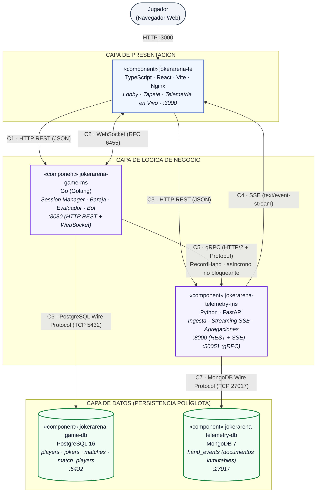
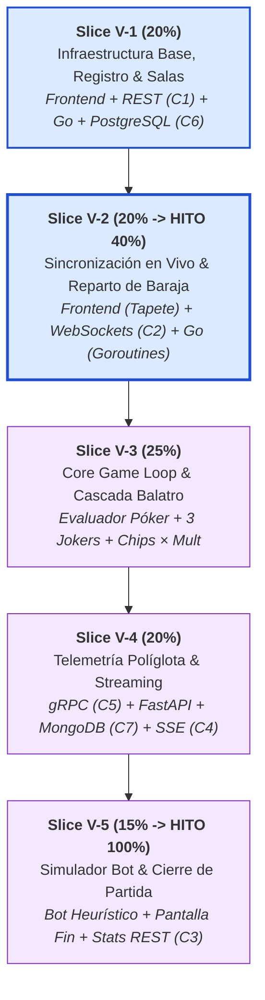

# p1_X — JokerArena: Multiverse Poker Engine
### Prototipo 1 — Simple Architectural Structure
**Arquitectura de Software 2026-II · Universidad Nacional de Colombia — Sede Bogotá**  
**Docente:** Jeisson Andrés Vergara Vargas  

> **Entregable Oficial:** Este documento en formato `.md` se exporta directamente a `p1_X.pdf` (donde `X` es el identificador del equipo asignado en clase: ej. `1a`, `2b`, etc.) y se entrega a través de MiCampus UNAL por un único integrante.  
> **Fecha límite de entrega:** Lunes 12 de octubre de 2026.  
> **Sustentación del Prototipo:** Martes 13 de octubre de 2026 (en sesión de clase).

---

## 1. Identificación del Equipo

* **Nombre del equipo:** `Grupo X` *(Asignar identificador del grupo: ej. 1a, 1b, 2a, 2b)*
* **Integrantes (Nombres completos y códigos):**
  * `[Nombre Completo Integrante 1] — Código: [Código UNAL 1]`
  * `[Nombre Completo Integrante 2] — Código: [Código UNAL 2]`
  * `[Nombre Completo Integrante 3] — Código: [Código UNAL 3]`
  * `[Nombre Completo Integrante 4] — Código: [Código UNAL 4]`

---

## 2. Sistema de Software

### 2.1. Nombre
**JokerArena: Multiverse Poker Engine**

### 2.2. Logo


*Figura 1: Identidad visual de JokerArena. Un comodín en arte pixel-art/retro sosteniendo una carta holográfica, enmarcado por nodos de red distribuida y visualización de multiplicadores exponenciales (×Mult).*

### 2.3. Descripción del Sistema y Dominio

**JokerArena** es un videojuego web distribuido y plataforma de telemetría competitiva inspirado en las mecánicas centrales de puntuación del roguelike de construcción de barajas *Balatro*. 

El sistema traslada la evaluación de manos tradicionales de póker (baraja francesa de 52 cartas), combinadas con modificadores pasivos y acumulativos (*Jokers*: multiplicadores aditivos y exponenciales), a un entorno multijugador sincronizado en red. Los jugadores compiten en salas por superar metas de puntaje crecientes (*Blinds* / Ciegas), en rondas con restricciones de descartes y manos disponibles.

Adicionalmente, el sistema integra una **consola de auditoría y telemetría en tiempo real** que permite a espectadores y rivales inspeccionar el desglose algebraico exacto de cada jugada (fichas base de la mano, fichas de cartas individuales, multiplicadores aditivos de Jokers y escalamiento exponencial), almacenando un historial inmutable para análisis estadístico posterior.

#### Alcance Funcional del Prototipo 1 (Prototipo Vertical)

El Prototipo 1 abarca un flujo funcional completo de extremo a extremo (*End-to-End*) que atraviesa todas las capas lógicas y físicas de la arquitectura:

| # | Funcionalidad | Componentes Involucrados | Conectores Clave |
|---|---|---|---|
| **F1** | **Registro de jugador por alias** (identificación liviana sin credenciales). | Frontend → Game Engine → PostgreSQL | C1 (REST), C6 (SQL) |
| **F2** | **Gestión de salas y partidas** con código alfanumérico único para 2 a 4 jugadores, incluyendo modo **Simulador de Oponente (Bot)** para pruebas locales. | Frontend → Game Engine → PostgreSQL | C1 (REST), C6 (SQL) |
| **F3** | **Sincronización de sala y reparto en tiempo real**: sesión WebSocket autoritativa, barajado de 52 cartas y reparto inicial de 8 cartas. | Frontend ↔ Game Engine | C2 (WebSocket) |
| **F4** | **Core Game Loop**: jugar o descartar de 1 a 5 cartas. Reconocimiento determinista de 9 manos de póker y reposición de baraja. | Frontend ⇄ Game Engine | C2 (WebSocket) |
| **F5** | **Pipeline de puntuación y Jokers**: cálculo algebraico con 3 Jokers canónicos (Banner, Joker Clásico, The Duo) bajo la fórmula $\text{Chips} \times \text{Mult}$. | Game Engine | Lógica interna autoritativa |
| **F6** | **Pipeline de telemetría y auditoría en vivo**: despacho asíncrono gRPC al servicio analítico, persistencia en MongoDB y emisión SSE en vivo. | Game Engine → Telemetry Service → MongoDB → Frontend | C5 (gRPC HTTP/2), C7 (BSON), C4 (SSE) |
| **F7** | **Cierre de partida y métricas**: evaluación de victoria/derrota (meta de 300 puntos o 4 manos agotadas), persistencia final y consulta analítica. | Game Engine → PostgreSQL · Frontend → Telemetry → MongoDB | C6 (SQL), C3 (REST) |

*Fuera de alcance en el Prototipo 1:* Tienda de compra/venta entre rondas, barajas especiales (decks cosméticos), múltiples blinds sucesivas (*Antes*), autenticación OAuth/contraseñas y emparejamiento global automático (matchmaking por ELO).

#### Reglas de Puntuación (Valores Base Balatro)

| Tipo de Mano | Fichas Base (Chips) | Multiplicador Base (Mult) | Condición de Reconocimiento |
|---|---|---|---|
| **High Card** | 5 | 1 | Ninguna combinación mayor; puntúa la carta más alta. |
| **Pair** | 10 | 2 | 2 cartas del mismo valor. |
| **Two Pair** | 20 | 2 | Dos pares distintos de cartas del mismo valor. |
| **Three of a Kind** | 30 | 3 | 3 cartas del mismo valor. |
| **Straight** | 30 | 4 | 5 cartas con valores numéricos consecutivos. |
| **Flush** | 35 | 4 | 5 cartas del mismo palo (picas, corazones, tréboles, diamantes). |
| **Full House** | 40 | 4 | Un trío y un par combinados. |
| **Four of a Kind** | 60 | 7 | 4 cartas del mismo valor. |
| **Straight Flush** | 100 | 8 | 5 cartas consecutivas del mismo palo. |

*Fichas aportadas por cartas individuales anotadoras:* Cartas numéricas `2` a `10` aportan su valor nominal; figuras `J`, `Q`, `K` aportan `10` fichas cada una; As `A` aporta `11` fichas.

#### Catálogo Oficial de Jokers del Prototipo 1

Todos los jugadores cuentan con 3 Jokers activos en su zona de modificadores, evaluados estrictamente en este orden:

| Orden | Joker | Efecto Mecánico | Tipo de Modificador | Condición de Activación |
|---|---|---|---|---|
| **1** | **Banner** | $+30\text{ Chips}$ por cada descarte restante | Aditivo de Fichas (`ADD_CHIPS`) | Proporcional a los descartes disponibles al jugar la mano. |
| **2** | **Joker Clásico** | $+4\text{ Mult}$ | Aditivo de Multiplicador (`ADD_MULT`) | Siempre activo en cualquier mano jugada. |
| **3** | **The Duo** | $\times 2\text{ Mult}$ | Multiplicador Exponencial (`X_MULT`) | Solo si la mano reconocida contiene al menos un Par (`Pair`). |

**Fórmula de evaluación en cascada:**
$$\text{Puntaje} = \Big(\text{Chips}_{\text{mano}} + \sum \text{Chips}_{\text{cartas}} + (30 \times \text{descartes})\Big) \times \Big((\text{Mult}_{\text{mano}} + 4) \times (2 \text{ si contiene Par, else } 1)\Big)$$

*Ejemplo de verificación:* Jugador juega un Full House ($K\spadesuit, K\heartsuit, K\clubsuit, 4\diamondsuit, 4\spadesuit$) con 0 descartes restantes:
1. Chips Base = $40$ (Full House) $+$ $(10 + 10 + 10 + 4 + 4) = 78\text{ Chips}$.
2. Banner: $30 \times 0 = +0\text{ Chips} \rightarrow \text{Total Chips} = 78$.
3. Mult Base = $4$ (Full House). Joker Clásico: $+4 \rightarrow \text{Mult} = 8$.
4. The Duo: Al contener Par (de 4s y trío de Ks), aplica $\times 2 \rightarrow \text{Mult Final} = 16$.
5. **Puntaje Total de la Mano:** $78 \times 16 = \mathbf{1248\text{ puntos}}$.

---

## 3. Estructuras Arquitectónicas

### 3.1. Estructura de Componentes y Conectores (C&C)

#### 3.1.1. Vista C&C



*Figura 2: Diagrama de Componentes y Conectores (C&C) de JokerArena. Ilustra los microservicios, persistencia políglota y los 7 conectores tipificados.*

#### 3.1.2. Estilos Arquitectónicos Utilizados

1. **Cliente–Servidor con Servidor Autoritativo (*Server-Authoritative*):**  
   El cliente web es una interfaz delgada de presentación. Toda validación de legalidad de jugadas, barajado determinista, reglas de descarte y cálculo algebraico ocurre exclusivamente en el Game Engine. Esto previene la manipulación de puntajes desde el navegador y asegura la integridad de la partida.
2. **Microservicios con Base de Datos por Servicio (*Database-per-Service*):**  
   La lógica se descompone en dos servicios funcional y tecnológicamente independientes:
   * `jokerarena-game-ms` gestiona el estado transaccional en memoria y persiste en PostgreSQL (`jokerarena-game-db`).
   * `jokerarena-telemetry-ms` ingiere eventos analíticos y persiste en MongoDB (`jokerarena-telemetry-db`).  
   Ningún servicio tiene acceso a la base de datos del otro, garantizando desacoplamiento físico y de esquema.
3. **Arquitectura por Capas (*Layered Architecture*):**  
   Presentación (Web SPA) $\rightarrow$ Lógica de Negocio (Microservicios Go/Python) $\rightarrow$ Persistencia (PostgreSQL/MongoDB). Las responsabilidades están estrictamente delimitadas.
4. **Publicación–Suscripción y Streaming Unidireccional de Eventos (*Event-Driven Streaming*):**  
   Para la telemetría, `telemetry-ms` actúa como publicador emitiendo eventos `hand_scored` vía Server-Sent Events (SSE) hacia los navegadores suscritos, eliminando el sobrecosto de sondeo (*polling*) cíclico. A nivel de sala, `game-ms` difunde actualizaciones de estado mediante WebSockets en un canal de difusión (*room broadcast*).

#### 3.1.3. Elementos Arquitectónicos (Componentes y Puertos)

| Componente | Tipo | Tecnología | Puertos Expuestos / Utilizados | Responsabilidades |
|---|---|---|---|---|
| **`jokerarena-fe`** | Presentación | TypeScript, React 18, Vite, Tailwind CSS, Nginx | `p_http_in` (3000)<br/>`p_rest_out`<br/>`p_ws_io`<br/>`p_sse_in` | Renderizar interfaz reactiva: registro de alias, lobby de salas, tapete interactivo de cartas, botones de acción y panel lateral dual de telemetría en vivo. |
| **`jokerarena-game-ms`** | Lógica | Go 1.23, `net/http`, `gorilla/websocket`, `google.golang.org/grpc`, `pgx/v5` | `p_rest_srv` (8080)<br/>`p_ws_srv` (8080/ws)<br/>`p_grpc_client`<br/>`p_sql_out` | Autoridad central de la partida: sesiones de sala en memoria (goroutines/canales), barajado determinista, evaluación de manos, aplicación de Jokers, bot simulado y despacho asíncrono a telemetría. |
| **`jokerarena-telemetry-ms`** | Lógica | Python 3.12, FastAPI, `grpcio`, `motor` (async Mongo) | `p_grpc_srv` (50051)<br/>`p_rest_srv` (8000)<br/>`p_sse_out` (8000/stream)<br/>`p_mongo_out` | Receptor de telemetría vía gRPC, inserción asíncrona no bloqueante de eventos inmutables en MongoDB, cálculo de agregaciones estadísticas y difusión en streaming SSE hacia los clientes. |
| **`jokerarena-game-db`** | Persistencia Relacional | PostgreSQL 16 (Alpine) | `p_sql_in` (5432) | Persistencia relacional ACID: registro de jugadores, catálogo estático de Jokers, sesiones maestras de partidas y puntajes finales. |
| **`jokerarena-telemetry-db`** | Persistencia NoSQL | MongoDB 7 | `p_mongo_in` (27017) | Almacenamiento documental flexible de auditoría (*Audit Trail Ledger*): colección `hand_events` con esquema flexible optimizado para escritura intensiva. |

#### 3.1.4. Relaciones y Conectores de Comunicación

| ID | Enlace | Protocolo / Tecnología | Roles Semánticos | Propósito y Comportamiento |
|---|---|---|---|---|
| **C1** | `fe` $\rightarrow$ `game-ms` | **HTTP/1.1 REST (JSON)** | Client $\rightarrow$ Server | Operaciones síncronas de gestión de sesión: registro de jugadores (`POST /api/players`), creación de salas (`POST /api/rooms`) y consulta de estado (`GET /api/rooms/{code}`). |
| **C2** | `fe` $\leftrightarrow$ `game-ms` | **WebSocket (RFC 6455)** | Peer $\leftrightarrow$ Peer | Canal dúplex persistente de baja latencia (<50 ms): envío de jugadas/descartes (`PLAY_HAND`, `DISCARD_CARDS`) y recepción de eventos de sala (`ROOM_STATE_UPDATE`, `MATCH_FINISHED`). |
| **C3** | `fe` $\rightarrow$ `telemetry-ms` | **HTTP/1.1 REST (JSON)** | Client $\rightarrow$ Server | Consultas síncronas de cierre de partida: historial completo de manos (`GET /api/matches/{id}/hands`) y estadísticas consolidadas (`GET /api/matches/{id}/stats`). |
| **C4** | `telemetry-ms` $\rightarrow$ `fe` | **Server-Sent Events (SSE)** | Publisher $\rightarrow$ Subscriber | Streaming continuo unidireccional de telemetría (`GET /api/matches/{id}/stream`). Envía eventos `hand_scored` en vivo con el desglose algebraico exacto. |
| **C5** | `game-ms` $\rightarrow$ `telemetry-ms` | **gRPC (HTTP/2 + Protobuf)** | Client $\rightarrow$ Server | Despacho binario de cada jugada en goroutine asíncrona con *timeout* estricto de 200 ms. Si la telemetría se degrada o cae, la partida nunca se interrumpe (aislamiento de fallos). |
| **C6** | `game-ms` $\rightarrow$ `game-db` | **PostgreSQL Wire Protocol** | Client $\rightarrow$ Server | Conexión persistente mediante pool binario de alto rendimiento (`pgxpool`) sobre TCP puerto 5432. |
| **C7** | `telemetry-ms` $\rightarrow$ `telemetry-db` | **MongoDB Wire Protocol** | Client $\rightarrow$ Server | Operaciones de inserción documental asíncronas no bloqueantes (`motor`/`pymongo`) sobre TCP puerto 27017. |

> **Cumplimiento Estricto de Conectores HTTP (RNF 2.2 del PDF):**  
> El sistema implementa dos conectores basados en HTTP netamente diferenciados en transporte, semántica y serialización:
> 1. **HTTP REST (HTTP/1.1 + JSON):** Conectores C1 y C3 (solicitud-respuesta sobre texto estructurado).
> 2. **gRPC (HTTP/2 + Protocol Buffers):** Conector C5 (transporte binario multiplexado sobre HTTP/2).  
> Adicionalmente, cuenta con **Server-Sent Events (SSE)** sobre HTTP/1.1 (C4) y **WebSockets** con handshake HTTP `Upgrade` (C2).

---

### 3.2. Especificación Formal de Contratos de Conectores

#### 3.2.1. Conector C1: API REST del Game Engine (HTTP/1.1 JSON)

* **`POST /api/players`** — Registrar alias de jugador
  * *Request Body:* `{"alias": "JokerPro99"}`
  * *Response (201 Created):* `{"id": "a0eebc99-9c0b-4ef8-bb6d-6bb9bd380a11", "alias": "JokerPro99", "created_at": "2026-10-12T19:00:00Z"}`
* **`POST /api/rooms`** — Crear sala de juego
  * *Request Body:* `{"player_id": "a0eebc99-9c0b-4ef8-bb6d-6bb9bd380a11", "target_score": 300, "with_bot": true}`
  * *Response (201 Created):* `{"room_code": "JKR-402", "match_id": "8f1c7d2e-3b5a-49c1-8d2a-112233445566", "status": "WAITING"}`
* **`GET /api/rooms/{code}`** — Consultar estado de sala
  * *Response (200 OK):* `{"room_code": "JKR-402", "status": "IN_PROGRESS", "player_count": 2, "target_score": 300}`

#### 3.2.2. Conector C2: Protocolo WebSocket (Bidireccional RFC 6455)

Estructura de sobre estándar (*Envelope*):
```json
{
  "type": "NOMBRE_DEL_EVENTO",
  "payload": { ... }
}
```

* **Mensajes Cliente $\rightarrow$ Servidor:**
  1. `JOIN_ROOM`: `{"type": "JOIN_ROOM", "payload": {"room_code": "JKR-402", "player_id": "uuid-jugador"}}`
  2. `PLAY_HAND`: `{"type": "PLAY_HAND", "payload": {"card_indices": [0, 1, 3, 4]}}` (índices de cartas seleccionadas de la mano, 1 a 5).
  3. `DISCARD_CARDS`: `{"type": "DISCARD_CARDS", "payload": {"card_indices": [2, 5]}}` (descartar hasta 5 cartas).
* **Mensajes Servidor $\rightarrow$ Clientes:**
  1. `ROOM_STATE_UPDATE`:
     ```json
     {
       "type": "ROOM_STATE_UPDATE",
       "payload": {
         "room_code": "JKR-402",
         "target_score": 300,
         "hands_left": 3,
         "discards_left": 2,
         "current_score": 1248,
         "cards_in_hand": [
           {"rank": "A", "suit": "SPADES", "chips": 11},
           {"rank": "10", "suit": "HEARTS", "chips": 10}
         ],
         "deck_count": 44,
         "active_jokers": ["banner", "joker", "the_duo"]
       }
     }
     ```
  2. `MATCH_FINISHED`:
     ```json
     {
       "type": "MATCH_FINISHED",
       "payload": {
         "winner_id": "uuid-jugador",
         "final_score": 1540,
         "target_reached": true,
         "reason": "TARGET_SCORE_REACHED"
       }
     }
     ```

#### 3.2.3. Conector C5: Contrato Protocol Buffers (`proto/telemetry.proto`)

```protobuf
syntax = "proto3";

package telemetry;

option go_package = "github.com/jokerarena/game-ms/pkg/telemetry;telemetrypb";

service TelemetryService {
  rpc RecordHand(HandEventRequest) returns (HandEventResponse);
  rpc HealthCheck(HealthRequest) returns (HealthResponse);
}

message HealthRequest {}
message HealthResponse {
  string status = 1;
}

message Card {
  string rank = 1;
  string suit = 2;
  int32 chips = 3;
  bool scored = 4;
}

message JokerScored {
  string id = 1;
  string name = 2;
  string effect = 3;
  int32 chips_added = 4;
  int32 mult_added = 5;
  double mult_factor = 6;
}

message ScoringBreakdown {
  int32 base_chips = 1;
  int32 base_mult = 2;
  int32 card_chips = 3;
  repeated JokerScored jokers = 4;
  int32 final_chips = 5;
  int32 final_mult = 6;
  int32 score = 7;
}

message HandEventRequest {
  string match_id = 1;
  string player_id = 2;
  int32 round_number = 3;
  int32 hand_number = 4;
  string poker_hand = 5;
  repeated Card cards_played = 6;
  ScoringBreakdown scoring = 7;
  int32 discards_left = 8;
  int32 accumulated_score = 9;
  string timestamp = 10;
}

message HandEventResponse {
  bool success = 1;
  string event_id = 2;
  string message = 3;
}
```

#### 3.2.4. Conector C4: Streaming Server-Sent Events (SSE)

* **Endpoint:** `GET /api/matches/{id}/stream`
* **Formato MIME:** `text/event-stream`
* **Cuerpo de evento emitido:**
  ```text
  event: hand_scored
  data: {"match_id":"8f1c...","player_id":"usr-01","poker_hand":"FULL_HOUSE","final_chips":78,"final_mult":16,"score":1248,"breakdown":{"banner_chips":0,"joker_mult":4,"duo_mult":2.0},"accumulated":1248}
  ```

---

### 3.3. Esquema de Datos y Persistencia Políglota

#### 3.3.1. Modelo Relacional en PostgreSQL (`db/postgres/init.sql`)

```sql
CREATE EXTENSION IF NOT EXISTS "uuid-ossp";

CREATE TABLE IF NOT EXISTS players (
    id         UUID PRIMARY KEY DEFAULT uuid_generate_v4(),
    alias      VARCHAR(50) UNIQUE NOT NULL,
    total_wins INT NOT NULL DEFAULT 0,
    created_at TIMESTAMPTZ NOT NULL DEFAULT CURRENT_TIMESTAMP
);

CREATE TABLE IF NOT EXISTS jokers (
    id            VARCHAR(30) PRIMARY KEY,
    name          VARCHAR(50) NOT NULL,
    description   TEXT NOT NULL,
    modifier_type VARCHAR(20) NOT NULL CHECK (modifier_type IN ('ADD_CHIPS', 'ADD_MULT', 'X_MULT')),
    default_val   NUMERIC(6,2) NOT NULL,
    apply_order   SMALLINT NOT NULL
);

CREATE TABLE IF NOT EXISTS matches (
    id           UUID PRIMARY KEY DEFAULT uuid_generate_v4(),
    room_code    VARCHAR(10) UNIQUE NOT NULL,
    target_score INT NOT NULL DEFAULT 300,
    status       VARCHAR(20) NOT NULL DEFAULT 'WAITING' CHECK (status IN ('WAITING', 'IN_PROGRESS', 'FINISHED')),
    winner_id    UUID REFERENCES players(id) ON DELETE SET NULL,
    started_at   TIMESTAMPTZ NOT NULL DEFAULT CURRENT_TIMESTAMP,
    finished_at  TIMESTAMPTZ
);

CREATE TABLE IF NOT EXISTS match_players (
    match_id      UUID NOT NULL REFERENCES matches(id) ON DELETE CASCADE,
    player_id     UUID NOT NULL REFERENCES players(id) ON DELETE CASCADE,
    is_bot        BOOLEAN NOT NULL DEFAULT false,
    final_score   INT NOT NULL DEFAULT 0,
    hands_left    INT NOT NULL DEFAULT 4,
    discards_left INT NOT NULL DEFAULT 3,
    PRIMARY KEY (match_id, player_id)
);

-- Seed Data de Jokers Canónicos
INSERT INTO jokers (id, name, description, modifier_type, default_val, apply_order) VALUES
('banner', 'Banner', '+30 Chips por cada descarte restante en la mano', 'ADD_CHIPS', 30.00, 1),
('joker', 'Joker Clásico', '+4 Mult fijo a toda mano jugada', 'ADD_MULT', 4.00, 2),
('the_duo', 'The Duo', 'x2 Mult exponencial si la mano contiene al menos un Par', 'X_MULT', 2.00, 3)
ON CONFLICT (id) DO NOTHING;
```

#### 3.3.2. Modelo Documental en MongoDB (`hand_events`)

Colección: `hand_events` (Base de datos: `jokerarena_telemetry`).
```json
{
  "_id": "6701f4c281e892d7b1a2001a",
  "match_id": "8f1c7d2e-3b5a-49c1-8d2a-112233445566",
  "player_id": "a0eebc99-9c0b-4ef8-bb6d-6bb9bd380a11",
  "hand_number": 1,
  "poker_hand": "FULL_HOUSE",
  "cards_played": [
    {"rank": "K", "suit": "SPADES", "chips": 10, "scored": true},
    {"rank": "K", "suit": "HEARTS", "chips": 10, "scored": true},
    {"rank": "K", "suit": "CLUBS", "chips": 10, "scored": true},
    {"rank": "4", "suit": "DIAMONDS", "chips": 4, "scored": true},
    {"rank": "4", "suit": "SPADES", "chips": 4, "scored": true}
  ],
  "scoring": {
    "base_chips": 40,
    "base_mult": 4,
    "card_chips": 38,
    "jokers": [
      {"id": "banner", "chips_added": 0},
      {"id": "joker", "mult_added": 4},
      {"id": "the_duo", "mult_factor": 2.0}
    ],
    "final_chips": 78,
    "final_mult": 16,
    "score": 1248
  },
  "discards_left": 0,
  "accumulated_score": 1248,
  "timestamp": "2026-10-12T19:40:00Z"
}
```
*Índices optimizados:* `{"match_id": 1, "timestamp": 1}` y `{"player_id": 1}`.

---

## 4. Estrategia de Implementación por Slices Verticales y Hito del 40%

Para mitigar riesgos y asegurar la validez arquitectónica desde el primer día, la construcción del prototipo no se realiza por capas horizontales aisladas, sino mediante **Slices Verticales Secuenciales**. Cada slice implementa una funcionalidad de principio a fin, atravesando la presentación, la lógica y la persistencia.



### 4.1. Descomposición de Funcionalidades en Slices Verticales

#### **Slice Vertical 1 (V-1): Infraestructura, Identidad y Gestión de Salas (20% del total)**
* **Objetivo:** Establecer la base distribuida y el primer flujo funcional E2E síncrono.
* **Flujo:** El usuario entra a la SPA, escribe su alias, presiona "Registrarse" y luego "Crear Sala". La solicitud viaja por REST HTTP (C1) a Go, el cual inserta el jugador y la partida en PostgreSQL (C6), respondiendo con el código alfanumérico generado (`JKR-XXX`).
* **Conectores ejercitados:** C1 (REST) y C6 (PostgreSQL).

#### **Slice Vertical 2 (V-2): Sincronización en Tiempo Real y Baraja Francesa (Acumula el 40% del total — HITO OBJETIVO)**
* **Objetivo:** Abrir el canal de comunicación persistente y repartir el estado interactivo del juego.
* **Flujo:** Tras crear o unirse a la sala, el Frontend establece conexión WebSocket (C2). Go levanta una goroutine para la sala, inicializa la baraja de 52 cartas, la baraja deterministamente y reparte 8 cartas al jugador emitiendo `ROOM_STATE_UPDATE`. El Frontend renderiza el tapete de cartas y permite seleccionar/deseleccionar interactivamente hasta 5 cartas.
* **Conectores ejercitados:** C2 (WebSocket) sobre el estado relacional de C6.

#### **Slice Vertical 3 (V-3): Core Game Loop, Evaluador de Póker y Cascada de Jokers (Acumula el 65% del total)**
* **Objetivo:** Lógica de juego autoritativa y cálculo de puntuación.
* **Flujo:** El jugador presiona "Jugar Mano" o "Descartar". Go evalúa las cartas jugadas, determina la mejor mano de póker entre las 9 disponibles, aplica la cascada de Jokers (Banner, Joker Clásico, The Duo), calcula $\text{Chips} \times \text{Mult}$, actualiza el acumulado y repone cartas de la baraja.
* **Conectores ejercitados:** C2 (WebSocket bidireccional).

#### **Slice Vertical 4 (V-4): Pipeline de Telemetría Políglota y Consola en Vivo (Acumula el 85% del total)**
* **Objetivo:** Integrar el segundo microservicio (Python) y la base de datos documental (MongoDB).
* **Flujo:** Al evaluar la mano, Go envía de forma asíncrona un mensaje gRPC (C5) al Telemetry Service en Python. Python inserta el documento de auditoría en MongoDB (C7) y emite un evento Server-Sent Events (C4) hacia el navegador. El panel lateral del Frontend recibe el evento y desglosa en vivo la fórmula matemática.
* **Conectores ejercitados:** C5 (gRPC HTTP/2), C7 (MongoDB BSON) y C4 (SSE).

#### **Slice Vertical 5 (V-5): Bot Oponente, Finalización de Partida y Métricas Finales (100% Final)**
* **Objetivo:** Conclusión completa del ciclo de vida y modo autónomo de demostración.
* **Flujo:** El bot oponente realiza jugadas automáticas. Cuando un jugador alcanza 300 puntos o agota 4 manos, se emite `MATCH_FINISHED`. Go persiste al ganador en PostgreSQL (C6). La pantalla de resultados consulta las estadísticas agregadas en Python vía REST (C3) desde MongoDB.
* **Conectores ejercitados:** C6 (SQL), C2 (WebSocket), C3 (REST Telemetry).

---

### 4.2. Delimitación y Alcance Específico del Hito del 40%

El **Hito del 40%** solicitado por el usuario comprende la culminación integral y demostrable de los **Slices Verticales V-1 y V-2**, respaldados por la **Infraestructura Multi-Contenedor completa**.

#### Entregables Concretos del Hito del 40%:
1. **Entorno Docker Compose Unificado:**
   * Archivo `docker-compose.yml` que orquesta los 5 servicios (`jokerarena-fe`, `jokerarena-game-ms`, `jokerarena-telemetry-ms`, `jokerarena-game-db`, `jokerarena-telemetry-db`).
   * Red bridge común `jokerarena-net` y volúmenes de persistencia.
   * `db/postgres/init.sql` ejecutándose automáticamente en el primer arranque de PostgreSQL con esquema y seed data.
   * Endpoints de salud (`/health`) activos y verificables.
2. **Frontend Web Operativo (`jokerarena-fe`):**
   * Vista de Bienvenida / Registro de alias.
   * Vista de Lobby: Crear sala con código alfanumérico y selector "Jugar contra Bot".
   * Vista del Tapete de Juego: renderizado interactivo de las 8 cartas repartidas en mano, con capacidad de selección y deselección visual (máximo 5 cartas) mediante clics.
3. **Game Engine Autoritativo (`jokerarena-game-ms`):**
   * Servidor HTTP REST (C1) en Go con endpoints `POST /api/players`, `POST /api/rooms` y `GET /api/rooms/{code}`.
   * Servidor WebSocket (C2) en Go (`ws://localhost:8080/ws/{room_code}`) con Session Manager en memoria basado en goroutines y canales.
   * Motor de Baraja Francesa: creación del mazo de 52 cartas, barajado determinista y reparto de 8 cartas.
   * Cliente PostgreSQL (`pgxpool`) con transacciones seguras para registrar jugadores y salas.
4. **Esqueleto de Telemetría Preparado (`jokerarena-telemetry-ms`):**
   * Servicio FastAPI en Python respondiendo en puerto 8000 (`/health` y `/docs`).
   * Contrato Protocol Buffers (`proto/telemetry.proto`) definido y listo para compilación en Go y Python.
   * Conexión asíncrona hacia MongoDB 7 inicializada.

#### Criterios de Aceptación Objetivos del Hito del 40%:
* [ ] Al ejecutar `docker compose up --build -d`, los 5 contenedores levantan exitosamente sin reinicios inesperados.
* [ ] Un usuario abre `http://localhost:3000`, ingresa un alias, y este queda registrado en PostgreSQL (`SELECT * FROM players;` devuelve la fila con su UUID).
* [ ] El usuario crea una sala con opción Bot y recibe un código de sala visible en la interfaz (ej. `JKR-101`), quedando la partida registrada en PostgreSQL (`SELECT * FROM matches;`).
* [ ] El Frontend abre automáticamente el socket `ws://localhost:8080/ws/JKR-101` y recibe el evento `ROOM_STATE_UPDATE`.
* [ ] La interfaz renderiza las 8 cartas francesas recibidas en tiempo real y permite seleccionar hasta 5 cartas con retroalimentación visual reactiva.
* [ ] `http://localhost:8000/health` responde `{ "status": "ok" }` y `http://localhost:8080/health` responde `{ "status": "ok" }`.

---

## 5. Instrucciones de Ejecución del Prototipo

El prototipo se encuentra 100% contenerizado. Para desplegarlo en cualquier entorno Windows, macOS o Linux solo se requiere Git, Docker Engine 24+ y Docker Compose v2+.

### 5.1. Descarga y Despliegue Paso a Paso

```bash
# 1. Clonar el repositorio
git clone https://github.com/[GRUPO_UNAL]/jokerarena.git
cd jokerarena

# 2. Configurar variables de entorno desde la plantilla
cp .env.example .env

# 3. Construir imágenes y levantar los 5 contenedores en segundo plano
docker compose up --build -d

# 4. Verificar que todos los servicios estén operativos (healthy / running)
docker compose ps
```

### 5.2. URLs de Validación del Sistema

| Componente | URL de Acceso Local | Propósito de Validación |
|---|---|---|
| **Web Frontend Client** | `http://localhost:3000` | Interfaz gráfica: Registro, Lobby y Tapete de cartas. |
| **Game Engine (Go)** | `http://localhost:8080/health` | Verificación de salud y endpoint WebSocket en `ws://localhost:8080/ws/{code}`. |
| **Telemetry Service (Python)** | `http://localhost:8000/docs` | Documentación interactiva Swagger UI y salud en `http://localhost:8000/health`. |
| **PostgreSQL 16** | `localhost:5432` | Inspección SQL (BD: `jokerarena_db`, usuario: `postgres`). |
| **MongoDB 7** | `localhost:27017` | Inspección BSON (BD: `jokerarena_telemetry`, colección: `hand_events`). |

### 5.3. Guía de Prueba para la Sustentación del Hito del 40%

1. Abrir `http://localhost:3000` en el navegador.
2. Ingresar el alias (ej. `JugadorDemo`) y hacer clic en **"Registrarse"**.
3. Hacer clic en **"Crear Sala (con Bot)"**.
4. Constatar que se realiza la transición inmediata al tapete de juego y se muestra el código de sala generado.
5. Observar cómo el tapete recibe por WebSocket (C2) y dibuja en pantalla la mano inicial de 8 cartas repartidas aleatoriamente desde la baraja francesa de 52 cartas.
6. Hacer clic sobre las cartas para seleccionar hasta 5 cartas, observando el efecto visual de elevación/selección.
7. Verificar en terminal la persistencia relacional en PostgreSQL:
   ```bash
   docker compose exec jokerarena-game-db psql -U postgres -d jokerarena_db -c "SELECT alias, created_at FROM players; SELECT room_code, status FROM matches;"
   ```
8. Para detener y limpiar el entorno:
   ```bash
   docker compose down -v
   ```

---

## 6. Verificación de Requisitos No Funcionales (RNF)

| Requisito Exigido en el PDF | Implementación en JokerArena | Evidencia Arquitectónica |
|---|---|---|
| **Arquitectura Distribuida** | 5 servicios desacoplados en contenedores independientes sobre la red virtual `jokerarena-net`. | `docker-compose.yml` con comunicación TCP/IP por nombres de servicio. |
| **$\ge$ 1 Componente de Presentación** | Single Page Application (SPA) web interactiva. | `jokerarena-fe` (TypeScript / React 18 / Tailwind CSS). |
| **$\ge$ 2 Componentes de Lógica** | Microservicios de propósito especializado: motor de juego y servicio analítico. | 1. `jokerarena-game-ms` (Go)<br/>2. `jokerarena-telemetry-ms` (Python / FastAPI). |
| **$\ge$ 2 Componentes de Datos** | Persistencia políglota con patrón *Database-per-Service*. | 1. PostgreSQL 16 (`jokerarena-game-db`, relacional ACID)<br/>2. MongoDB 7 (`jokerarena-telemetry-db`, NoSQL documental). |
| **$\ge$ 2 Tipos Distintos de Conectores HTTP** | Diversidad protocolar sobre HTTP con diferentes contratos y formatos. | 1. HTTP REST (HTTP/1.1 JSON): C1 y C3.<br/>2. gRPC (HTTP/2 Protocol Buffers): C5.<br/>*Complementarios:* SSE (C4) y WebSockets (C2). |
| **$\ge$ 3 Lenguajes de Propósito General** | Tres lenguajes compilados/interpretados de propósito general. | 1. TypeScript (Frontend)<br/>2. Go (Game Engine)<br/>3. Python (Telemetry Service). |
| **Despliegue Orientado a Contenedores** | Empaquetamiento unificado reproducible. | Dockerfiles individuales y orquestación multi-contenedor con Docker Compose. |
